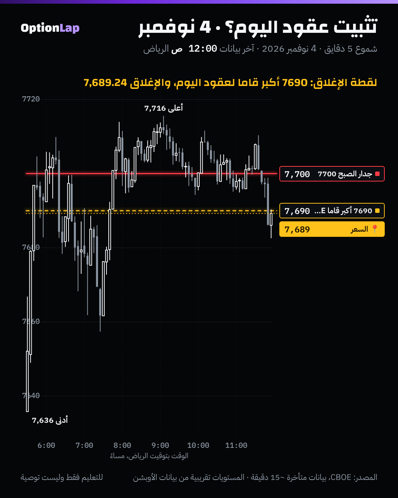

# 3.6 عقود 0DTE: حجمها، وأثرها خلال اليوم، وخطر التثبيت (Pin Risk)

> للتعليم فقط وليست توصية.

## الشرح
- **0DTE = عقود تنتهي نفس اليوم.** من منتصف 2022 صار لـSPX عقود تنتهي **كل يوم تداول**.
- **الحجم:** حسب بيانات Cboe، 0DTE كانت حوالي **59%** من حجم أوبشن SPX في 2025، والأرقام تتجاوز 60% في بعض الأشهر. يعني أغلب تداول أوبشن SPX اليوم عقود نفس اليوم.
- **ليش تأثر خلال اليوم:**
  - قاما العقود القريبة من السعر **تنفجر** قرب الانتهاء، فتحوّط صناع السوق عند هالسترايكات يصير كبير وسريع.
  - في قاما موجبة، هذا ممكن يثبّت السعر حول سترايك كبير (**Pinning**).
  - وفي قاما سالبة، يسرّع الحركة.
- **خطر التثبيت (Pin Risk):** قرب الإغلاق، لو السعر عند سترايك فيه عقود ضخمة، ممكن «ينشد» له، لأن تحوّط الطرفين يعاكس أي ابتعاد.
- **الحذر من المبالغة:**
  - الحجم **مو** نفس صافي موقع صناع السوق. كثير من 0DTE تنفتح وتنقفل نفس اليوم، ومتوازنة بين الطرفين.
  - وما لقينا دراسة محكّمة منشورة تقيس أثر التثبيت خلال اليوم بشكل واضح. أغلب الكلام من منصات تجارية.

## مثال بالأرقام: 4 نوفمبر
- **جدار الصبح:** 7700 (ضعيف +20M).
- **لقطة الإغلاق** (9:15 م UTC، بعد السوق): أكبر قاما لعقود اليوم عند **7690** (+43,396M). والإغلاق **7,689.24**، يعني على بعد **0.76 نقطة**.
- **⚠️ تحفّظ مهم:** هذي اللقطة **بعد** الإغلاق. وقاما العقد اللي عند السعر بالضبط وقت الانتهاء تطلع ضخمة **لأن** السعر عنده، مو بالضرورة إنها هي اللي شدّته. يعني الدليل **دائري**، ونحتاج لقطة **قبل** آخر ساعة عشان نختبر التثبيت صح.

## تطبيق على الشارت

**قراءتي:**
- السعر قضى آخر ساعات اليوم بين 7690 و7710، وانتهى عند 7690 تقريباً.
- شكله «تثبيت»، بس بدون لقطة قبل الإغلاق ما نقدر نقول إن 7690 كانت أكبر سترايك **قبل** ما يوصلها السعر.
- **الخطوة الجاية:** ناخذ لقطة GEX لعقود اليوم الساعة 11 م بتوقيت الرياض (قبل الإغلاق بساعة) ونقارنها بالإغلاق.

## باك تست: هل تغيّر سلوك SPX اليومي بعد العقود اليومية؟ (`bt_daily.py zerodte`، جديد)
| الفترة | n | وسيط المدى | انحراف الافتتاح للإغلاق | انحراف الفجوة | حصة الجلسة من التذبذب | مسافة الإغلاق لأقرب سترايك 25 |
|---|---|---|---|---|---|---|
| 2016 لين 2019 | 1,006 | 0.668% | 0.691% | 0.321% | **82%** | **6.25** |
| 2020 لين مايو 2022 | 608 | 1.134% | 1.147% | 0.779% | 68% | 5.93 |
| يونيو 2022 لين الحين (0DTE يومي) | 1,114 | 0.938% | 0.854% | 0.516% | **73%** | **6.25** |

**القراءة:**
- **ما فيه تثبيت ظاهر في الإغلاق اليومي** بعد العقود اليومية: المسافة لأقرب سترايك 25 **6.25**، وهي بالضبط اللي نتوقعها لو الإغلاق عشوائي.
- حصة الجلسة من التذبذب **ما زادت** (73% مقابل 82% قبل 2020).
- المدى أعلى من 2016–2019، بس هذا غالباً **بسبب نظام التذبذب العام** (2020 لين 2022 كانت فترة متقلبة)، مو 0DTE بالذات.
- **الخلاصة:** البيانات اليومية **ما تبيّن أثر بنيوي واضح** للـ0DTE. أثرها (إن وجد) يكون داخل الجلسة وعند سترايكات معيّنة، ويحتاج بيانات دقيقة لكل دقيقة مع لقطات GEX في وقتها.
- يومي، وصفي، بدون تكاليف.

## الربط بالقاما (طريقتنا)
- **عقود اليوم أهم من كل العقود:** أغلب الحجم 0DTE، فنرسم الجدران من **تاريخ اليوم** (قاعدة المحاضرة الأولى).
- **آخر ساعة:** في قاما موجبة، السعر ممكن ينشد لأكبر سترايك قريب. فلا تتوقع اختراق كبير بآخر ساعة إلا لو النظام سالب.
- **قيمة العقد:** عقد 0DTE يخسر قيمته الزمنية بسرعة بعد الظهر (صفقة MSFT)، فالوقت جزء من الوقف.

## الأخطاء الشائعة
1. تعامل حجم 0DTE كأنه موقع صناع السوق.
2. تصدّق «التثبيت» من لقطة بعد الإغلاق (دليل دائري).
3. تتوقع تثبيت في نظام قاما سالب.
4. تشتري 0DTE بعيد عن السعر آخر اليوم وتتوقع معجزة.
5. تستخدم مستويات «كل العقود» لتداول نفس اليوم.

## أسئلة مع إجاباتها
1. **كم حصة 0DTE من حجم أوبشن SPX؟** حوالي 59% في 2025 حسب Cboe.
2. **ليش لقطة الإغلاق يوم 4 نوفمبر ما تثبت التثبيت؟** لأن قاما العقد اللي عند السعر وقت الانتهاء تطلع ضخمة **لأن** السعر عنده. لازم لقطة قبل آخر ساعة.
3. **بيّنت البيانات اليومية تثبيت بعد 2022؟** لا. مسافة الإغلاق لأقرب سترايك 6.25، وهي نفس العشوائي.

## المصادر
- [Cboe: 0DTEs Decoded, positioning, trends and market impact](https://www.cboe.com/insights/posts/0-dt-es-decoded-positioning-trends-and-market-impact)
- [SpotGamma: 0DTE options explained](https://spotgamma.com/0dte-options-explained/)
- [SpotGamma: Record 0DTE volume reshapes the S&P 500](https://spotgamma.com/record-0dte-volume-reshapes-the-sp-500/)
- [FlashAlpha: 0DTE gamma exposure and pin risk](https://flashalpha.com/articles/0dte-gamma-exposure-pin-risk-intraday-options-analytics)
- [LuxAlgo: 0DTE Flow Effects](https://www.luxalgo.com/library/concept/0dte-flow-effects.md)
- [Resonanz Capital: Every day, the market hires a counter-trend trader](https://resonanzcapital.com/insights/every-day-the-market-hires-a-counter-trend-trader)
