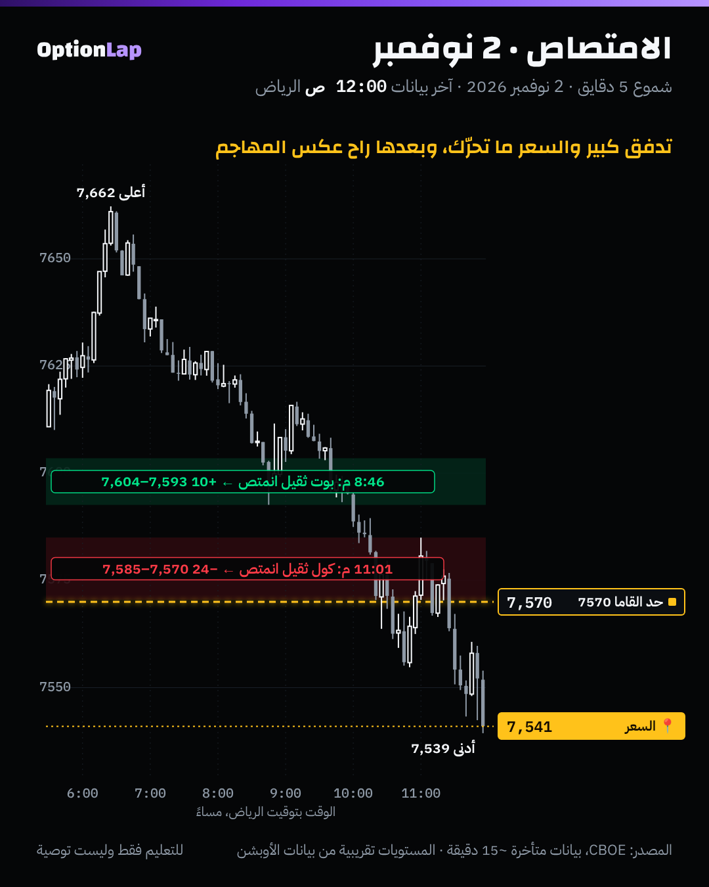

# 2.6 الامتصاص (Absorption) والإنهاك (Exhaustion)

> للتعليم فقط وليست توصية.

## الشرح
- **الامتصاص:** حجم مهاجم كبير يضرب مستوى، والسعر **بالكاد يتحرك**. يعني فيه أوامر سلبية كبيرة «تاكل» الهجوم، وأحد يدافع عن المستوى.
  - النهاية ممكن تكون **انعكاس**: المهاجم يتعب، والسعر يروح عكسه.
  - أو **استمرار**: الأوامر السلبية تخلص، والسعر يكسر بقوة.
  - عشان كذا يحتاج تأكيد.
- **الإنهاك:** العكس. الحجم **يقل** في آخر دفعة عند الطرف (قمة أو قاع جديد على حجم ضعيف)، يعني الحركة تموت لحالها.
  - أصعب في التوقيت من الامتصاص، لأن الحجم الضعيف يظهر برضو في الاستمرار الهادي.
- **أشهر غلط:** تعتبر الإنهاك إشارة انعكاس لحاله، وتنضرب في الدفعة اللي بعدها.
- **التأكيد:** تباعد الدلتا (2.5)، أو شمعة رفض عند مستوى مرسوم، أو فشل الـImbalance في نفس المنطقة.

## ملاحظة على بياناتنا
البديل عندنا من فوليوم أوبشن SPX لكل شمعة 5 دقايق، والحدود محسوبة من الشموع **اللي قبلها بنفس اليوم بس** (بدون نظر للمستقبل):
- **امتصاص:**
  - الحجم 1.5 ضعف متوسط اليوم لين الحين أو أكثر.
  - وجسم الشمعة نص وسيط الأجسام أو أقل.
  - وميل الكول أو البوت 10% أو أكثر.
- **إنهاك:** قمة أو قاع جديد للجلسة على حجم أقل من 0.7 من المتوسط.

## مثال بالأرقام: 2 نوفمبر (يوم قاما سالبة ونزول)
| الوقت (نيويورك / الرياض) | الشمعة | الحجم | الميل | بعد 30 دقيقة |
|---|---|---|---|---|
| 12:46 / 8:46 م | من 7600.1 لـ 7600.8 (مدى 7592.6–7603.5) | 128,790 عقد | **بوت أثقل 13%** | 7,611، يعني **+10.4** عكس البوت |
| 3:01 / 11:01 م | من 7575.8 لـ 7576.0 (مدى 7570.5–7585.0) | 132,333 عقد | **كول أثقل 12%** | 7,552، يعني **−24** عكس الكول |

## تطبيق على الشارت

**قراءتي:**
1. **الساعة 8:46 م:** تدفق بوت ثقيل والسعر واقف عند 7600. البيع انمتص، فصار ارتداد صغير (+10). وهذا في يوم نازل، يعني ارتداد مو انعكاس.
2. **الساعة 11:01 م:** تدفق كول ثقيل والسعر واقف فوق حد القاما 7570. الشراء انمتص، وبعدها السعر كسر 7570 ونزل لين 7,539. **امتصاص + كسر حد القاما في قاما سالبة = استمرار للنزول.**

## الربط بالقاما
- **امتصاص عند جدار في قاما إجمالية إيجابية:** الجدار يدافع، والصفقة ارتداد (مثل MSFT تحت 535).
- **امتصاص في قاما إجمالية سلبية:** انتبه. ممكن يكون «آخر دفاع» قبل الكسر، والكسر يتسارع، مثل 2 نوفمبر الساعة 11:01 م عند 7570.
- **الإنهاك عند مقاومة الكول في قاما إيجابية:** الدفعة الأخيرة ضعيفة، والجدار غالباً يمسك. بس انتظر شمعة الرفض.

## باك تست وإحصائيات
- **الأداة:** `python3 team/tools/bt_intraday.py absorb` (جديدة).
- **النتيجة** (4 أيام، بالنقاط، بدون تكاليف):
  - **الامتصاص:** n=4. حركة الـ30 دقيقة عكس الطرف الأثقل: متوسط **+8.48**، والوسيط +9.2، وإيجابية 75% (3 من 4)، وt=+1.54.
  - **الإنهاك:** n=1، والنتيجة −1.7. ما يكفي لأي حكم.
  - **الأساس:** متوسط حجم حركة الـ30 دقيقة (بدون اتجاه) 9.8 نقطة.
- **العيّنة صغيرة، النتيجة غير موثوقة.** والاتجاه مبشّر، بس 4 حالات ما تعني شي. نعيد بعد 30 يوم.

## الأخطاء الشائعة
1. تعاكس على أول امتصاص بدون تأكيد. ممكن الأوامر السلبية تخلص والسعر يكسر.
2. تعتبر كل قمة على حجم ضعيف إنهاك. الاستمرار الهادي له نفس الشكل.
3. تنسى السياق: الامتصاص في قاما سالبة غير الامتصاص في قاما موجبة.
4. تقرأه برّا مستوياتك. قيمته عند الجدران والمستويات المرسومة.

## أسئلة مع إجاباتها
1. **حجم كبير جداً والسعر ما تحرّك. وش تسميه، ووش تنتظر؟** امتصاص. وتنتظر تأكيد: شمعة رفض أو تباعد دلتا.
2. **وش الفرق بين الامتصاص والإنهاك؟** الامتصاص: حجم كبير وحركة صغيرة (أحد يدافع). والإنهاك: حجم يقل عند الطرف (الحركة تموت).
3. **يوم 2 نوفمبر الساعة 11:01 م، ليش الامتصاص ما عطى ارتداد؟** لأن السوق في قاما سالبة، وكسر حد القاما 7570 سرّع النزول.

## المصادر
- [LuxAlgo: Absorption & Exhaustion](https://www.luxalgo.com/library/concept/absorption-and-exhaustion/)
- [Tradezella: Order flow terms and concepts](https://www.tradezella.com/learning-items/order-flow-terms-and-concepts)
- [Optimus Futures: Footprint Absorption vs Exhaustion](https://optimusfutures.com/blog/?p=19691)
- [NexusFi: Advanced footprint chart patterns](https://nexusfi.com/a/strategies/advanced-footprint-chart-patterns)
- [Tradezella: Order Flow Secrets](https://www.tradezella.com/blog/order-flow-secrets-how-to-catch-explosive-moves-using-order-flow)
