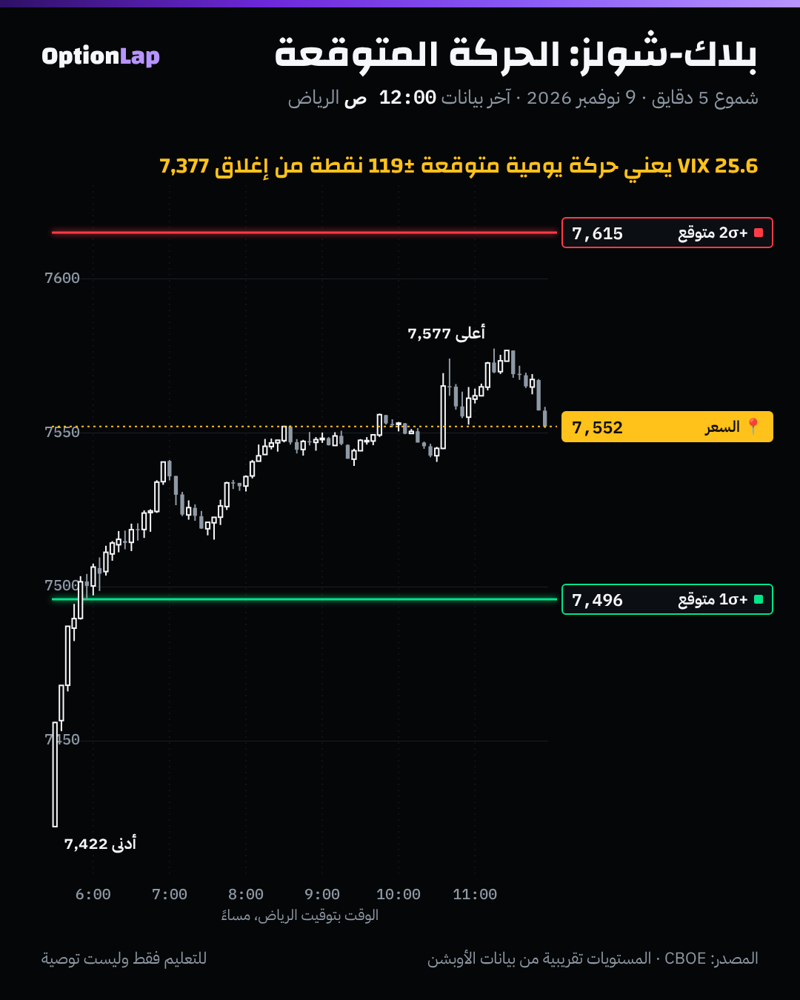

# 4.8 بلاك-شولز ببساطة: وش يفترض، ووين يخرب

> للتعليم فقط وليست توصية.

## الشرح
- **بلاك-شولز** معادلة تسعّر العقد من 5 أشياء: السعر، والسترايك، والوقت، والفائدة، والتذبذب. ومنها تطلع كل اليونانيات اللي درسناها (الدلتا، والقاما، والثيتا، والفيقا).
- **الشي الوحيد اللي ما نشوفه هو التذبذب.** فالسوق يقلب المعادلة: ياخذ سعر العقد ويطلّع منه **التذبذب الضمني (IV)**. وVIX مبني على نفس الفكرة لعقود سباكس 30 يوم.
- **وش يفترض؟**
  1. التذبذب **ثابت**: نفسه لكل السترايكات ولكل الأوقات.
  2. العوائد **طبيعية** (منحنى الجرس على اللوغاريتم)، **بدون قفزات**.
  3. التداول والتحوّط **مستمر** وبدون تكاليف.
  4. الفائدة ثابتة، وعقد أوروبي (تنفيذ عند الانتهاء بس، وهذا يناسب سباكس).
- **وين يخرب؟**
  - **التذبذب مو ثابت:** البوتات البعيدة تحت تتسعّر بتذبذب أعلى (الـSkew، `skew-vol-surface.md`). وهذا اعتراف من السوق إن الهبوط الحاد أكثر من ما تفترضه المعادلة.
  - **ذيول سمينة وقفزات:** الأيام الحادة تصير أكثر من ما يقول منحنى الجرس، وأغلبها **نزول**.
  - **التحوّط مو مستمر:** صانع السوق يتحوّط على فترات، والقفزة (مثل فجوة الافتتاح) تفوّت عليه التحوّط.
- **الخلاصة:** المعادلة **لغة** يتكلم فيها السوق، مو وصف كامل له. نستخدمها، ونعرف وين ما نثق فيها.

## مثال بالأرقام: الحركة المتوقعة من VIX
- **القاعدة:** الحركة اليومية المتوقعة (انحراف معياري وحد) ≈ VIX ÷ √252.
  - VIX 16 ← حوالي **1.0%** باليوم.
  - VIX 25.6 ← حوالي **1.6%** باليوم.
- **حسب منحنى الجرس:**
  - حوالي 68% من الأيام داخل ±1σ.
  - و95% داخل ±2σ.
  - وحركة أكبر من 3σ مرة كل حوالي **370 يوم**.
- **مثال 5 نوفمبر:** VIX أمسها كان **16.61**، يعني متوقع ±1.05%. والسعر نزل **4.36%**. هذا حوالي **4.2σ**، والمعادلة تقول هالشي يصير مرة كل **عشرات السنين** تقريباً. وصار.

## تطبيق على الشارت: 9 نوفمبر

- إغلاق 6 نوفمبر **7,377**، وVIX **25.64**، يعني الحركة المتوقعة ±1.6% ≈ **±119 نقطة**.
  - +1σ = **7,496**، و+2σ = **7,615**.
- **اللي صار:** السعر طلع فوق +1σ بأول ساعة، ووصل **7,577**، وما لمس +2σ. والإغلاق 7,550 = حوالي **+1.46σ**.
- **قراءتي:** يوم قوي، بس داخل اللي تتوقعه المعادلة. التذبذب العالي (VIX 25) كان «مسعّر» حركة بهالحجم.
- **ونفس اليوم يوضح كسر الفرضية الأولى:** لقطة سلسلة الإغلاق لعقود 10 نوفمبر فيها تذبذب ضمني **23.4%** عند 7,450 و**17.0%** عند 7,650. يعني التذبذب مو ثابت حتى لنفس اليوم.

## باك تست: هل VIX يتوقع حجم الحركة صح؟ (`bt_daily.py bs_tails`، جديد)
- **الطريقة:**
  - حركة سباكس اليوم ÷ الحركة المتوقعة من **VIX أمس**، فيطلع لنا رقم z بدون نظر للمستقبل.
  - نقارن توزيع z بمنحنى الجرس.
  - الفترة 2014 لين 9 نوفمبر 2026، n=3,232 يوم، والمصدر CBOE.

| الحد | أيام فعلية | منحنى الجرس يتوقع | نزول / صعود |
|---|---|---|---|
| أكبر من 1σ | 18.8% | 31.7% | 294 / 313 |
| أكبر من 2σ | 1.76% | 4.55% | **47 / 10** |
| أكبر من 3σ | **0.37%** (12 يوم) | 0.27% (حوالي 9 أيام) | **11 / 1** |
| أكبر من 4σ | **0.03%** (يوم واحد) | 0.006% (حوالي 0.2 يوم) | 1 / 0 (5 نوفمبر 2026) |

- **أرقام ثانية:**
  - انحراف z = **0.78** (لو VIX دقيق يكون 1.00). يعني VIX **يبالغ** في الحركة العادية بحوالي 22%، وهذي علاوة التذبذب (`theta.md`).
  - التواء العوائد **−0.37**، والتفرطح الزائد **+15.2** (منحنى الجرس = 0).
  - أشد أيام النزول نسبةً لـVIX: 5 نوفمبر 2026 (−4.2σ)، و5 فبراير 2018 (−3.8)، و3 أبريل 2025 (−3.6)، و11 يونيو 2020 (−3.4)، و24 يونيو 2016 (−3.3).
- **الخلاصة:**
  - **الأيام العادية أهدى** من ما يسعّره VIX، وهذا ليش بايع العقود يكسب أغلب الأيام.
  - **بس الذيول أسمن**، وتقريباً **كلها نزول**: 11 من 12 يوم فوق 3σ كانت هبوط.
  - وهذا بالضبط اللي يفسّر الـSkew.
- **الحدود:** VIX تذبذب 30 يوم ومو توقع ليوم واحد بالضبط. وبيانات يومية بس، وبدون تكاليف. والذيول فيها عدد أيام قليل (12 ويوم واحد)، فنسبها تقريبية.

## الربط بالقاما
- اليونانيات اللي نحسب منها الجدران (القاما، وGEX، والدلتا) **كلها من بلاك-شولز**. فلما تخرب الفرضيات، أرقام الجدران تصير تقريبية.
- **في القفزات** صانع السوق ما يلحق يتحوّط بالتدريج. وفي قاما سالبة يتحوّط بعد الحركة، فيكبّرها. وهذا يفسّر ليش أغلب أيام الذيل نزول.
- وهذا سبب ثاني إن رقم زيرو قاما من MenthorQ (اللي يستخدم سطح تذبذب حقيقي) هو المرجع عندنا، مو تقديرنا البسيط.

## أخطاء شائعة
1. تعتبر ±1σ من VIX «حدود» للسعر. هي احتمالات، والذيول أسمن من المنحنى.
2. تفترض نفس التذبذب لكل السترايكات وأنت تقيّم بوت بعيد. الـSkew يخليه أغلى.
3. تبيع عقود بعيدة لأن «المعادلة تقول احتمالها صغير». أغلب أيام 3σ نزول، وتصير أكثر من المتوقع.
4. تنسى إن الدلتا والقاما في المنصات من نفس المعادلة، فهي تقريب مو حقيقة.

## أسئلة وأجوبة
- **س: كيف أحسب الحركة اليومية المتوقعة بسرعة؟** ج: VIX ÷ 16 تقريباً (لأن √252 ≈ 15.9). VIX 20 يعني حوالي ±1.25% باليوم.
- **س: VIX يبالغ ولا يقصّر؟** ج: الاثنين: يبالغ بالأيام العادية (انحراف z = 0.78)، ويقصّر بالأيام الحادة، وخصوصاً النزول.
- **س: ليش البوتات البعيدة أغلى من الكولات البعيدة بنفس المسافة؟** ج: لأن السوق يعرف إن الهبوط الحاد يصير أكثر من ما تفترضه المعادلة. فيسعّرها بتذبذب أعلى (الـSkew).

## المصادر
- NYU Stern، ملاحظات عن بلاك-شولز: https://pages.stern.nyu.edu/~churvich/Forecasting/Handouts/Scholes.pdf
- QuestDB، حدود نموذج بلاك-شولز: https://questdb.com/glossary/black-scholes-model-limitations/
- كتاب الرياضيات المالية، حدود وتوسعات بلاك-شولز: https://sungchullee.github.io/financial_math_book_writing/ch07/extensions_black_scholes/limitations_extensions
- AcadiFi، الفرضيات اللي ما تتحقق: https://www.acadifi.com/community/black-scholes-assumptions-violations-real-world-cfa-level-2
- AcadiFi، سبب الابتسامة والـSkew: https://www.acadifi.com/community/volatility-smile-skew-options-pricing-explained
- بيانات VIX اليومية من Cboe: https://cdn.cboe.com/api/global/us_indices/daily_prices/VIX_History.csv
- الإحصاء: `team/tools/bt_daily.py bs_tails`
