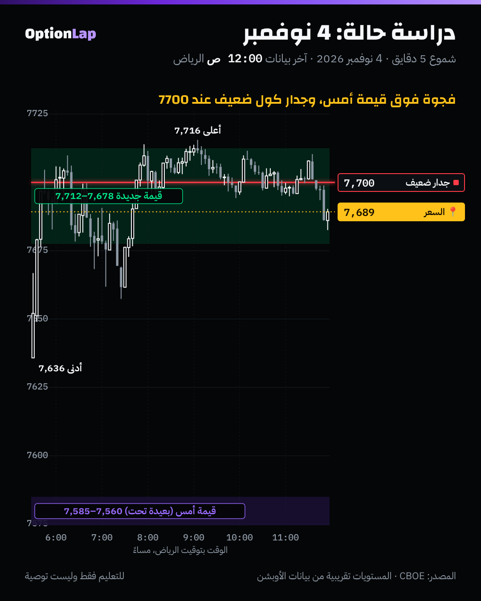

# 5.4 دراسة حالات: أيام سباكس بالطرق الثلاث (القاما + المزاد + التدفق)

> للتعليم فقط وليست توصية. **6 أيام من 10:** هذي كل الأيام المؤرشفة لين الحين. والملف يكبر مع الأرشيف (2، 3، 4، 6، 9، 10 نوفمبر).
> المصادر: ملخصات الصبح (`team/out/market/`، معروفة قبل الافتتاح)، وشموع CBOE (`team/data/intraday/`)، و`tpo.py` و`bt_intraday.py`.

## الطرق الثلاث
1. **القاما (الخريطة):** جدار الكول، والقاما السالبة الكبيرة، والنظام، كلها من ملخص الصبح.
2. **المزاد:** وين الافتتاح من قيمة أمس، ونوع اليوم، والقبول أو الرفض.
3. **التدفق:** شيّكنا بديل تدفق الأوبشن في البنود 2.4 لين 2.6. وما أضاف شي واضح، فهنا نستخدمه وصف بس.

## جدول الحالات (الأوقات بتوقيت الرياض)
| اليوم | جدار الكول (الصبح) | النظام (حسابنا) | الافتتاح ضد قيمة أمس | نوع اليوم | أعلى / أدنى / إغلاق | الإغلاق ضد جدار الكول |
|---|---|---|---|---|---|---|
| 2 نوفمبر | 7660 (+976M) | موجب | (قيمة 30 أكتوبر مو مؤرشفة) | تنوّع طبيعي **هابط** (1.36) | **7,662** (6:29 م) / 7,539 / 7,541 | تحت (−119) |
| 3 نوفمبر | 7620 (+211M) | سالب | **تحت** VAL أمس (7580) | تنوّع طبيعي صاعد | 7,595 / 7,545 / 7,568 | تحت (−52) |
| 4 نوفمبر | 7700 (+20M، **ضعيف**) | سالب | **فوق** VAH أمس (7585) بـ51 | طبيعي | **7,716** / 7,636 / 7,689 | تحت (−11) |
| 6 نوفمبر | (ما فيه ملخص، انقطاع) | | (قيمة 5 نوفمبر مو مؤرشفة) | طبيعي | 7,444 / 7,370 / 7,381 | |
| 9 نوفمبر | 7550 (+554M) | سالب | **داخل** قيمة أمس (7392–7430) | تنوّع طبيعي صاعد | **7,577** / 7,422 / 7,552 | **عند** الجدار (+2) |
| 10 نوفمبر | 7550 (+159M) | سالب | **على** VAL أمس (7510) | طبيعي | **7,544** / 7,470 / 7,520 | تحت (−30) |

## اللي يطلع من الحالات
1. **جدار الكول كان سقف الإغلاق في 5 من 5 أيام** فيها ملخص: ولا يوم أغلق فوق جدار الصبح بأكثر من نقطتين.
   - **وتعدّاه خلال اليوم** يومين: 4 نوفمبر بـ16 نقطة (الجدار كان ضعيف)، و9 نوفمبر بـ27 نقطة. ورجع بعدها.
   - **ولمسه بالضبط** يوم 2 نوفمبر (7,662 ضد 7660) ورجع 120 نقطة.
2. **النظام ما حدد الاتجاه:** 2 نوفمبر موجب ونزل بقوة. والأيام السالبة طلعت وما نزلت. يعني النظام يقول **كيف** يتحرك السعر (ارتداد أو كسر)، مو **وين** يروح.
3. **المزاد أعطى أوضح قصص:**
   - **4 نوفمبر:** فجوة فوق قيمة أمس بـ51 نقطة، وقبول، وقيمة جديدة 7677.5 لين 7712.5.
   - **9 نوفمبر:** افتتح داخل القيمة، والمبادرين طلعوه فوق، وقبول.
   - **10 نوفمبر:** افتتح على حد القيمة، وكسر، ورجع داخلها.
4. **أقوى أيام «الخريطة»** كانت لما المزاد والجدار اتفقوا، مثل 9 و10 نوفمبر عند 7550.

## تطبيق على الشارت: 4 نوفمبر

- **فجوة فوق:** افتتح 7,636، و51 نقطة فوق VAH أمس (7585). قيمة أمس بعيدة تحت.
- **القبول:** بنى قيمة جديدة 7677.5 لين 7712.5، يعني ما رجع يدوّر القيمة القديمة.
- **الجدار الضعيف:** جدار 7700 كان +20M بس، فتعدّاه لين 7,716. بس الإغلاق رجع تحته (7,689).
- **قراءتي:** المزاد حدد الاتجاه (فجوة وقبول = ما تبيع الفجوة). والجدار حتى وهو ضعيف حدد مكان الإغلاق تقريباً.

## باك تست
- **«الإغلاق تحت جدار الكول الصبحي أو عنده»:** 5 من 5. **العيّنة صغيرة، النتيجة غير موثوقة.**
- **ممكن يكون بديهي:** جدار الكول أصلاً **فوق** السعر وقت الصبح، والسعر ما يتحرك كثير بيوم واحد. فالاختبار الصحيح يقارنه بمستوى عشوائي على نفس المسافة. هذا ضمن خطة الـ30 يوم.
- **يكمل الملف** لين 10 أيام لما يتأرشف 4 أيام جديدة.

## الربط بالقاما وقاعدة المالك
- **الجدار:** خذ جدار الكول كسقف **محتمل للإغلاق**، مو سقف صلب خلال اليوم. تعدّاه يومين بـ16 و27 نقطة ورجع.
- **النظام:** يحدد الأسلوب (ارتداد أو كسر)، مو الاتجاه.
- **المزاد:** يحدد الاتجاه المرجّح من مكان الافتتاح:
  - فوق القيمة مع قبول: صعود.
  - داخل القيمة: توازن، إلا لو دخلوا مبادرين.
  - على الحد: انتبه للكسر.

## أخطاء شائعة
1. تعتبر النظام الموجب «صعود» والسالب «نزول». 2 نوفمبر موجب ونزل 120 نقطة.
2. تبيع أول ما يلمس جدار الكول في يوم فجوة وقبول. يوم 4 نوفمبر تعدّاه.
3. تحكم من يوم واحد. كل نمط هنا يحتاج 30 يوم على الأقل.
4. تنسى الانقطاعات: يوم 6 نوفمبر ما كان فيه خريطة صبح، فما ينحسب.

## أسئلة وأجوبة
- **س: وش أثبت نمط في الأيام الست؟** ج: الإغلاق تحت جدار الكول الصبحي أو عنده (5 من 5). بس ممكن يكون بديهي، ويحتاج مقارنة بمستوى عشوائي.
- **س: ليش 2 نوفمبر نزل وهو نظام موجب؟** ج: لمس جدار الكول (7,662) ورجع، وكسر الـIB من تحت، وكمل. النظام الموجب ما منع الاتجاه، بس الحركة صارت بعد رفض الجدار.
- **س: وش تتعلم من 4 نوفمبر؟** ج: فجوة فوق القيمة مع قبول = لا تعاكسها. والجدار الضعيف (+20M) ممكن يتعدّى، بس الإغلاق رجع تحته.

## المصادر
- Dalton، أنواع الأيام والقبول (ملخص LuxAlgo): https://www.luxalgo.com/library/concept/day-type-taxonomy/
- SpotGamma، جدار الكول وجدار البوت: https://spotgamma.com/call-wall-put-wall-explained/
- TradingView، القيمة والـPOC: https://kr.tradingview.com/chart/SPX500USD/4NqmzeTD-How-to-trade-using-Value-Areas-and-POC
- البيانات: CBOE، وملخصات الصبح، والأدوات `tpo.py` و`bt_intraday.py`
