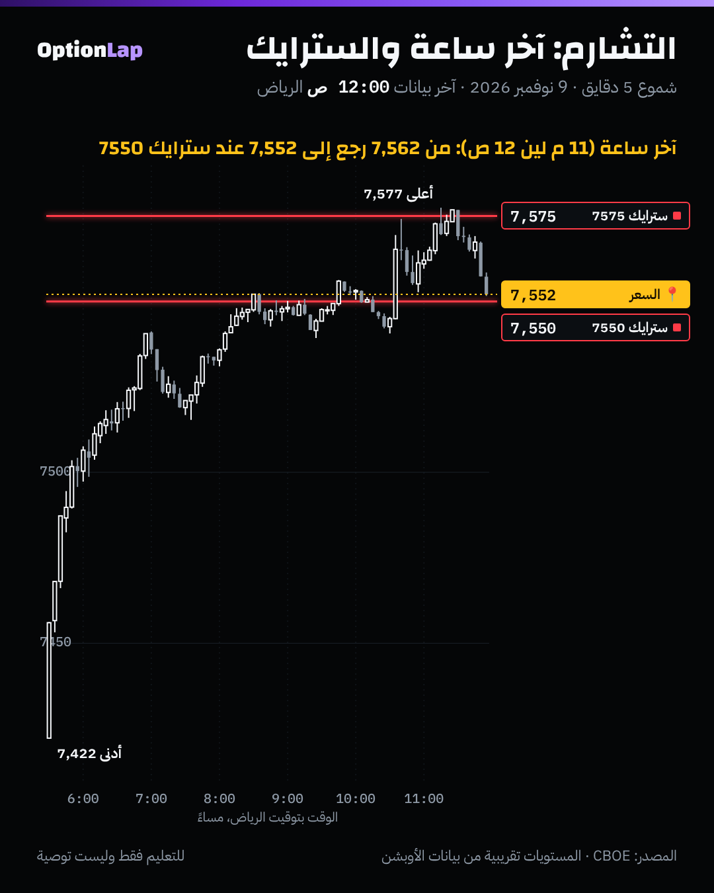

# 4.6 التشارم (Charm): تغيّر الدلتا مع الوقت، وتدفقات آخر اليوم

> للتعليم فقط وليست توصية.

## الشرح
- **التشارم = كم تتغيّر الدلتا مع مرور الوقت**، والسعر والتذبذب ثابتين. اسمه الثاني «تآكل الدلتا».
- **الاتجاه:**
  - العقد البعيد عن السعر (OTM) دلتاه تنزل باتجاه **0**.
  - والعقد داخل السعر (ITM) دلتاه تطلع باتجاه **1**.
  - وكل ما قرب الانتهاء صار التغيّر أسرع.
- **ليش يهم؟** صانع السوق يتحوّط حسب الدلتا. فلما تتغير الدلتا مع الساعة، **يعدّل تحوّطه حتى لو ما تحرك السعر**. لهذا يسمونه «تدفق على الساعة».
- **في 0DTE:** آخر ساعة أو ساعتين التشارم في أقواه. والرواية المتداولة إن هذا يشدّ السعر للسترايكات اللي فيها عقود مفتوحة كثيرة (التثبيت أو Pin).
- **على أيام أطول:** الوقت يتراكم خلال الويكند والإجازات، فالتحوّط يتعدّل عند الافتتاح بعدها. وقبل OPEX الشهري، التشارم مع الفانا يعطي تدفق داعم حسب الرواية (شوف `opex-charm.md`).
- **تحفّظ:** أغلب كلام «تدفقات التشارم» من شركات تبيع أدوات. وما لقيت دراسة مستقلة تثبت التدفق داخل اليوم.

## مثال بالأرقام: كول 0DTE (بلاك-شولز، السعر 7,550 ثابت، التذبذب 20%)
| الوقت المتبقي للإغلاق | دلتا كول 7575 (25 نقطة فوق) | دلتا كول 7600 (50 نقطة فوق) |
|---|---|---|
| 6.5 ساعة (الافتتاح) | 0.40 | 0.30 |
| 3 ساعات | 0.35 | 0.22 |
| ساعة | 0.25 | 0.09 |
| ربع ساعة | 0.09 | 0.00 |

- **مثال توضيحي:** صانع سوق باع 5,000 كول 7575 (المضاعف 100).
  - تحوّطه وقت الافتتاح: شراء ما يعادل 0.40 × 5,000 × 100 = **200,000** وحدة سباكس.
  - قبل الإغلاق بربع ساعة: يحتاج **45,000** بس.
  - فيبيع حوالي **155,000** وحدة خلال اليوم، **والسعر ما تحرك**. ونص هالبيع تقريباً يصير بآخر ساعة.
- الأرقام **توضيحية**. ما نعرف مراكز صناع السوق الحقيقية.

## تطبيق على الشارت: 9 نوفمبر

- **آخر ساعة** (11 م لين 12 ص بتوقيت الرياض): السعر كان **7,562**، ونزل وأغلق **7,552**، يعني نقطتين بس عن سترايك **7550**.
- قبلها لمس **7,577** فوق سترايك 7575 وما ثبت.
- **قراءتي:** هذا يوم يشبه «التثبيت». بس الاختبار تحت يقول إن هالشي ما تكرر في باقي الأيام المؤرشفة.

## باك تست: هل آخر ساعة تقرّب السعر من أقرب سترايك؟ (`bt_intraday.py charm`، جديد)
- **الطريقة:**
  - كل يوم نأخذ السعر بداية الساعة، وأقرب سترايك 25 نقطة له وقتها (بدون نظر للمستقبل).
  - ونشوف: هل نهاية الساعة أقرب للسترايك؟
  - آخر ساعة (3 لين 4 العصر نيويورك) نقارنها بساعتين قبلها كأساس.
  - البيانات: شموع دقيقة مؤرشفة من CBOE (2، 3، 4، 6، 9 نوفمبر). بدون تكاليف.
- **العيّنة صغيرة، النتيجة غير موثوقة** (n=5).

| الساعة (نيويورك) | n | انتهت أقرب للسترايك | متوسط البعد: البداية ← النهاية | متوسط الحركة |
|---|---|---|---|---|
| 11 لين 12 الظهر | 5 | 2 من 5 | 8.0 ← 11.8 | 11.4 نقطة |
| 1 لين 2 الظهر | 5 | 3 من 5 | 6.6 ← 6.8 | 11.1 نقطة |
| **3 لين 4 (آخر ساعة)** | 5 | **2 من 5** | **6.5 ← 14.5** | **15.9 نقطة** |

(لو السعر عشوائي، متوسط البعد عن أقرب سترايك 25 نقطة يكون 6.25.)

- **الخلاصة:**
  - في 5 أيام، آخر ساعة **ما قرّبت** السعر من السترايك. بالعكس، كانت أكبر ساعة حركة.
  - 2 نوفمبر: بدأت عند 7575 بالضبط، ونزلت 35 نقطة. و6 نوفمبر: نزلت 22 نقطة بعيد عن 7400.
  - 9 نوفمبر بس (وشوي 3 نوفمبر) شبه التثبيت.
  - واختبار يومي سابق (`bt_daily.py zerodte`) لقى إن بعد الإغلاق عن السترايك قريب من العشوائي.
- **الحدود:**
  - 5 أيام بس.
  - وأقرب سترايك 25 مو بالضرورة السترايك اللي فيه أكبر عقود مفتوحة. لقطات السلسلة (`team/data/chain/`) بدأت قريب، والاختبار يتحسّن لما تكبر.

## الربط بالقاما
- **القاما:** الدلتا تتغير مع **السعر**. **التشارم:** مع **الوقت**. والاثنين يكبرون قرب الانتهاء وعند السعر.
- **في قاما موجبة:** صانع السوق يبيع الصعود ويشتري النزول، والتشارم يضيف تعديل على الساعة. هنا ممكن يصير التثبيت عند جدار كبير.
- **في قاما سالبة:** صانع السوق يطارد السعر، فالتعديل على الساعة ممكن يسرّع الحركة بدل ما يثبتها. وهذا يتوافق مع الأيام اللي آخر ساعة فيها كانت عنيفة.

## أخطاء شائعة
1. تفترض إن السعر لازم يتثبت عند سترايك آخر ساعة. في عيّنتنا 3 من 5 أيام ما صار.
2. تختار «السترايك المغناطيس» برقم دائري بس، بدون ما تشوف العقود المفتوحة ووضع القاما.
3. تحسب التشارم اليومي بقسمة بسيطة قرب الانتهاء. التغيّر يتسارع، فالتقدير الخطي يخرب.
4. تنسى أثر الويكند: دلتا العقود تتغير بين الجمعة والاثنين حتى لو السعر ثابت.

## أسئلة وأجوبة
- **س: ليش دلتا الكول البعيد تنزل مع الوقت؟** ج: لأن الوقت المتبقي يقل، فاحتمال إن السعر يوصل للسترايك يقل.
- **س: متى التشارم أقوى؟** ج: في عقود 0DTE، وخصوصاً آخر ساعة إلى ساعتين، وفي العقود القريبة من السعر.
- **س: هل التثبيت آخر ساعة يصير دايم؟** ج: لا. في اختبارنا (5 أيام) صار مرة وحدة بوضوح (9 نوفمبر). نحتاج عيّنة أكبر، ونربطه بوضع القاما والعقود المفتوحة.

## المصادر
- SpotGamma، أهم اليونانيات لتداول 0DTE: https://spotgamma.com/most-important-greeks-0dte-trading/
- SpotGamma، تعريف التشارم: https://support.spotgamma.com/hc/en-us/articles/15246596430483-Charm
- Options Analysis Suite، تعريف التشارم: https://www.optionsanalysissuite.com/documentation/charm
- Options Analysis Suite، تدفق التشارم: https://www.optionsanalysissuite.com/documentation/charm-flow
- DayTrading.com، التشارم: https://daytrading.com/charm
- البيانات: شموع سباكس المؤرشفة من CBOE (`team/data/intraday/`)
- الإحصاء: `team/tools/bt_intraday.py charm`
