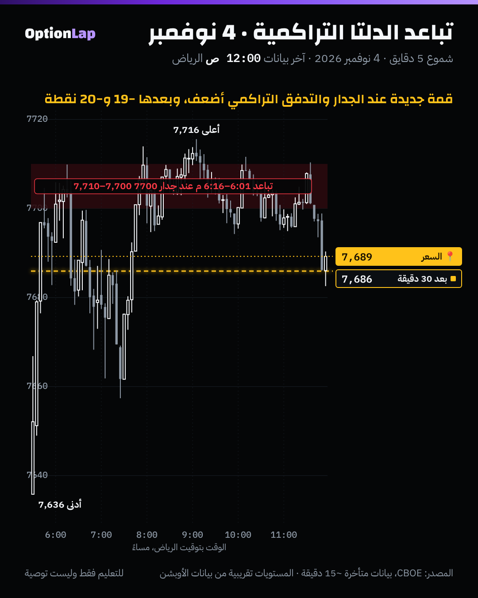

# 2.5 الـCVD والدلتا التراكمية والتباعد (Divergence)

> للتعليم فقط وليست توصية.

## الشرح
- **الـCVD (Cumulative Volume Delta):** مجموع دلتا كل شمعة من بداية الجلسة، يعني الشراء المهاجم ناقص البيع المهاجم بشكل تراكمي.
- **قيمته في الميل، وفي علاقته بالسعر،** مو في رقمه. CVD صاعد يعني المشترين هم اللي يدفعون.
- **التباعد السلبي (Bearish):** السعر يسوي قمة جديدة، والـCVD يسوي قمة أقل. يعني الشراء اللي يدفع يضعف أو ينمتص عند بائع سلبي.
- **التباعد الإيجابي (Bullish):** السعر يسوي قاع جديد، والـCVD قاع أعلى. يعني البيع ينمتص.
- **الامتصاص ضد الإنهاك (تمهيد للبند 2.6):**
  - **الامتصاص:** CVD يتحرك بقوة والسعر ما يلحقه.
  - **الإنهاك:** الطرف المسيطر يوقف نشاطه.
- **أهم تحذير من المصادر:** التباعد **مو** إشارة دخول. يقول إن الزخم يضعف بدري، بس ما يأكّد الانعكاس لحاله.

## ملاحظة على بياناتنا
ما عندنا Bid×Ask لـES. فالـCVD عندنا **بديل**: مجموع (فوليوم الكول − فوليوم البوت) في أوبشن SPX، على شموع 5 دقايق. وهذا يقيس ميل تدفق الأوبشن، مو الشراء والبيع المهاجم الحقيقي.

## مثال بالأرقام: 4 نوفمبر
- الساعة 10:01 لين 10:16 بتوقيت نيويورك (6:01 لين 6:16 م الرياض): السعر سوى قمم جديدة لين **7,709.9** فوق جدار الكول 7700.
- والـCVD (البديل) كان **أقل** من قيمته عند القمة اللي قبلها، وهذا تباعد سلبي.
- بعد 30 دقيقة من الإشارتين: **−18.6** و**−20.2** نقطة.
- وبعدها السعر رجع وطلع لين 7,716 آخر اليوم. يعني التباعد أعطى رجعة، **مو انعكاس**.

## تطبيق على الشارت

**قراءتي:**
- التباعد صار **عند جدار القاما 7700**، والقاما الإجمالية كانت موجبة (السعر فوق الزيرو قاما 7605). هذا التقاء: جدار + نظام ارتداد + تباعد.
- الرجعة وصلت تقريباً 7,686، وبعدها السعر رجع للجدار. وهذا يتماشى مع القاما الموجبة: حركة بين الجدران، مو اتجاه.

## الربط بالقاما
- **قاما إجمالية إيجابية + تباعد سلبي عند مقاومة الكول:** إشارة توقيت للارتداد (بوت)، والهدف قريب.
- **قاما إجمالية سلبية:** التباعد أضعف، لأن تحوّط صناع السوق يدفع الحركة حتى لو التدفق ضعف. الأفضل ما تعاكس الاتجاه على تباعد بس.
- **التأكيد يبقى بالشمعة:** إغلاق 5 دقايق تحت المستوى مع ذيل فوقه (قاعدة المالك).

## باك تست وإحصائيات
- **الأداة:** `python3 team/tools/bt_intraday.py cvd` (جديدة).
  - بعد أول 30 دقيقة، كل قمة أو قاع جديد للجلسة يتصنّف: تباعد أو مؤكد.
  - ونقيس حركة الـ30 دقيقة اللي بعده. وكل شي يتقاس وقته، فما فيه نظر للمستقبل.
- **النتيجة** (4 أيام، بالنقاط، بدون تكاليف):

| الحالة | n | المتوسط | الوسيط | الصعود | t |
|---|---|---|---|---|---|
| كل الشموع (الأساس) | 260 | −2.64 | −2.74 | 40% | −3.49 |
| تباعد سلبي (قمة جديدة وCVD أقل) | 10 | −3.85 | −7.20 | 30% | −0.90 |
| قمة جديدة مؤكدة | 14 | −3.17 | −1.99 | 43% | −0.82 |
| تباعد إيجابي | 0 | – | – | – | – |
| قاع جديد مؤكد | 12 | −0.67 | +1.67 | 50% | −0.16 |

- **القراءة:** التباعد السلبي **أسوأ شوي** من الأساس (الوسيط −7.2 مقابل −2.7)، بس الفرق مو مؤكد إحصائياً.
- والأساس نفسه سالب، لأن الأيام الأربعة فيها نزول قوي (2 نوفمبر).
- **العيّنة صغيرة، النتيجة غير موثوقة.**

## الأخطاء الشائعة
1. تعاكس الاتجاه على أول تباعد. في يوم الاتجاه ممكن يتكرّر التباعد والسعر يكمل.
2. تقرأ رقم الـCVD بدال ميله.
3. تقارن الـCVD بين أيام مختلفة، وهو يبدأ من صفر كل جلسة.
4. تعتبر بديل الأوبشن نفس الـCVD الحقيقي.

## أسئلة مع إجاباتها
1. **السعر قمة جديدة والـCVD قمة أقل. وش تسوي؟** تنتبه إن الشراء يضعف، وتنتظر شمعة رفض عند مستوى مرسوم قبل أي دخول.
2. **ليش التباعد أضعف في قاما سلبية؟** لأن تحوّط صناع السوق يكمّل الحركة حتى لو التدفق ضعيف.
3. **يوم 4 نوفمبر، التباعد عند 7700 أعطى انعكاس ولا رجعة؟** رجعة حوالي 20 نقطة، وبعدها السعر رجع للجدار وسوى قمة جديدة 7,716.

## المصادر
- [Coinglass: CVD Explained](https://www.coinglass.com/learn/cvd-en)
- [deltavalue.de: Cumulative Volume Delta](https://www.deltavalue.de/cumulative-volume-delta-cvd-indikator/)
- [MMT: CVD - Cumulative Volume Delta](https://alpha.mmt.gg/learn/cvd-cumulative-volume-delta)
- [TradingView: CVD Order Flow script](https://www.tradingview.com/script/vfIQ3hsG-CVD-Order-Flow/)
