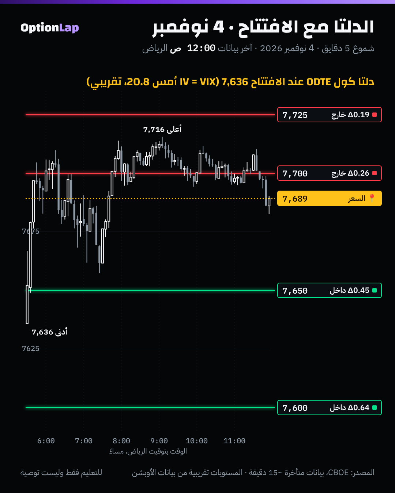

# 4.1 الدلتا: التعريف، والاحتمال، والتحوّط

> للتعليم فقط وليست توصية. فاتحة المسار 4 (اليونانيات).

## الشرح
الدلتا لها **3 معاني** مع بعض:
1. **السرعة:** كم يتغيّر سعر العقد لما يتحرك الأصل دولار (أو نقطة).
   - دلتا كول 0.40 يعني العقد يربح حوالي 0.40 لكل نقطة صعود.
   - والبوت دلتاه سالبة (من 0 لين −1).
2. **نسبة التحوّط:** كم وحدة من الأصل يحتاج صانع السوق عشان يلغي اتجاه العقد. عقد SPX واحد بدلتا 0.40 = تقريباً 40 وحدة من المؤشر.
3. **«احتمال» تقريبي إن العقد ينتهي داخل الفلوس:** المتداولين يقولون «دلتا 0.30 = تقريباً 30% فرصة».
   - **بس انتبه:** الدلتا محسوبة بـ**احتمال محايد للمخاطرة**، مع تذبذب ضمني (اللي غالباً أعلى من الحقيقي) وبدون اتجاه السوق.
   - فهي **مو** الاحتمال الحقيقي بالضبط. الأدق شوي هو N(d2)، بس نفس المشكلة.
- **الدلتا تتغيّر:** مع السعر (هذي القاما، البند 4.2)، ومع الوقت (الـCharm)، ومع التذبذب (الـVanna).

## مثال بالأرقام: 4 نوفمبر مع الافتتاح (7,636)
بلاك-شولز لعقود نفس اليوم (يوم تداول واحد)، والتذبذب = VIX إغلاق أمس 20.8%. **تقريبي**، والمنصات تستخدم تذبذب كل سترايك.

| الكول | الدلتا مع الافتتاح | وين انتهى (الإغلاق 7,689) |
|---|---|---|
| 7600 | 0.64 | داخل الفلوس ✅ |
| 7650 | 0.45 | داخل الفلوس ✅ |
| 7700 | 0.26 | خارج (لمس 7,716 خلال اليوم بس أغلق تحته) ❌ |
| 7725 | 0.19 | خارج ❌ |

## تطبيق على الشارت

**قراءتي:**
- الكول 7700 (دلتا 0.26) **صار داخل الفلوس خلال اليوم** (السعر 7,716)، بس **انتهى خارج**. يعني الدلتا تقول احتمال الانتهاء، مو احتمال اللمس.
- واحتمال اللمس تقريباً ضعف دلتا الانتهاء (قاعدة تقريبية معروفة).
- وهذا مهم لعقود 0DTE: ممكن تكون صح على الاتجاه وتخسر لأن السعر رجع قبل الإغلاق.

## باك تست: هل الدلتا = احتمال حقيقي؟ (`bt_daily.py delta_prob`، جديد)
- **الطريقة:**
  - كل يوم من 2014، نحسب دلتا كول لـ20 يوم تداول عند سترايكات −5%، و−2.5%، و0، و+2.5%، و+5% من الإغلاق.
  - التذبذب = VIX ذاك اليوم (بدون نظر للمستقبل).
  - ونقارن **متوسط الدلتا** بـ**نسبة الأيام اللي فعلاً أغلق فيها SPX فوق السترايك بعد 20 يوم**.

| السترايك | متوسط الدلتا N(d1) | متوسط N(d2) | الواقع (2014 لين 2026، n=3,212) | الواقع (2023 لين 2026، n=946) |
|---|---|---|---|---|
| −5% (داخل الفلوس) | 0.863 | 0.850 | **0.927** | 0.958 |
| −2.5% | 0.716 | 0.698 | **0.844** | 0.867 |
| **0% (عند السعر)** | **0.510** | 0.490 | **0.671** | 0.702 |
| +2.5% | 0.306 | 0.289 | 0.351 | 0.405 |
| **+5% (بعيد خارج الفلوس)** | **0.161** | 0.148 | **0.113** | 0.119 |

**القراءة:**
1. **عند السعر وتحته، الدلتا قللت من الاحتمال الحقيقي:** دلتا 0.51 مقابل واقع 67%. والسبب: السوق صعد تاريخياً (اتجاه موجب)، والدلتا ما تحسب الاتجاه.
2. **الكول البعيد (+5%)، الدلتا بالغت:** 0.16 مقابل واقع 11%. والسبب: VIX عادةً **أعلى** من التذبذب الحقيقي (علاوة الخوف)، فالعقود البعيدة «تتوقع» حركات أكبر من اللي تصير.
3. **الخلاصة:** الدلتا **نسبة تحوّط** ممتازة، بس **احتمال تقريبي متحيّز**.
- **تحفّظات:**
  - VIX تذبذب واحد لكل السترايكات (بدون الـSkew).
  - العينة فترة سوق صاعد.
  - النوافذ متداخلة.
  - وبدون تكاليف.

## الربط بالقاما (طريقتنا)
- **الـDEX = الدلتا × العقود المفتوحة:** يعني «وين الفلوس» (البند 3.5).
- **اختيار العقد (المحاضرة الأولى):** العقد القريب من السيولة ودلتاه معقولة (0.4–0.6) **يتحرك**. والبعيد الرخيص بدلتا 0.1 «يموت» لو ما تحرك السعر بسرعة.
- **صفقة MSFT:** البوت 537.5 كان داخل الفلوس (دلتا عالية)، فتحرّك مع السهم. هذا اختيار صح.

## الأخطاء الشائعة
1. تقرأ الدلتا كاحتمال حقيقي بالضبط.
2. تخلط احتمال **اللمس** باحتمال **الانتهاء**.
3. تشتري دلتا 0.1 وتتوقع حركة العقد مثل دلتا 0.5.
4. تنسى إن دلتا البوت سالبة عند جمع الـDEX.
5. تحسب الدلتا بتذبذب واحد لكل السترايكات وتتعامل معها كأرقام المنصة.

## أسئلة مع إجاباتها
1. **وش 3 معاني الدلتا؟** سرعة العقد مع الأصل، ونسبة التحوّط، واحتمال تقريبي إنه ينتهي داخل الفلوس.
2. **دلتا 0.16 لكول بعيد +5%: كم كان الواقع تاريخياً؟** حوالي 11%، لأن التذبذب الضمني يبالغ في الحركة المتوقعة.
3. **الكول 7700 يوم 4 نوفمبر لمس داخل الفلوس وانتهى خارج. ليش؟** الدلتا (0.26) تقيس احتمال الانتهاء مو اللمس، والسعر رجع تحت 7700 قبل الإغلاق.

## المصادر
- [CME Group: Options Delta, The Greeks](https://www.cmegroup.com/education/courses/option-greeks/options-delta-the-greeks.html)
- [Options Analysis Suite: Dealer delta exposure](https://www.optionsanalysissuite.com/documentation/dealer-delta-exposure)
- [FlashAlpha: Delta Exposure (DEX)](https://flashalpha.com/concepts/dex)
- بيانات Cboe اليومية: SPX وVIX_History.csv.
- ملفاتنا: `dex-walls.md`، و`team/knowledge/examples/2026-11-06-msft-put.md`.
