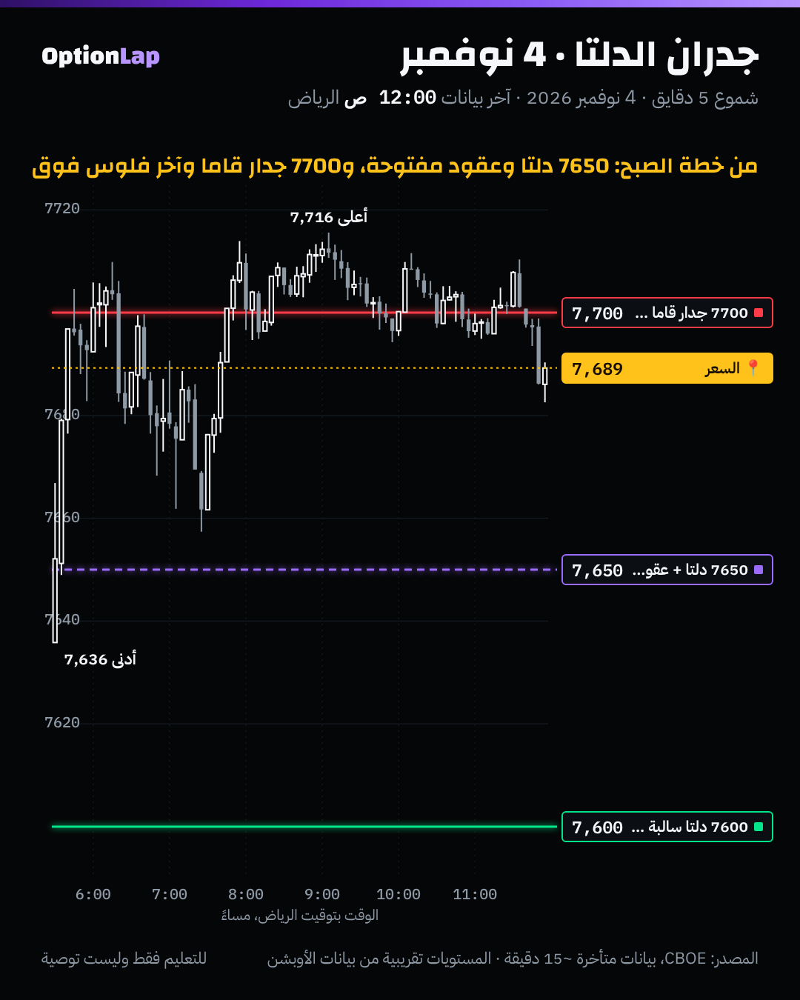

# 3.5 الـDEX وجدران الدلتا

> للتعليم فقط وليست توصية.

## الشرح
- **الـDEX (Delta Exposure)** لكل سترايك:

  DEX = دلتا × العقود المفتوحة × 100 (× السعر عشان يصير بالدولار)

  يعني **كم سهم أو دولار** لازم صانع السوق يمسكه عشان يتحوّط عند هالسترايك.
- **الفرق عن الـGEX:**
  - **GEX:** حساسية صانع السوق **للحركة الجاية** (كم بيعدّل لكل 1%)، يعني «الجدران».
  - **DEX:** **موقعه الحالي**، يعني «وين الفلوس متجمّعة».
- **ضغط التحوّط:** لو صانع السوق ماسك دلتا موجبة كبيرة عند سترايك، ونزل السعر باتجاهه، يضطر **يبيع** عشان يتحوّط. والعكس للسالبة. وقرب الانتهاء (0DTE) الدلتا تتغيّر بسرعة حول السعر، فيصير فيه ضغط «تثبيت» عند السترايكات الكبيرة.
- **⚠️ إشارة الـDEX تختلف بين المنصات:**
  - بعضها يحسب من **جهة العميل**: دلتا الكول موجبة والبوت سالبة. وهذا اللي تسويه أداتنا `gex.py`.
  - وبعضها من **جهة صانع السوق** (يقلب الإشارة).
  - فقبل ما تقول «دلتا موجبة»، اعرف **منصتك تحسبها من أي جهة**.
- **طريقة المحاضرات (MenthorQ):**
  - أكبر دلتا موجبة = **هدف ومغناطيس**.
  - الدلتا الإيجابية تجذب لتحت، والسلبية لفوق (المحاضرة الثانية).
  - فوق آخر دلتا موجبة **منطقة ضغط** ما فيها فلوس.
  - والدخول فوق دلتا قوية **بعد إغلاق شمعة**.

## مثال بالأرقام: خطة 4 نوفمبر الصبح (إغلاق أمس 7,568)
| المستوى | من الخطة | وش صار |
|---|---|---|
| **7700** | مقاومة الكول (ضعيفة +20M) + أكبر عقود مفتوحة لكل التواريخ | السعر وصلها وقعد حولها 5 ساعات، والأعلى 7,716 |
| **7650** | دلتا وعقود مفتوحة (كول 2,780 / بوت 2,664) | السعر **قطعها** أول نص ساعة بعد الافتتاح (7,636)، وبعدها ما رجع لها إلا مرة وحدة قريب منها (7,657) |
| **7600** | دلتا كبيرة (−1,580M) | ما انلمست، والافتتاح كان فوقها بفجوة |

**القراءة:** يوم 4 نوفمبر كان الافتتاح بفجوة فوق أغلب مستويات الدلتا. فالمستوى اللي حكم اليوم هو **الجدار** (7700، قاما + أكبر عقود مفتوحة)، مو مستويات الدلتا تحت.

## تطبيق على الشارت

**قراءتي:**
- **7650** كانت «منطقة دخول» محتملة لو رجع السعر لها. ورجع مرة قريب منها (حوالي 7,657 الساعة 7:29 م) وارتد لين الجدار. وهذا يتماشى مع «فوق دلتا قوية = دخول».
- **7700** هي «آخر فلوس فوق» وجدار بنفس الوقت، فالسعر انحبس عندها.

## الربط بالقاما
- **الـGEX يقول وين يوقف السعر، والـDEX يقول وين يروح.** الهدف = أكبر دلتا في اتجاه الحركة. والجدار = أكبر قاما قبله.
- **في قاما موجبة:** السعر يتذبذب بين جدار ودلتا كبيرة (مثل 7650 ↔ 7700 يوم 4 نوفمبر).
- **في قاما سالبة:** التحوّط يلحق الحركة، فالدلتا الكبيرة **في اتجاه الكسر** تصير هدف أسرع.

## باك تست وإحصائيات
- **ما فيه اختبار رقمي موثوق لين الحين:** مستويات الدلتا من خطط الصبح عندنا ليومين بس (3 و4 نوفمبر)، وما فيه أرشيف أقدم.
- **وصفي:** 4 نوفمبر، مستوى الدلتا 7650 انقطع مع الافتتاح وصار دعم مرة وحدة، و7600 ما انلمس. **العيّنة صغيرة، النتيجة غير موثوقة.**
- **خطة الأرشفة:** `archive_day.py` يحفظ «top DEX» كل ليلة في `team/data/gex/`. وبعد 30 يوم نختبر: هل أكبر دلتا موجبة تحت السعر تنلمس خلال الجلسة أكثر من مستوى عشوائي بنفس المسافة؟

## الأخطاء الشائعة
1. تقارن «دلتا موجبة» بين منصتين بإشارات مختلفة.
2. تخلط الـDEX بالـGEX: تحط هدف على جدار، أو جدار على دلتا.
3. تقرأ DEX «كل التواريخ» لتداول 0DTE.
4. تنسى إن الدلتا تتغيّر خلال الجلسة مع حركة السعر والوقت.
5. تدخل على لمسة مستوى الدلتا بدون إغلاق شمعة.

## أسئلة مع إجاباتها
1. **وش الفرق بين GEX وDEX بجملة؟** الـGEX وين الجدران (كيف يتغيّر التحوّط)، والـDEX وين الفلوس (موقع التحوّط الحالي).
2. **ليش «دلتا موجبة» عندك ممكن تكون سالبة في منصة ثانية؟** لأن بعض المنصات تحسب من جهة العميل وبعضها من جهة صانع السوق، فالإشارة تنقلب.
3. **يوم 4 نوفمبر، ليش 7700 حكمت اليوم مو 7650؟** لأن الافتتاح كان بفجوة فوق 7650، و7700 كانت جدار قاما وأكبر عقود مفتوحة وآخر فلوس فوق بنفس الوقت.

## المصادر
- [Tanuki Trade: DEX and GEX in 0DTE SPX, Part 1](https://tanukitrade.substack.com/p/0902-dex-and-gex-in-0dte-spx-with)
- [FlashAlpha: Delta Exposure (DEX)](https://flashalpha.com/concepts/dex)
- [Options Analysis Suite: Dealer Delta Exposure](https://www.optionsanalysissuite.com/documentation/dealer-delta-exposure)
- [SpotGamma: How options market structure controls intraday price action](https://spotgamma.com/gex-jpm-collar/)
- ملفاتنا: `team/out/market/2026-11-04.md`، و`team/out/content/2026-11-04-dex-video.md`، وملخص المحاضرتين الأولى والثانية.
