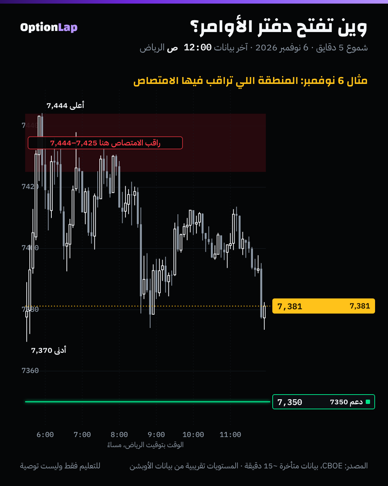

# 2.1 دفتر الأوامر (DOM): الأوامر المعلّقة والسوقية، ومن «يهاجم»

> للتعليم فقط وليست توصية.

## الشرح
- **دفتر الأوامر (DOM: Depth of Market)** يعرض الأوامر **المعلّقة** (Limit) عند كل سعر: طلبات الشراء تحت السعر (Bid)، وعروض البيع فوقه (Ask).
- **الأمر السوقي (Market)** ما يظهر في الدفتر أبداً. ينفّذ فوراً على أفضل أمر معلّق في الجهة الثانية.
- **المهاجم (Aggressor):** اللي يرسل أمر سوقي. المشتري المهاجم «يرفع» العرض (Lift the offer)، والبائع المهاجم «يضرب» الطلب (Hit the bid). والطرف المعلّق اسمه **سلبي (Passive)**.
- **السعر ما يتحرك إلا لما المهاجمين يخلّصون الأوامر المعلّقة عند السعر.** لو فيه أوامر معلّقة كبيرة، المهاجمين يضربون فيها وما يتحرك السعر.
- **الامتصاص (Absorption):** حجم تنفيذ كبير عند سعر واحد بدون ما يتقدّم السعر. يعني فيه طرف سلبي كبير «يمتص» الهجوم. وغالباً بعده ارتداد.
- **الآيسبيرغ (Iceberg):** أمر كبير مخفي يظهر منه جزء صغير، ويتجدّد كل ما ينفّذ. تستنتجه من التنفيذ المتكرر عند نفس السعر، وما تشوف حجمه الحقيقي.
- **التحذير:** الأوامر في الدفتر تنحط وتنشال بسرعة (Spoofing). عشان كذا الدفتر يعطيك **النيّة**، والتنفيذ الفعلي (الشريط أو الفوت برنت) يعطيك **الدليل**. والمحترف يقرأ الثنين مع بعض.

## مثال بالأرقام (توضيحي، مو بيانات حقيقية)
- السعر 7,430. وفي الدفتر عرض بيع معلّق 400 عقد عند 7,444.
- المشترين المهاجمين نفّذوا 900 عقد عند 7,444، والسعر ما تعدّاه، والعرض يرجع يتجدّد.
- القراءة: بائع سلبي كبير (ممكن آيسبيرغ) يمتص الشراء. لو بعدها بدأ البيع يضرب الطلبات وينزل السعر، هذي إشارة توقيت للبيع، والوقف فوق 7,444.

## الربط بالقاما (طريقتنا)
- **الأوبشن فلو يعطيك الخريطة:** جدار الكول من Net GEX يقول لك **وين** تتوقّع الامتصاص.
- **الأوردر فلو (الدفتر والشريط) يعطيك التوقيت:** يقول لك **هل** الامتصاص صار فعلاً.
- القاما الموجبة الكبيرة = صناع سوق يبيعون مع الصعود للتحوّط، وهذا بالضبط شكل البائع السلبي الكبير في الدفتر.
- تحت الزيرو قاما (قاما سلبية) التحوّط يلحق الحركة، فالامتصاص أضعف، والكسر أسهل.

## تطبيق على الشارت: 6 نوفمبر

- **قراءتي:** 6 نوفمبر، 67 شمعة دقيقة لمست 7,425 أو أعلى. أعلى سعر كان 7,444 الساعة 5:55 م (الرياض)، وبعدها أعلى محاولة ما تعدّت 7,438. وأغلقت 16 شمعة من هالـ67 تحت 7,425، والباقي فوقه.
- **وش يعني:** السعر قعد فترة طويلة في المنطقة وما قدر يطلع منها. هذا **شكل** الامتصاص على الشارت، بس **ما نقدر نأكّده** لأن ما عندنا بيانات الدفتر أو التنفيذ.
- لو كان عندنا الدفتر، كان المكان الصح نفتحه فيه هو هالمنطقة بالذات، مو طول اليوم.

## باك تست وإحصائيات
- **غير قابل للاختبار ببياناتنا:** بيانات CBOE فيها شموع دقيقة وفوليوم العقود بس، وما فيها دفتر أوامر ولا جهة المهاجم.
- الأرقام فوق وصف ليوم واحد. **العيّنة صغيرة، النتيجة غير موثوقة.**
- لاختباره لاحقاً نحتاج بيانات دفتر وتنفيذ مدفوعة لعقود ES (مثل اشتراك منصة أوردر فلو). وهذا قرار صرف يرجع للمالك.

## الأخطاء الشائعة
1. تصدّق كل أمر كبير في الدفتر. ممكن ينشال قبل ما يوصله السعر.
2. تفتح الدفتر طول الجلسة. الصح تفتحه عند المستويات اللي رسمتها الصبح بس.
3. تخلط بين الدفتر (المعلّق) والفوت برنت (المنفّذ).
4. تدخل على أول امتصاص بدون تأكيد. انتظر إن الطرف الثاني يبدأ يهاجم.
5. تقرأ دفتر SPX. مؤشر SPX ما له دفتر، والدفتر يكون على العقود المستقبلية (ES) أو الـETF (SPY).

## أسئلة مع إجاباتها
1. **ليش الأمر السوقي ما يظهر في الدفتر؟** لأنه ينفّذ فوراً على الأوامر المعلّقة، والدفتر يعرض المعلّق بس.
2. **حجم تنفيذ ضخم عند 7,444 والسعر ما تحرّك. وش تسمّيه؟** امتصاص: طرف سلبي كبير يقابل المهاجمين.
3. **وش علاقة جدار الكول بالدفتر؟** الجدار يقول وين تتوقّع البائع السلبي (تحوّط صناع السوق)، والدفتر والشريط يأكّدون هل ظهر فعلاً.

## المصادر
- [The Order Book and DOM Explained](https://bestscalping.pages.dev/docs/market-mechanics/order-book-and-dom)
- [Bookmap: Essential trading glossary](https://bookmap.com/blog/essential-trading-glossary-terms-used-in-bookmap-a-comprehensive-guide)
- [Bookmap Knowledge Base: Glossary](https://www.bookmap.com/knowledgebase/docs/KB-Help-Glossary)
- [LuxAlgo: DOM](https://www.luxalgo.com/library/concept/dom/)
- [LuxAlgo: Footprint Concepts](https://www.luxalgo.com/library/concept/footprint-concepts.md)
- [ATAS: DOM trading](https://atas.net/blog/dom-trading-trade-like-a-prop-company/)
- ملخص ثانوي لمقابلة Fabio Valentini (يعامل بحذر): [forex.in.rs](https://www.forex.in.rs/footprint-vwap-compounding)
