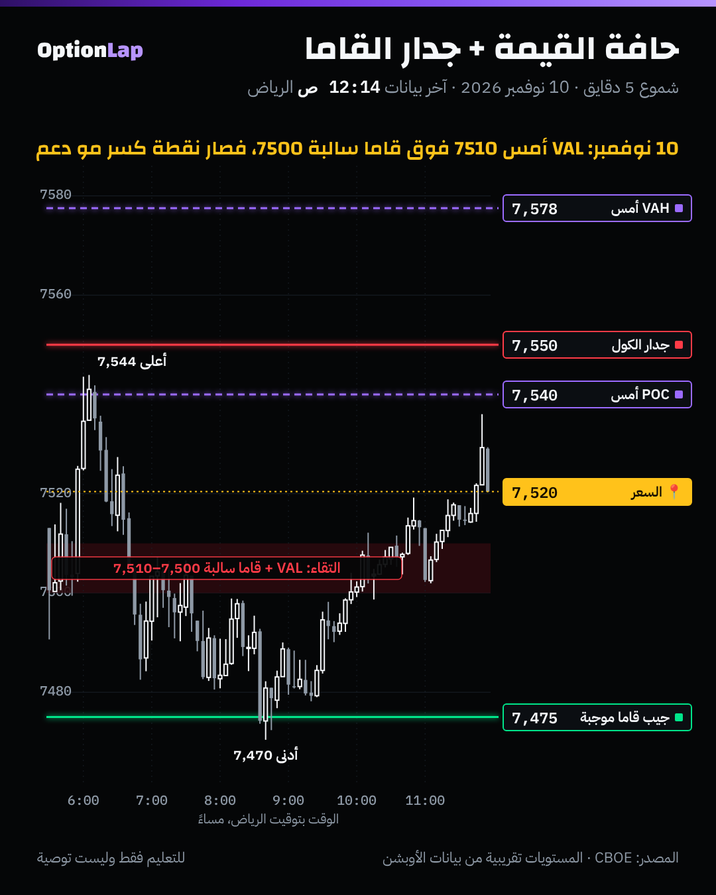

# 5.1 جدار قاما على حافة منطقة بزنس: أقوى منطقة؟

> للتعليم فقط وليست توصية.

## الشرح
- **الفكرة:** لما حافة قيمة أمس (VAH أو VAL أو حد البزنس) تطيح على مستوى قاما كبير، يكون عندنا **سببين** لنفس السعر:
  - **المزاد:** المدافعين (Responsive) يدافعون عن حافة القيمة (`business-area.md`).
  - **التحوّط:** صانع السوق عنده تحوّط كبير عند نفس السترايك (`greeks-to-walls.md`).
- **بس النظام هو اللي يحدد الدور:**
  - **قاما موجبة عند الحافة:** صانع السوق يعاكس الحركة، والمدافعين يدافعون. هنا **أقوى رفض** (ارتداد).
  - **قاما سالبة عند الحافة:** صانع السوق يتحوّط مع الحركة. لو انكسرت الحافة، الكسر **يتسارع**. فالالتقاء يصير **نقطة كسر** مو دعم.
- **الخلاصة:** «الالتقاء» يعطيك **وين** تنتبه. و**النظام** يقول لك **وش** تتوقع، ارتداد ولا كسر. وهذي قاعدة المالك بالضبط.
- **من المصادر:** كل اللي لقيته شركات أدوات وحسابات تداول تنصح بـ«الالتقاء» بدون أرقام. ما فيه اختبار منشور يثبت إن الالتقاء أقوى من كل واحد لحاله.

## مثال بالأرقام: 10 نوفمبر (يوم CPI)
| المستوى | المصدر | الرقم |
|---|---|---|
| VAH أمس | بروفايل 9 نوفمبر (`tpo.py`) | 7577.5 |
| POC أمس | نفسه | 7540 |
| **VAL أمس** | نفسه | **7510** |
| **قاما سالبة** | عقود 0DTE عند الافتتاح (`chain_walls.py`) | **7500 (−156M)** |
| جيب قاما موجبة | نفسه | 7475 (+110M) |
| النظام | صافي القاما عند الافتتاح | **سالب (−1.52 مليار)** |

- **الالتقاء:** VAL أمس (7510) مع قاما سالبة كبيرة (7500)، يعني منطقة **7500 لين 7510**.
- **التوقّع حسب القاعدة:** النظام سالب، فالمنطقة **نقطة كسر**. لو انكسرت بإغلاق 5 دقايق، الحركة تمشي لين الجيب الجاي (7475).

## تطبيق على الشارت

- **أول ساعة:** السعر داخل قيمة أمس، وطلع لين 7,544 تحت جدار الكول، ورجع.
- **6:45 و6:50 م:** إغلاق 5 دقايق تحت 7510 ثم تحت 7500. **كُسر الالتقاء.**
- **8:42 م:** أدنى سعر **7,470** عند جيب 7475، يعني حوالي **30 نقطة** تحت المنطقة.
- **آخر اليوم:** رجع فوق المنطقة وأغلق 7,520 داخل قيمة أمس. يعني المنطقة صارت **دعم بعد الاسترجاع**.
- **قراءتي:** الالتقاء في نظام سالب تصرّف **كنقطة كسر**، مثل ما تقول القاعدة. ويوم واحد بس.

## باك تست: هل الرقم الدائري (بديل الجدار) يقوّي حافة أمس؟ (`bt_daily.py edge_strike`، جديد)
- **السبب:** ما عندنا عقود مفتوحة تاريخية. فاستخدمنا **بديل**: هل قمة أو قاع أمس على بعد 0.1% أو أقل من سترايك دائري (مضاعف 50)؟ لأن العقود تتكدّس عادةً عند الأرقام الدائرية.
- **الطريقة:**
  - الافتتاح داخل نطاق أمس، والسعر يختبر الحافة خلال اليوم.
  - نقيس هل يغلق راجع داخل النطاق (رفض)، وعائد اليوم اللي بعده.
  - الفترة 2014 لين 2026، والمصدر CBOE، بدون تكاليف.

| الحافة | قريبة من سترايك دائري؟ | n | رجع داخل (رفض) | عائد بكرة: متوسط / صعود / t |
|---|---|---|---|---|
| قمة أمس | **نعم** | 166 | **43.4%** (±7.5) | +0.15% / 56.0% / +1.50 |
| قمة أمس | لا | 964 | **43.4%** (±3.1) | +0.01% / 53.2% / +0.23 |
| قاع أمس | **نعم** | 149 | **48.3%** (±8.0) | +0.17% / 55.7% / +2.13 |
| قاع أمس | لا | 876 | **50.2%** (±3.3) | +0.05% / 54.8% / +1.29 |

- **الخلاصة:** **الرقم الدائري لحاله ما يفرق.** نسبة الرفض نفسها تقريباً (43% ضد 43%، و48% ضد 50%).
  - يعني «سترايك دائري» مو بديل كافي لجدار حقيقي.
  - الجدار الحقيقي يحتاج **عقود مفتوحة وقاما فعلية**، و**النظام** معها.
- **الحدود:**
  - بديل ضعيف للجدار.
  - وما يفرّق بين نظام موجب وسالب، فممكن الأثرين يلغون بعض.
  - والاختبار الصحيح ينتظر 30 لقطة سلسلة (`archive_day.py`).

## الربط بالقاما
- **الالتقاء + قاما موجبة:** أقوى ارتداد. وهنا قاعدة المالك للبوت: إغلاق 5 دقايق تحت مقاومة الكول مع ذيل فوقها.
- **الالتقاء + قاما سالبة:** نقطة كسر. ننتظر إغلاق برّا المنطقة، ونمشي مع الكسر لين الجيب الجاي.
- **الالتقاء بدون جدار حقيقي** (رقم دائري بس): ما يضيف شي حسب الاختبار.

## أخطاء شائعة
1. تعتبر كل التقاء «دعم قوي» وتشتري عنده في قاما سالبة.
2. تستخدم الرقم الدائري بدل الجدار الحقيقي. الاختبار يقول ما يفرق.
3. تنسى إن المنطقة تقلب دورها: بعد ما انكسرت 7500–7510 ورجع فوقها، صارت دعم آخر اليوم.
4. تحسب الجدار من كل الانتهاءات بدل عقود اليوم.

## أسئلة وأجوبة
- **س: متى الالتقاء يكون أقوى منطقة فعلاً؟** ج: لما يكون في نظام قاما موجب، والسعر يوصله ويطلع رفض واضح (إغلاق مع ذيل).
- **س: وش صار عند 7500–7510 يوم 10 نوفمبر؟** ج: النظام كان سالب، فانكسرت المنطقة ونزل السعر حوالي 30 نقطة لين جيب 7475. وآخر اليوم رجع فوقها.
- **س: ليش ما نعتمد على الأرقام الدائرية؟** ج: من 2014، قمة أو قاع أمس قرب رقم دائري ما غيّر نسبة الرفض (43% ضد 43%). نحتاج الجدار الحقيقي من السلسلة.

## المصادر
- TradingView، وصف مؤشر GEX لسباكس (جدار الكول والبوت والزيرو قاما): https://es.tradingview.com/scripts/gex
- LuxAlgo، مستويات SpotGamma: https://www.luxalgo.com/blog/spotgamma-levels-reveal-dealer-positioning/
- TradingView، القيمة والـPOC في الماركت بروفايل: https://kr.tradingview.com/chart/SPX500USD/4NqmzeTD-How-to-trade-using-Value-Areas-and-POC
- SpotGamma، جدار الكول وجدار البوت: https://spotgamma.com/call-wall-put-wall-explained/
- البيانات: CBOE، والأدوات `tpo.py` و`chain_walls.py` و`bt_daily.py edge_strike`
