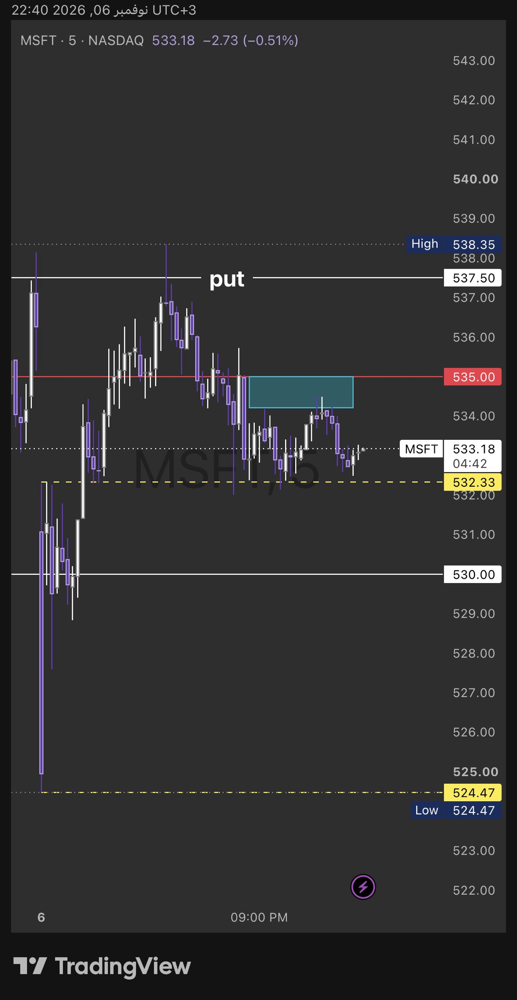
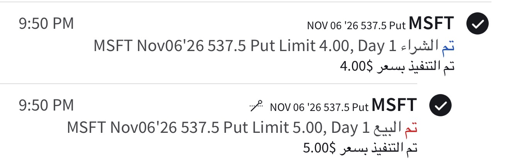

# مثال تعليمي: بوت MSFT تحت مقاومة الكول (6 نوفمبر 2026)

> صفقة حقيقية من عضو في الفريق، عقد واحد. للتعليم فقط وليست توصية.

## الخريطة (الأوبشن فلو)
- **النظام:** وضع القاما **الإجمالي** للسهم إيجابي (من MenthorQ)، يعني صانع السوق يعاكس الحركة والجدران تصمد. فالصفقة المناسبة **ارتداد من الجدار**.
- **مقاومة الكول:** 535 (الخط الأحمر).
- **أول دعم:** 532.33 (الخط الأصفر المتقطع)، وبعده 530.

## التوقيت (على شارت 5 دقايق)
- السعر طلع لمنطقة 534.2–535 (المربع الأزرق) وما قدر يقفل فوق 535.
- **شرط الدخول:** إغلاق شمعة 5 دقايق **واضح تحت** مقاومة الكول، وفيها **ذيل خفيف فوق المنطقة**. الذيل يقول إن السعر جرّب فوق وانرفض، فالرفض قوي.
- بعد الدخول: مراقبة الدلتا والقاما (هل الجدار باقي، ووين الفلوس تحت).

## العقد
- بوت 537.5 ينتهي نفس اليوم (0DTE)، والسهم حوالي 534. يعني داخل الفلوس بحوالي 3.5.
- أغلب السعر المدفوع (4.00) قيمة حقيقية، فالدلتا عالية والعقد يتحرك مع السهم، وتذويب الوقت عليه أقل من عقد بعيد.

## التنفيذ (من شاشة الوسيط)
| | السعر | الوقت (الرياض) |
|---|---|---|
| شراء 1 عقد | 4.00 | 9:50 م (1:50 الظهر نيويورك) |
| بيع 1 عقد (أمر Limit جاهز) | 5.00 | |

- **النتيجة:** +1.00 × 100 = **+100$** قبل العمولة (+25% على المبلغ المدفوع).
- بيع 5.00 يعادل تقريباً وصول السهم لـ532.3–532.5، يعني **أول دعم مرسوم**.

## وش كان صح
1. النظام الإجمالي إيجابي، فالدخول ارتداد من الجدار بعد شمعة رفض واضحة بذيل فوق المنطقة.
2. عقد داخل الفلوس، مو رخيص بعيد عن السيولة.
3. هدف على مستوى مرسوم، وأمر بيع جاهز من البداية.

## وش نحسّنه
1. **الوقف لازم ينكتب قبل الدخول.** الوقف المنطقي إغلاق شمعة 5 دقايق فوق 535، والبوت وقتها تقريباً 2.5–3.
   - المخاطرة تقريباً 1.00–1.50 والربح 1.00، فالنسبة حوالي 0.7–1.
   - هذي النسبة مقبولة في قاما إيجابية لأن احتمال الارتداد أعلى، بس أضعف من مثال المحاضرة (حوالي 5). والأرقام تقديرية من الشارت.
2. **لو أكثر من عقد:** اطلع بالنص عند 532.3، وحرّك وقف الباقي لنقطة الدخول، والهدف الثاني 530.
3. **0DTE بعد الظهر:** القيمة الزمنية تذوب بسرعة، فالدخول داخل الفلوس كان اختيار صح.

## ولو كان وضع القاما الإجمالي سلبي؟
- ما نعاكس الجدار. ننتظر **إغلاق شمعة 5 دقايق تحت 532.33** وناخذ بوت مع الكسر، والهدف 530.
- أو **إغلاق فوق 535** وناخذ كول.

## أسئلة للطالب
1. ليش الدخول تحت 535 أقوى لما وضع القاما الإجمالي إيجابي؟ **الجواب:** لأن صانع السوق يبيع مع الصعود عند الجدار، فالجدار يصمد غالباً.
4. وش يأكّد لك إن الرفض قوي قبل ما تدخل؟ **الجواب:** إغلاق 5 دقايق واضح تحت مقاومة الكول، مع ذيل خفيف فوق المنطقة.
2. وين الوقف؟ **الجواب:** إغلاق شمعة 5 دقايق فوق 535.
3. ليش سترايك 537.5 أحسن من بوت رخيص عند 525؟ **الجواب:** لأنه داخل الفلوس ودلتاه عالية، فيتحرك مع السهم. والبعيد ممكن «يموت» حتى لو صح الاتجاه.

**المصدر:** شارت المالك وشاشة الوسيط (6 نوفمبر). ما فيه بيانات CBOE لـMSFT عندنا، والأسعار من الصورة.
للتعليم فقط وليست توصية.
