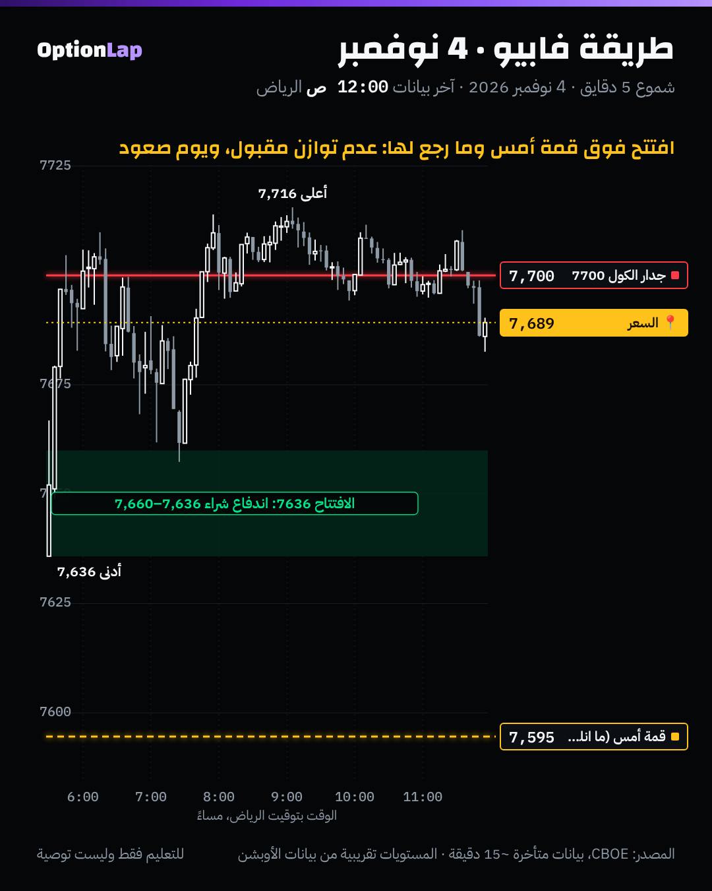

# 2.8 طريقة فابيو: الاتجاه ← المكان ← العدوانية (من المصادر العامة)

> للتعليم فقط وليست توصية. المصدر ملخصات عامة لمقابلات Fabio Valentini (بودكاست Titans of Tomorrow، وحلقات Chart Fanatics، وقناة Andrea Cimitan). ما فيه أي محتوى من كورسات مدفوعة، والتفاصيل **ثانوية**، فتعامل بحذر.

## الشرح
فابيو يسمّيها **«موديل» مو «استراتيجية»**، لأنها تبدأ بفهم قصة السوق قبل أي دخول. وهي 3 خطوات بالترتيب:
1. **الاتجاه (حالة السوق):** توازن ولا عدم توازن؟
   - في عدم التوازن يمشي مع الترند (أغلب شغله في جلسة نيويورك).
   - في التوازن يرجع للوسط (جلسة لندن).
2. **المكان:** مستوى مهم يتأكّد بالفوليوم بروفايل، مثل الـLVN وحدود القيمة. ما يدخل في نص اللاشي.
3. **العدوانية (الزناد):**
   - ينتظر بعد الرجوع للمستوى: فقاعات أوامر كبيرة، أو تحوّل في الدلتا، أو Stacked Imbalances في اتجاه فكرته.
   - أو امتصاص وآيسبيرغ ضد الحركة المعاكسة.
- **طبقات الوقت** (حسب ملخص ثانوي): 15 دقيقة للانحياز، ودقيقة للتجهيز، و15 ثانية للتنفيذ.
- **المخاطرة:** يفضّل عائد لمخاطرة 1:3 تقريباً، ومخاطرة صغيرة لكل صفقة (البند 2.9).
- **أهم قاعدة عنده:** الخروج عن الموديل هو اللي يخسّر.

## مثال بالأرقام: 4 نوفمبر
1. **الاتجاه:** افتتح 7,636، فوق قمة أمس 7,595. هذا عدم توازن صاعد.
2. **المكان:** المستوى المهم للرجوع كان قمة أمس 7,595 (حد القيمة القديمة).
3. **العدوانية:** السعر **ما رجع للمستوى أصلاً**، وأقل سعر كان 7,636. والافتتاح كان اندفاع شراء (Open-Drive).
4. **النتيجة:** وصل جدار الكول 7700، وأعلى سعر 7,716، وأغلق 7,689 (+53 من الافتتاح).
- **الدرس:** في عدم التوازن القوي، السعر ممكن ما يعطيك «المكان» أبداً. ومستوى ثاني (مثل اندفاع الافتتاح أو أول رجعة صغيرة) يصير المكان.

## تطبيق على الشارت

**قراءتي:** قمة أمس (7,595) بعيدة تحت وما انلمست. هذا **قبول** فوق النطاق القديم، والقاما فوق الزيرو قاما 7605 (من منصة المالك). يعني الحركة صعدت لين الجدار 7700 وقعدت تتذبذب حوله.

## الربط بالقاما (طريقتنا)
| خطوة فابيو | عندنا |
|---|---|
| الاتجاه (توازن أو عدم توازن) | **وضع القاما الإجمالي:** إيجابي = ارتداد وتوازن، وسلبي = اختراق واتجاه. ومعه مكان الافتتاح من نطاق أمس |
| المكان (فوليوم بروفايل، LVN) | **جدران القاما** (مقاومة الكول، ودعم البوت)، والـHVN والـLVN، ومستويات الدلتا |
| العدوانية (فوتبرنت، دلتا) | **شمعة 5 دقايق** (إغلاق تحت المستوى مع ذيل فوقه)، والتباعد، والامتصاص |

يعني طريقتنا نفس الهيكل، بس الخريطة من الأوبشن فلو، والزناد من الشمعة.

## باك تست وإحصائيات (تقريب يومي للاتجاه + المكان، **بدون** فلتر العدوانية)
- **الأداة:** `python3 team/tools/bt_daily.py dla` (جديدة).
  - **A:** تدخل مع الاتجاه من الافتتاح.
  - **B:** تنتظر **المكان** (رجوع لقمة أمس أو قاعه بأمر معلّق) وتدخل هناك.
  - الخروج عند الإغلاق. بدون وقف، وبدون تكاليف.

| الفترة | الحالة | n | المتوسط | الصعود (أو نجاح البيع) | t |
|---|---|---|---|---|---|
| 2014 لين 2026 | فوق قمة أمس، A (شراء من الافتتاح) | 659 | **+0.167%** | 62.7% | 6.01 |
| 2014 لين 2026 | فوق قمة أمس، B (شراء عند الرجوع للقمة) | 381 (57.8% رجعت) | **+0.029%** | 54.3% | 0.90 |
| 2014 لين 2026 | تحت قاع أمس، A (بيع من الافتتاح) | 374 | +0.165% | 51.6% | 3.08 |
| 2014 لين 2026 | تحت قاع أمس، B (بيع عند الرجوع للقاع) | 229 | −0.037% | 42.8% | −0.76 |
| 2023 لين 2026 | فوق، A | 219 | +0.078% | 57.1% | 1.86 |
| 2023 لين 2026 | فوق، B | 146 | +0.023% | 56.8% | 0.49 |
| 2023 لين 2026 | تحت، B (بيع) | 85 | **−0.127%** | 41.2% | **−2.22** |

**القراءة (مهمة):**
- **«المكان» لحاله بدون «العدوانية» يخرب الصفقة.** الرجوع لقمة أمس غالباً يعني إن عدم التوازن يضعف (نفس نتيجة plan_open). فالشراء هناك بدون تأكيد أضعف بكثير من الشراء من الافتتاح.
- وفي جهة البيع من 2023، البيع عند الرجوع لقاع أمس **خسّر** (t=−2.22).
- **هذا بالضبط ليش فابيو يصر على الخطوة الثالثة:** ما يدخل عند المكان إلا إذا شاف عدوانية في اتجاهه. وعندنا نفس الشي: ما ندخل إلا بشمعة رفض أو تأكيد.
- **التحفّظ:** بيانات يومية. ما نقدر نختبر فلتر العدوانية يومياً، فهذا يحتاج بيانات داخل الجلسة (30 يوم أو أكثر). بدون تكاليف، وبدون وقف.

## الأخطاء الشائعة
1. تدخل عند «المكان» بدون ما تنتظر العدوانية. الأرقام فوق تبيّن ليش هذا غلط.
2. تقلب الترتيب: تشوف أوامر عدوانية وتدخل بدون ما تعرف حالة السوق ولا المكان.
3. تستخدم موديل الترند في يوم توازن، أو العكس.
4. تنسخ «فابيو» من سكربتات TradingView اللي تدّعي إنها طريقته. أغلبها تقريب من بيانات فوليوم عامة، مو أوردر فلو حقيقي.

## أسئلة مع إجاباتها
1. **وش الخطوات الثلاث بالترتيب؟** الاتجاه (حالة السوق)، ثم المكان (مستوى مهم)، ثم العدوانية (الزناد).
2. **ليش الشراء عند الرجوع لقمة أمس أضعف من الشراء من الافتتاح؟** لأن الرجوع غالباً علامة إن عدم التوازن يضعف. وبدون تأكيد عدواني، تشتري في سوق يرجع للتوازن.
3. **وش يقابل «العدوانية» في طريقتنا؟** إغلاق شمعة 5 دقايق واضح عند المستوى مع ذيل رفض، ومعه التباعد أو الامتصاص.

## المصادر
- [Titans of Tomorrow: World's #1 Scalper, Fabio Valentini (Buzzsprout)](https://www.buzzsprout.com/2237815/episodes/16969314-world-s-1-scalper-these-small-mistakes-are-keeping-you-unprofitable-fabio-valentini)
- [Recapio: Trading LIVE with the #1 Scalper (Chart Fanatics)](https://recapio.com/digest/trading-live-with-the-1-scalper-in-the-world-extreme-accuracy-by-chart-fanatics)
- [Recapio: He Became World's #1 Scalper with This Tool (Andrea Cimi)](https://recapio.com/digest/he-became-world-s-1-scalper-with-this-tool-by-andrea-cimi)
- [Recapio: These Small Mistakes Are Keeping You Unprofitable](https://recapio.com/digest/world-s-1-scalper-these-small-mistakes-are-keeping-you-unprofitable-fabio-valentini-by-titans-of-tom)
- [forex.in.rs: Fabio Valentini's Order-Flow Edge (ثانوي)](https://www.forex.in.rs/footprint-vwap-compounding)
- [Tradezella: Auction market strategy](https://www.tradezella.com/strategies/auction-market-strategy)
