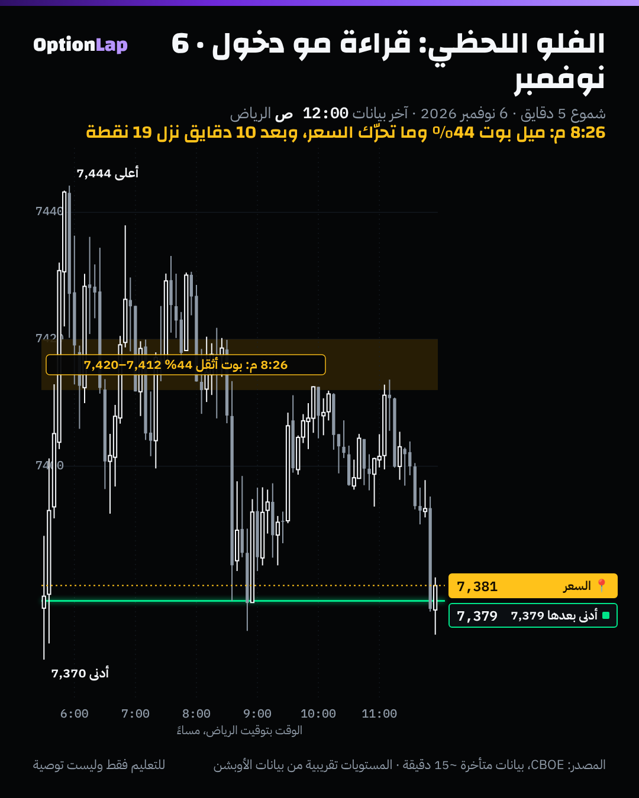

# 3.8 قراءة الفلو اللحظي: Sweeps وBlocks، والفرق بين Opening وClosing

> للتعليم فقط وليست توصية.

## الشرح
- **الفلو اللحظي (Option Flow Feed):** شاشة تعرض الصفقات الكبيرة على العقود أول بأول: الرمز، والسترايك، والتاريخ، والحجم، والمبلغ.
- **Sweep (اكتساح):** أمر كبير **يتقسّم على كذا بورصة** عشان ينفّذ بسرعة على أفضل الأسعار المتاحة. يعتبرونه **استعجال**: أحد يبي يدخل الحين ومستعد يدفع.
- **Block (بلوك):** صفقة **وحدة كبيرة** تنفّذ بسعر متفق عليه، وغالباً خارج الشاشة. كثير منها **تحوّط** أو **رِجل من استراتيجية** (سبريد)، مو رهان اتجاه.
- **Opening ضد Closing:**
  - الشريط **ما يقول لك** الصفقة فاتحة مركز جديد ولا قافلة مركز قديم.
  - المنصات **تستنتج** هذا. أشهر طريقة: **حجم اليوم أكبر من العقود المفتوحة (Volume > OI)**، يعني غالباً مراكز جديدة.
  - والحدود تختلف بين المنصات: بعضها 2.5 ضعف، وبعضها 5 لين 10 أضعاف.
  - ولو أغلب العقود المفتوحة في نفس الجهة، الصفقة الكبيرة ممكن تكون **قفل** مو فتح.
- **حدود مهمة:**
  - ما تعرف سياق الصفقة: تحوّط؟ رِجل من سبريد؟ صانع سوق يعدّل؟
  - كثير من المنصات تعطي «درجة» بأوزان سرية.
  - **ما لقينا اختبار مستقل** يثبت إن «الفلو غير العادي» يتوقع الحركة.
- **رأي المدرّب (المحاضرة الثانية):**
  - شاشات التدفق اللحظي تفيد في **القراءة** بس، مو في الدخول والخروج. ولا تلحق صفقات الحيتان.
  - والـCall OI والـPut OI تقول **كم اشترى الناس**، مو **وين الفلوس**. شغلك على Net GEX بـ Intraday.

## مثال بالأرقام: 6 نوفمبر (ميل تدفق الأوبشن، من بياناتنا)
- **8:26 م بتوقيت الرياض (12:26 نيويورك):** شمعة 5 دقايق فيها البوت أثقل بـ**44%**، والسعر **ما تحرّك** (+1.7 نقطة).
- **بعد 10 دقايق:** شمعة نزلت **−19.4** نقطة، والأدنى **7,379**.
- **بس تذكّر نتيجة البند 2.4:** ميل التدفق يوصف الشمعة (+0.37) وما يتوقع اللي بعدها (−0.003) على 304 شموع. يعني هالمثال **قصة وحدة**، مو قاعدة.

## تطبيق على الشارت

**قراءتي:** الفلو اللحظي أعطى «تلميح» قبل النزول. بس نفس الإشارة طلعت مرات ثانية بدون حركة (الاختبار في 2.4). فاستخدامه الصح:
- **قراءة** للسياق: هل الطلب بوت ولا كول؟
- و**تأكيد** عند جدار مرسوم، مع شمعة الرفض.
- مو زناد لحاله.

## الربط بالقاما
- **الفلو اللحظي يحرّك الـGEX:** الصفقات الجديدة الكبيرة (Opening) تغيّر الجدران خلال اليوم. عشان كذا المدرّب يقول «ارجع لـ Exposure لما يوصل السعر للمستوى».
- **Sweep على كول قريب من جدار الكول في قاما سالبة:** ممكن يكون وقود اختراق. وفي قاما موجبة، غالباً ينمتص عند الجدار.

## باك تست وإحصائيات
- **غير قابل للاختبار حالياً:** ما عندنا شريط صفقات على مستوى الصفقة (Time & Sales للأوبشن)، فما نقدر نفرّق Sweep عن Block.
- **تحسين للأرشيف (جديد اليوم):** `archive_day.py` صار يحفظ **لقطة السلسلة** (الحجم، والعقود المفتوحة، والتذبذب، والدلتا، والقاما لكل عقد ضمن ±3% ولمدة 7 أيام) في `team/data/chain/`. بعد 30 يوم نقدر نختبر:
  1. هل السترايكات اللي فيها **حجم > عقود مفتوحة** (فتح جديد) تصير جدران الجلسة الجاية؟
  2. هل السعر ينشد لها؟
- **وصفي:** 6 نوفمبر، ميل بوت 44% قبل نزول 19 نقطة. حالة وحدة. **العيّنة صغيرة، النتيجة غير موثوقة.**

## الأخطاء الشائعة
1. تلحق صفقة «حوت» من الشاشة بدون ما تعرف هي فتح ولا قفل.
2. تقرأ كل Block كرهان اتجاه، وأغلبها تحوّط أو سبريد.
3. تعتمد على «درجة» منصة بدون ما تعرف أوزانها.
4. تخلط الـOI (كم اشترى الناس) بالـGEX والـDEX (وين الفلوس والجدران).
5. تدخل على إشارة الفلو بدون مستوى مرسوم وشمعة.

## أسئلة مع إجاباتها
1. **وش الفرق بين Sweep وBlock؟** الـSweep يتقسّم على بورصات بسرعة (استعجال)، والـBlock صفقة وحدة كبيرة متفق عليها، وغالباً تحوّط أو سبريد.
2. **كيف تعرف إن الصفقة فاتحة مركز جديد؟** ما تعرف أكيد. أشهر تقدير: حجم اليوم أكبر من العقود المفتوحة.
3. **ليش المدرّب يقول لا تلحق الحيتان؟** لأنك ما تعرف سياق صفقتهم، والإشارة لحالها ما تتوقع الحركة. شغلك على الجدران والفلوس (Net GEX/DEX).

## المصادر
- [Benzinga: What are options sweeps?](https://benzinga.com/money/what-options-sweeps)
- [OptionStrat: Unusual options flow tutorial](https://optionstrat.com/tutorials/unusual-options-flow)
- [Options Analysis Suite: What is unusual options activity?](https://www.optionsanalysissuite.com/documentation/unusual-options-activity)
- [FlashAlpha: Flow signals, sweeps, blocks, opening bias](https://flashalpha.com/articles/flow-signals-api-scoring-unusual-options-activity)
- [TradesViz: How to read options flow](https://www.tradesviz.com/blog/how-to-read-options-flow/)
- ملخص المحاضرة الثانية (ملاحظة المدرّب عن شاشات التدفق).
