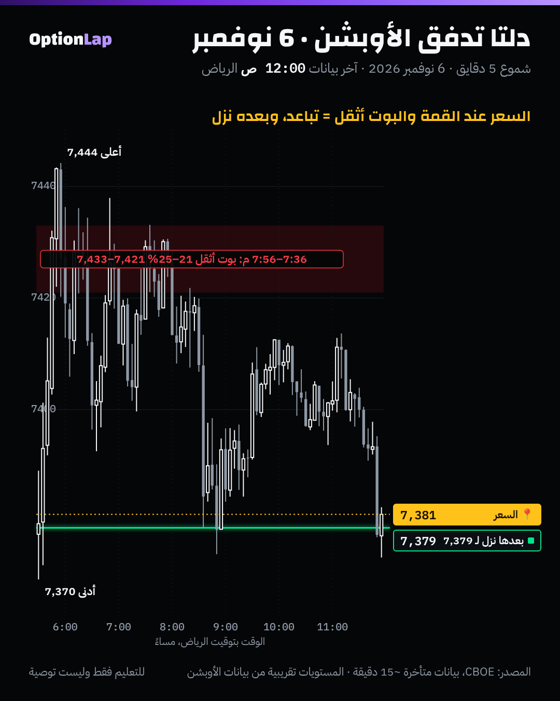

# 2.4 الفوتبرنت: Bid×Ask، والدلتا لكل شمعة، والـImbalance

> للتعليم فقط وليست توصية.

## الشرح
- **الفوتبرنت:** يفتح الشمعة من داخل. عند كل سعر فيها رقمين:
  - **Bid:** حجم البيع اللي ضرب الطلبات (بائع مهاجم).
  - **Ask:** حجم الشراء اللي رفع العروض (مشتري مهاجم).
- **الدلتا لكل شمعة** = حجم الـAsk − حجم الـBid. موجبة يعني الشراء المهاجم أكثر، وسالبة يعني البيع أكثر. **الدلتا تقيس العدوانية، مو الاتجاه الجاي.**
  - وانتبه: هذي «دلتا الأوردر فلو»، غير دلتا الأوبشن (سرعة العقد).
- **الـImbalance (خلل):** يتقاس **بالقطر**. الشراء عند الـAsk في سعر، يتقارن بالبيع عند الـBid في السعر اللي تحته. والحد الشائع 300%. وتحطّ حد أدنى للحجم عشان المستويات الفاضية ما تطلع إشارات.
- **Stacked Imbalances:** خلل في نفس الجهة على 3 مستويات متتالية أو أكثر، وهذا يدل على قناعة. بس لو صدم مستوى كبير معاكس، غالباً ينمتص.
- **التباعد (Divergence):** السعر يسوي قمة جديدة والدلتا سالبة أو ضعيفة. يعني الشراء ما يدفع، وممكن يصير امتصاص ورجوع. وما لقينا له تعريف موحّد في المصادر، فنعامله كفكرة وصفية.
- **فابيو فالنتيني** (من ملخص ثانوي لمقابلته): يدخل بس لما الفوتبرنت يبيّن امتصاص أو آيسبيرغ، مع تحوّل في الدلتا أو Stacked Imbalances في اتجاه فكرته.

## ملاحظة على بياناتنا
ما عندنا Bid×Ask لـES. عندنا **فوليوم كولات وبوتات SPX لكل دقيقة** من CBOE. فنستخدم **«دلتا تدفق الأوبشن»** كبديل تقريبي:

  (كول − بوت) ÷ (كول + بوت) لكل شمعة 5 دقايق

هذا **مو فوتبرنت**: ما يفرّق بين شراء العقد وبيعه، بس يعطي «ميل» التدفق.

## مثال بالأرقام: 6 نوفمبر
| الوقت (نيويورك / الرياض) | الشمعة | الحركة | الميل |
|---|---|---|---|
| 11:36 / 7:36 م | 7427.8 ← 7430.1، والأعلى 7433 | **+2.3** | **بوت أثقل 25%** |
| 11:41 / 7:41 م | ← 7420.8 | −9.2 | بوت أثقل 17% |
| 11:56 / 7:56 م | ← 7428.0 | −1.4 | بوت أثقل 21% |
| 12:01 / 8:01 م | ← 7410.3 | **−17.6** | متعادل |
| 12:26 / 8:26 م | 7418.3 | +1.7 | **بوت أثقل 44%** |
| 12:36 / 8:36 م | ← 7392.8، والأدنى 7378.8 | **−19.4** | بوت أثقل 27% |

## تطبيق على الشارت

**قراءتي:**
- السعر كان عند منطقة الجدار (7421–7433) والتدفق يميل للبوت 21–25%. هذا **تباعد**: السعر فوق والتدفق ما يدعمه.
- بعدها نزل السعر على مرحلتين: −17.6 ثم −19.4، لين 7,379.
- **بس انتبه:** الاختبار تحت يقول إن الميل لحاله **ما يتوقع** الشمعة الجاية. قيمته في **الالتقاء**: جدار قاما + تباعد + شمعة رفض.

## الربط بالقاما
- **الجدار يقول وين، والفوتبرنت يقول متى.** عند مقاومة الكول في قاما إجمالية إيجابية، تدوّر على تباعد أو امتصاص قبل الدخول.
- **في قاما إجمالية سلبية:** تدوّر على Stacked Imbalances في اتجاه الكسر، عشان تأكّد الاختراق.
- مثل صفقة MSFT: إغلاق تحت مقاومة الكول بذيل فوقها هو النسخة «الشمعية» من نفس الفكرة.

## باك تست وإحصائيات
- **الأداة:** `python3 team/tools/bt_intraday.py flowdelta` (جديدة). وفيه شوي **in-sample**، لأن حدود الـ20% محسوبة من كل العيّنة.
- **النتيجة** (4 أيام، 304 شمعة 5 دقايق، بالنقاط، بدون تكاليف):
  - **ارتباط الميل مع حركة نفس الشمعة: +0.37.** يعني يوصف اللي صار.
  - **ارتباطه مع الشمعة الجاية: −0.003.** يعني **ما يتوقع**.
  - الأساس (كل الشموع): متوسط −0.09، والصعود 48.7%.
  - بعد ميل كول قوي (أعلى 20%): متوسط −0.54، والصعود 52.5% (t=−0.68).
  - بعد ميل بوت قوي (أدنى 20%): متوسط −0.54، والصعود 45.9% (t=−0.58).
- **الخلاصة:** ما فيه أفضلية لحاله.
- **العيّنة صغيرة، النتيجة غير موثوقة** (4 أيام بس، والشموع مترابطة).

## الأخطاء الشائعة
1. تعتبر دلتا موجبة إشارة شراء. هي تقول مين هاجم، مو مين بيكسب.
2. تقرأ الـImbalance أفقي، والصح **بالقطر**.
3. تلاحق Stacked Imbalances وهي صادمة جدار كبير، وغالباً تنمتص.
4. تخلط بين دلتا الأوردر فلو ودلتا الأوبشن.
5. تقرأ الفوتبرنت طول اليوم. الصح عند مستوياتك المرسومة بس.

## أسئلة مع إجاباتها
1. **السعر سوى قمة جديدة والدلتا سالبة. وش يعني؟** تباعد: الشراء ما يدفع، وممكن يكون امتصاص. ويحتاج تأكيد بشمعة رفض.
2. **كيف يتقاس الـImbalance؟** بالقطر: الـAsk في سعر مقابل الـBid في السعر اللي تحته، والحد الشائع 300%.
3. **ليش ميل تدفق الأوبشن ما ينفع لحاله؟** لأنه يوصف الشمعة الحالية (+0.37)، وما له علاقة بالشمعة الجاية (−0.003). قيمته مع الجدار والشمعة.

## المصادر
- [LuxAlgo: Footprint Concepts](https://www.luxalgo.com/library/concept/footprint-concepts/)
- [LuxAlgo: Bid/Ask Imbalance](https://www.luxalgo.com/library/concept/bid-ask-imbalance.md)
- [Quantower: Reading Stacked Imbalance](https://www.quantower.com/blog/imbalance-footprint-chart-and-rithmic-plugin)
- [MQL5: How to Read an Order Flow Footprint Chart](https://www.mql5.com/en/blogs/post/778690)
- [ProCharting: Imbalance charts](https://procharting.in/docs/orderflow/imbalance-charts)
- ملخص ثانوي لأسلوب فابيو (يعامل بحذر): [forex.in.rs](https://www.forex.in.rs/footprint-vwap-compounding)
