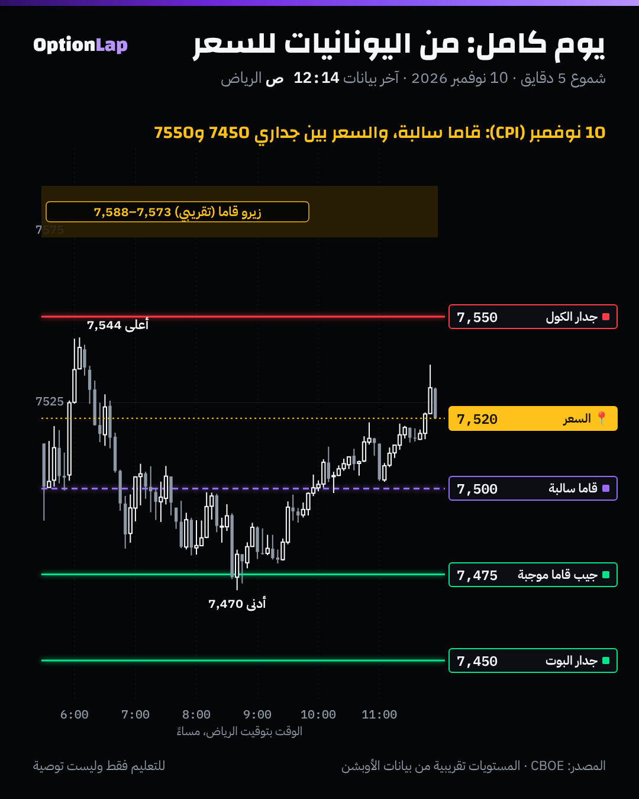

# 4.10 مثال كامل: يوم سباكس من اليونانيات للتدفقات للسعر (10 نوفمبر، يوم CPI)

> للتعليم فقط وليست توصية. كل أرقام «قبل الافتتاح» من بيانات معروفة وقتها (عقود مفتوحة من الليل، وVIX أمس)، بدون نظر للمستقبل.

## الشرح: السلسلة كاملة
1. **اليونانيات** (لكل عقد): الدلتا والقاما، ومنها الفانا والتشارم (`delta.md` و`gamma-greek.md` و`vanna.md` و`charm.md`).
2. **التجميع** (لكل سترايك): القاما × العقود المفتوحة = GEX، فتطلع الجدران والزيرو قاما (`greeks-to-walls.md`).
3. **النظام:** السعر تحت الزيرو قاما = قاما سالبة = صانع السوق يتحوّط **مع** الحركة، والكسر أسرع.
4. **المحفّز:** خبر (CPI) يحرّك السعر والتذبذب، فالتحوّط يتحرك وراه.
5. **السعر:** يمشي بين الجدران، والنظام يحدد هل يرتد منها ولا يكسرها. والمزاد (القيمة) يقول وين يتوقف.

## مثال بالأرقام: قبل الافتتاح (`chain_walls.py 2026-11-09 --expiry 261110 --spot 7513.09 --iv 0.1992`)
| البند | الرقم | المعنى |
|---|---|---|
| صافي القاما لعقود اليوم عند الافتتاح | **−1.52 مليار** | **نظام سالب** |
| الزيرو قاما (حسابنا) | **7573 لين 7588** | السعر (7,513) تحته بحوالي 65 نقطة |
| جدار الكول | **7550** (+117M) | سقف اليوم |
| قاما سالبة كبيرة | **7500** (−156M) | لو انكسرت، تسارع |
| جيب قاما موجبة | **7475** (+110M)، ودلتا موجبة +668M (ملخص الصبح) | مكان ممكن يتوقف فيه |
| جدار البوت | **7450** (−197M) | أرضية اليوم |
| قيمة أمس (المزاد) | 7510 لين 7577.5، والـPOC 7540 | الافتتاح 7,513 = على حدها السفلي |

## تطبيق على الشارت: اللي صار فعلاً

| الوقت (الرياض) | الحدث | التفسير |
|---|---|---|
| 4:30 م | CPI أعلى من المتوقع (+0.4% و+0.3%) | المحفّز |
| 5:30 م | افتتح **7,513** على حد قيمة أمس | بداية المزاد |
| 6:09 م | أعلى سعر **7,544**، **ما لمس جدار 7550** | فشل تحت السقف |
| 6:45 م | أول إغلاق 5 دقايق تحت **7510** (7,500.5) | خرج من قيمة أمس |
| 6:50 م | أول إغلاق 5 دقايق تحت **7500** (7,495) | كسر القاما السالبة: الحركة تسارعت |
| 8:42 م | أدنى سعر **7,470**، عند جيب **7475** | وقف قبل جدار البوت 7450 بـ20 نقطة |
| 9:55 م | رجع فوق **7500** | انتهى البيع |
| 12:00 ص | أغلق **7,520** داخل قيمة أمس | المزاد رجّعه للقيمة |

**قراءتي:**
- **اليوم كله صار بين الجدارين** (7,470 لين 7,544 داخل 7450 لين 7550).
- **النظام السالب انطبق:** الكسر تحت 7500 مشى حوالي **25 نقطة** (من إغلاق 7,495 لين 7,470).
- **بس ما وصل جدار البوت:** وقف عند جيب القاما الموجبة والدلتا عند 7475.
- **وآخر اليوم المزاد غلب:** رجع داخل القيمة. وهذا يتماشى مع اختبار التشارم: آخر ساعة السعر بعد عن 7500 (من 10.7 إلى 20.4 نقطة)، ما ثبت عند السترايك.
- **التذبذب ما انفجر:** VIX من 19.92 إلى 19.58 عند الإغلاق، وأعلى سعر خلال اليوم 21.43. الخبر كان حار، بس ما صار ذعر.

## باك تست: هل اليوم يبقى بين جداري الافتتاح؟ (`chain_walls.py` على لقطتين)
| اليوم | جدار البوت ← الكول عند الافتتاح | المدى الفعلي | داخل الجدارين؟ |
|---|---|---|---|
| 9 نوفمبر | 7350 ← 7550 | 7,422 لين 7,577 | **تجاوز الكول بـ27 ورجع أغلق عليه** |
| 10 نوفمبر | 7450 ← 7550 | 7,470 لين 7,544 | **نعم** |

- **العيّنة صغيرة، النتيجة غير موثوقة** (n=2).
- الفكرة تحتاج 30 يوم لقطات. و`archive_day.py` يحفظ لقطة كل يوم.

## الربط بالقاما وقاعدة المالك
- **قاعدة المالك:** النظام سالب = اختراق مع الكسر. والزناد كان إغلاق 5 دقايق تحت 7510 ثم 7500. ومن هناك المشي مع الكسر لين الجيب التالي (7475).
- **ومتى توقف؟** عند المستوى اللي بعده في الخريطة (7475)، مو «لين ما يوقف». وهذا يحمي من الرجوع.
- **وما تعاكس الاتجاه:** الكول تحت جدار 7550 في نظام سالب، والسهم نازل، كانت أضعف صفقة باليوم.

## أخطاء شائعة
1. تقرأ الجدار بدون النظام: 7550 كان سقف لأن السعر ما وصله أصلاً. ولو وصله في نظام سالب، ممكن ينكسر.
2. تتوقع الكسر يكمّل لين جدار البوت. الجيوب الموجبة بالنص (7475) ممكن توقفه.
3. تنسى المزاد: آخر اليوم السعر رجع لقيمة أمس، والقيمة أقوى من «الترند» في يوم طبيعي.
4. تحسب الجدران بلقطة الإغلاق بدل الافتتاح: لقطة 10 نوفمبر عند الإغلاق كانت شبه فاضية (عقود انتهت). خذ لقطة الليل لعقود اليوم.

## أسئلة وأجوبة
- **س: ليش النظام كان سالب والسعر 7,513؟** ج: الزيرو قاما بحسابنا كانت حوالي 7,580، والسعر تحتها. وقاما 7500 و7450 السالبة أكبر من 7550 الموجبة.
- **س: وين كان الهدف المنطقي بعد كسر 7500؟** ج: الجيب التالي في الخريطة: 7475 (قاما موجبة ودلتا كبيرة)، وبعده جدار البوت 7450.
- **س: هل CPI غيّر الخريطة؟** ج: لا. الخبر حرّك السعر، والخريطة حددت **وين** يتحرك و**وين** يوقف. وهذا ليش نرسمها قبل الخبر.

## المصادر
- SpotGamma، جدار الكول وجدار البوت: https://spotgamma.com/call-wall-put-wall-explained/
- SpotGamma، أهم اليونانيات لـ0DTE: https://spotgamma.com/most-important-greeks-0dte-trading/
- Fox Business، CPI أكتوبر: https://www.foxbusiness.com/economy/cpi-inflation-october-2026
- CNBC، السوق بعد CPI: https://www.cnbc.com/2026/11/09/stock-market-today-live-updates.html
- البيانات: CBOE (`team/data/intraday/2026-11-10_SPX.csv.gz` و`team/data/chain/2026-11-09_SPX.csv.gz`)، والأدوات `chain_walls.py` و`tpo.py`
