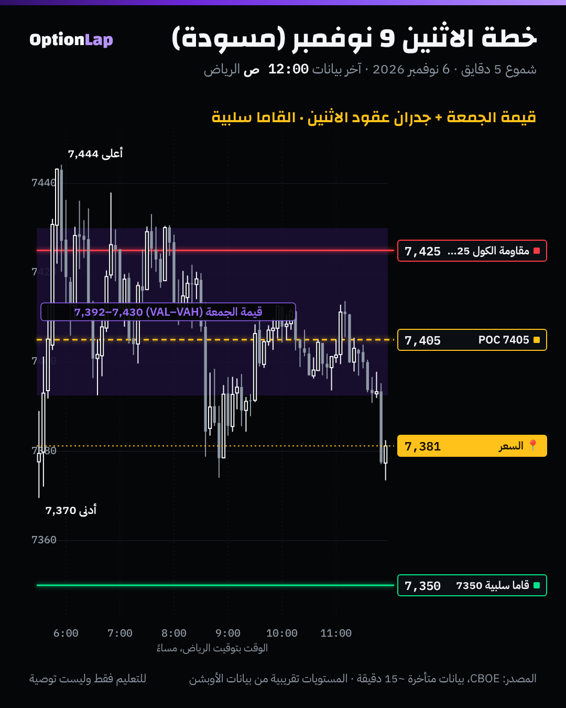

# 2.10 خطة يوم كاملة: أوردر فلو + منطقة البزنس (تجميع المسار 2)

> للتعليم فقط وليست توصية. هذا تجميع لكل اللي تعلّمناه في المسارين 1 و2 بخطة وحدة، ومطبّق كمسودة على الاثنين 9 نوفمبر.

## الهيكل (6 خطوات قبل الافتتاح، و3 خلال الجلسة)
**قبل الافتتاح (الخريطة):**
1. **وضع القاما الإجمالي** (من MenthorQ، ورقم المالك هو المرجع): إيجابي يعني ارتداد، وسلبي يعني اختراق.
2. **الجدران:** مقاومة الكول، ودعم البوت، والزيرو قاما لعقود اليوم.
3. **منطقة القيمة لليوم اللي قبله (البزنس إيريا):** POC وVAH وVAL، وشكل البروفايل (D أو P أو b)، والمناطق الخفيفة برّاها.
4. **وين الإغلاق؟** داخل القيمة ولا برّاها؟ قوي ولا ضعيف؟
5. **الالتقاء:** وين يجتمع جدار مع حد قيمة أو HVN؟ هذي أقوى مناطق اليوم.
6. **سيناريوهات «إذا… فـ…»** لكل مكان افتتاح محتمل، مع الوقف الهيكلي وحجم المخاطرة (0.25%).

**خلال الجلسة (التوقيت):**

7. **نوع الافتتاح** في أول 30 دقيقة: Drive أو Test-Drive أو Rejection-Reverse أو Auction.
8. **الزناد عند المكان:** إغلاق شمعة 5 دقايق مع ذيل رفض، وتباعد أو امتصاص إذا متوفر. **بدون زناد، ما فيه دخول** (البند 2.8: «المكان» لحاله يخسّر).
9. **الإدارة:** الهدف الأول الـPOC أو حد القيمة المقابل. والوقف ورا الهيكل. وبعد الهدف الأول، الوقف لنقطة الدخول.

## مسودة الاثنين 9 نوفمبر (من بيانات الجمعة، CBOE متأخرة)
**الخريطة:**
| البند | القيمة | المصدر |
|---|---|---|
| وضع القاما لعقود الاثنين | **سلبي** (صافي GEX ±3% حوالي −4,479 مليون) | gex.py، لقطة 7 نوفمبر 1:05 ص UTC، **تقريبي**. ورقم المالك من MenthorQ هو المرجع |
| مقاومة الكول | **7425** | نفس المصدر |
| أكبر قاما سالبة تحت | **7350**، ثم 7300 | نفس المصدر |
| قيمة الجمعة | POC **7405**، VAL **7392.5**، VAH **7430** | tpo.py 2026-11-06 |
| إغلاق الجمعة | **7,377**، تحت القيمة وفي أدنى 10% من مدى اليوم | CBOE |
| الالتقاء | **7425 إلى 7430**: مقاومة الكول + VAH + HVN ثانية (البند 2.2) | — |

**السيناريوهات (مسودة، تتحدّث برقم المالك وبيانات الصبح):**
- **أ) افتتاح تحت 7392.5 (تحت القيمة)، والقاما سلبية:**
  - نتوقع امتداد، والأهداف تحت 7350 ثم 7300.
  - **الزناد:** إغلاق 5 دقايق تحت قاع الجمعة 7,370 بعد اختبار وفشل.
  - **الوقف:** فوق آخر قمة صغيرة، ما يقل عن 10 نقاط.
- **ب) افتتاح ورجوع لداخل القيمة (قبول فوق 7392.5):**
  - **المغناطيس:** الـPOC 7405، ثم الجدار 7425–7430.
  - **عند 7425–7430:** نشوف شمعة رفض (إغلاق تحت مع ذيل فوق). هذا مكان بيع، والوقف فوق 7,446 (قمة الجمعة).
- **ج) افتتاح فوق 7430 (فوق القيمة والجدار):**
  - عدم توازن صاعد. **لا تعاكس.**
  - انتظر رجعة لـ7430 وقبول فوقها. وفي قاما سلبية، الحركة ممكن تتسارع.
- **الحجم:** 0.25% من الحساب لكل فكرة، وحد 3 وقوفات باليوم.

## تطبيق على الشارت

**قراءتي:** الجمعة كانت يوم توازن داخل نطاق أول ساعة (Normal Day)، وقطع الـVWAP 25 مرة. بس الإغلاق جاء ضعيف وتحت القيمة. فالاثنين يبدأ بسؤال واحد: **هل يقبل تحت 7392 ولا يرجع للقيمة؟** والقاما السلبية ترجّح إن أي كسر يكون أسرع.

## باك تست: الإغلاق الضعيف (`bt_daily.py weak_close`، جديد)
يوم يقفل في أدنى 15% من مداه (صاعد أو نازل، مثل الجمعة):

| الفترة | الحالة | n | اليوم اللي بعده | الصعود | t | لمس منتصف اليوم اللي قبله |
|---|---|---|---|---|---|---|
| 2014 لين 2026 | كل الأيام | 3,230 | +0.049% | 54.2% | 2.57 | 52.2% |
| 2014 لين 2026 | **إغلاق ضعيف** | 481 | **+0.175%** | 58.0% | **2.88** | 50.1% |
| 2023 لين 2026 | كل الأيام | 964 | +0.072% | 55.4% | 2.39 | 51.7% |
| 2023 لين 2026 | **إغلاق ضعيف** | 137 | +0.128% | 60.6% | 1.52 | 52.6% |

**القراءة:**
- بعد الإغلاق الضعيف، اليوم اللي بعده يميل للصعود **أكثر شوي** من العادي (ارتداد).
- ولمس منتصف أمس **ما يختلف** عن العادي (حوالي 50%).
- ومن 2023، الفرق **غير مؤكد** (t=1.52).
- يعني الإحصاء اليومي **ما يرجّح قوي** أي سيناريو. والقاما السلبية والقبول خلال الجلسة هم اللي يحكمون.
- يومي، وبدون تكاليف.

## الأخطاء الشائعة
1. خطة بسيناريو واحد. لازم «إذا… فـ…» لكل مكان افتتاح.
2. تدخل عند المستوى بدون زناد.
3. تتجاهل وضع القاما وتتعامل مع كل جدار كأنه يصمد.
4. تنسى تحديث الخطة برقم المالك وبيانات الصبح (المستويات تتغيّر مع العقود الجديدة).
5. تخاطر أكثر لأن «الخطة واضحة».

## أسئلة مع إجاباتها
1. **وش أقوى منطقة يوم الاثنين حسب المسودة؟** 7425 لين 7430: مقاومة الكول + VAH + HVN.
2. **الافتتاح تحت 7392 والقاما سلبية. ترتد ولا تمشي مع الكسر؟** تمشي مع الكسر بعد زناد (إغلاق تحت 7,370)، لأن القاما السلبية تسرّع الحركة.
3. **ليش ما نعتمد على إحصاء الإغلاق الضعيف لحاله؟** لأن الفرق صغير، ومن 2023 غير مؤكد (t=1.52)، ولمس المنتصف عادي.

## المصادر
- ملفاتنا: `auction-day-plan.md`، و`fabio-dla.md`، و`hvn-lvn.md`، و`vwap.md`، و`risk-management.md`، و`zero-gamma.md`.
- [Tradezella: Auction market playbook](https://www.tradezella.com/playbooks/auction-market-playbook)
- [Tradezella: Auction market strategy](https://www.tradezella.com/strategies/auction-market-strategy)
- [Titans of Tomorrow: Fabio Valentini](https://www.buzzsprout.com/2237815/episodes/16969314-world-s-1-scalper-these-small-mistakes-are-keeping-you-unprofitable-fabio-valentini)
- [TradingView Wiki: Volume Profile](https://www.tradingview.com/wiki/Volume_Profile)
