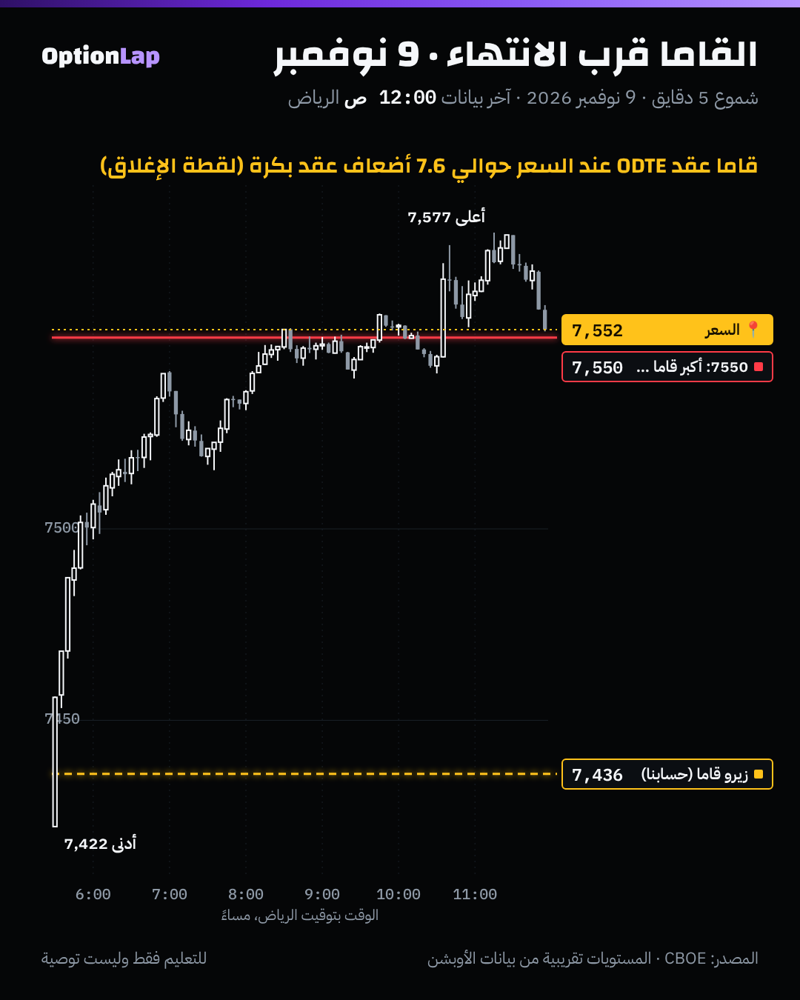

# 4.2 القاما: سرعة الدلتا، وليش تنفجر قرب الانتهاء

> للتعليم فقط وليست توصية.

## الشرح
- **القاما = كم تتغيّر الدلتا لما يتحرك السعر نقطة.** لو القاما 0.005، كل 10 نقاط حركة تغيّر الدلتا 0.05.
- **أعلى شي عند السعر (ATM)،** وتقل كل ما بعد السترايك داخل أو خارج الفلوس، لأن الدلتا هناك ثابتة تقريباً عند 0 أو 1.
- **ليش تنفجر قرب الانتهاء؟** قاما العقد عند السعر تقريباً:

  Γ ≈ 1 ÷ (السعر × التذبذب × √(2π × الوقت المتبقي))

  يعني تكبر مع **مقلوب جذر الوقت**. كل ما قرّب الانتهاء، تطير.
- **والعكس للعقود البعيدة:** قرب الانتهاء قاماها تقرب من الصفر، لأن دلتاها «حسمت» (0 أو 1).
- **النتيجة:** قرب الانتهاء، كل القاما تتجمّع في سترايكات قليلة حول السعر. وهذا ليش عقود 0DTE تصنع جدران قوية عند سترايك واحد.
- **لصاحب القاما القصيرة** (اللي باع العقد، غالباً صانع السوق): أي حركة صغيرة تحتاج تعديل تحوّط كبير، وهذي أخطر وضعية في الأوبشن. ولصاحب القاما الطويلة (المشتري): القاما معه، بس الـTheta (ذوبان الوقت) يزيد بنفس السرعة.

## مثال بالأرقام
**1) نظرياً (بلاك-شولز، السعر 7,550، والتذبذب 20%): قاما عقد عند السعر:**
| الوقت المتبقي | القاما لكل نقطة | تغيّر الدلتا مع 10 نقاط |
|---|---|---|
| 30 يوم | 0.0009 | 0.009 |
| 7 أيام | 0.0019 | 0.019 |
| يوم واحد | 0.0051 | 0.05 |
| 6 ساعات | 0.0101 | 0.10 |
| حوالي ساعة | 0.0226 | **0.23** |

- وعقد بعيد 1% فوق السعر: قاماه 0.0009 مع 30 يوم، بس **تقريباً صفر** (0.000003) آخر ساعة.

**2) فعلياً (لقطة سلسلة SPX عند إغلاق 9 نوفمبر، `team/data/chain/`):** متوسط قاما الكول عند 7550 (±10 نقاط):
| الانتهاء | القاما |
|---|---|
| **اليوم (9 نوفمبر)** | **0.0388** |
| بكرة (10 نوفمبر) | 0.0051 |
| 11 نوفمبر | 0.0039 |
| 13 نوفمبر | 0.0028 |
| 16 نوفمبر | 0.0024 |

يعني قاما عقد اليوم عند السعر **حوالي 7.6 أضعاف** عقد بكرة.

## تطبيق على الشارت: 9 نوفمبر

**قراءتي:**
- آخر ساعتين، قاما عقود اليوم عند 7550 صارت ضخمة (لقطة الإغلاق +22,106M).
- السعر لمس 7,577 الساعة 11:16 م ورجع، وأغلق على 7550 تقريباً.
- هذا اللي تتوقعه من قاما موجبة ضخمة قرب الانتهاء: صناع السوق يبيعون أي صعود ويشترون أي نزول حول السترايك.
- **تحفّظ (نفس البند 3.6):** لقطة الإغلاق تكبّر قاما السترايك اللي **وصل له** السعر، فالدليل جزئياً دائري.

## باك تست وإحصائيات
- **نظري:** الجدول فوق من المعادلة، مو اختبار.
- **فعلي:** نسبة قاما 0DTE إلى قاما عقد بكرة عند السعر = **7.6×**، من لقطة وحدة (9 نوفمبر).
- **محاولة قياس التذبذب داخل الجلسة:**
  - متوسط مدى شمعة 5 دقايق: **12.9** نقطة في أول ساعة، و**6.0** في باقي الجلسة.
  - **بس** هذا يخلط تأثير القاما مع نمط وقت اليوم (أول ساعة دايماً أعنف).
  - والسعر عبر الزيرو قاما من أول شمعة، فما فيه «قبل» كافي للمقارنة.
- **العيّنة صغيرة، النتيجة غير موثوقة.** نعيدها لما يتجمّع أرشيف السلاسل 30 يوم.

## الربط بالقاما (طريقتنا)
- **عقود اليوم هي اللي تصنع الجدران:** قاماها أضعاف قاما العقود البعيدة، فنرسم من تاريخ اليوم (المحاضرة الأولى).
- **آخر اليوم الجدار يقوى:** قاما 0DTE عند السترايك القريب تتضاعف مع الساعة، فالجدار القريب من السعر يصير أقوى قرب الإغلاق.
- **لمشتري عقد 0DTE:** القاما العالية تخلّي العقد يتحرك بسرعة لو صح الاتجاه. بس الـTheta يذوّبه بنفس السرعة لو ما تحرك (صفقة MSFT).

## الأخطاء الشائعة
1. تحسب إن القاما ثابتة. هي تتغيّر مع السعر والوقت.
2. تبيع عقود قريبة من السعر قبل الانتهاء بساعات وتتوقع «فلوس سهلة». هذي أخطر وضعية.
3. تشتري عقد بعيد آخر اليوم وتتوقع إنه يتحرك. قاماه تقريباً صفر.
4. تقارن جدران عقود اليوم بجدران الأسبوع بنفس الوزن.

## أسئلة مع إجاباتها
1. **وش القاما بجملة؟** سرعة تغيّر الدلتا مع حركة السعر.
2. **ليش قاما عقد اليوم عند السعر أكبر بكثير من عقد بكرة؟** لأنها تكبر مع مقلوب جذر الوقت المتبقي. وفي لقطة 9 نوفمبر كانت حوالي 7.6 أضعاف.
3. **عقد بعيد 1% فوق السعر، آخر ساعة قبل الانتهاء. قاماه؟** تقريباً صفر، لأن دلتاه حسمت قرب الصفر.

## المصادر
- [tastytrade: Gamma](https://tastytrade.com/learn/trading-products/options/gamma/)
- [Macroption: Option Gamma](https://www.macroption.com/option-gamma/)
- [Blow-up of gamma near expiry (financial math notes)](https://sungchullee.github.io/financial_math_book_writing/ch10/greeks_asympt/blow_up_of_gamma_near_expiry)
- [MenthorQ: The power and risk of gamma](https://menthorq.com/guide/the-power-and-risk-of-gamma/)
- [Options Analysis Suite: What is gamma?](https://www.optionsanalysissuite.com/documentation/gamma)
- [Trading Interview: Delta and gamma close to maturity](https://www.tradinginterview.com/interview-questions/delta-and-gamma-close-to-maturity/)
