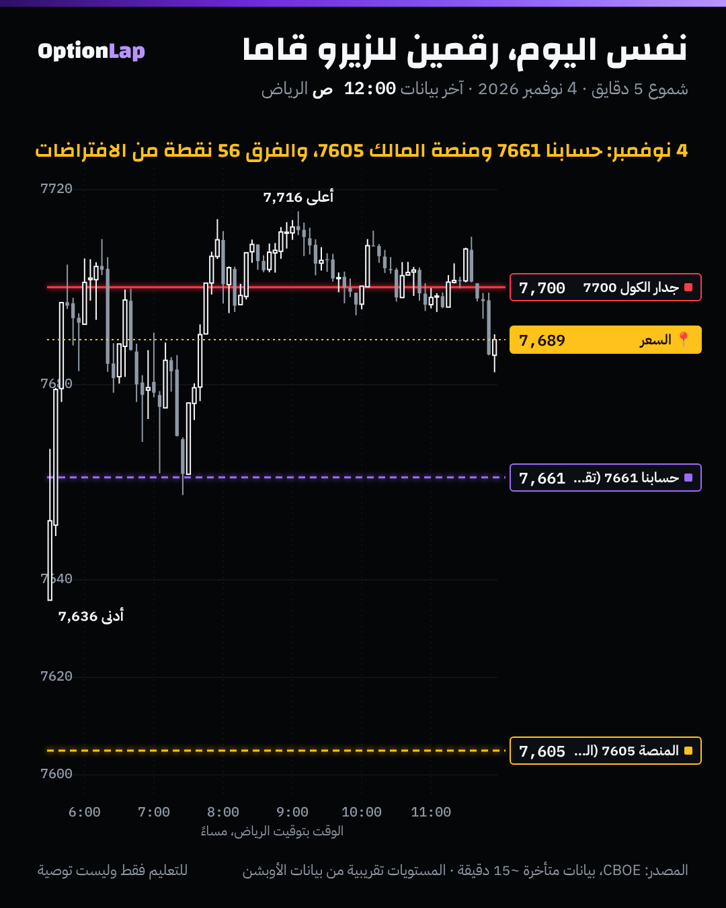

# 3.2 الـGEX بعمق: الحساب، والافتراضات، وحدوده (وليش أداتنا «تقريبية»)

> للتعليم فقط وليست توصية.

## الحساب (`team/tools/gex.py`)
لكل عقد في السلسلة:

  GEX = القاما × العقود المفتوحة × 100 × السعر² × 1%

- **الكول بإشارة +، والبوت بإشارة −.**
- النتيجة بالدولار: **كم يحتاج صانع السوق يشتري أو يبيع لكل حركة 1%**.
- نجمعها لكل سترايك، وبعدها نطلّع:
  - **مقاومة الكول:** أكبر GEX موجب فوق السعر.
  - **الجدران تحت:** أكبر GEX سالب.
  - **صافي القاما:** يحدد النظام، موجب أو سالب.
- **الزيرو قاما (`zero_gamma.py`):** نعيد حساب القاما ببلاك-شولز على أسعار افتراضية ±6%، وندوّر وين يتقلب صافي القاما من سالب لموجب.

## الافتراضات (وكل واحد منها ممكن يغلط)
1. **إشارة الكول والبوت:** نفترض إن العملاء يشترون البوت ويبيعون الكول، يعني صناع السوق قصيرين بوت وطويلين كول. **هذا عرف مو حقيقة.** العقود المفتوحة ما تقول مين اشترى ومين باع، وبعض المنصات تستنتج الجهة من بيانات التنفيذ بدال هالعرف.
2. **العقود المفتوحة تتحدّث مرة باليوم:** الرقم من بداية اليوم. وعقود 0DTE اللي تنفتح وتنقفل **نفس اليوم** (جزء كبير من تداولها) **ما تظهر** في الحساب أبداً.
3. **التذبذب والقاما من CBOE متأخرة** حوالي 15 دقيقة، ومحسوبة بنموذجهم.
4. **أي تواريخ انتهاء تختار يغيّر كل شي:** مثال من ملف الجمعة 6 نوفمبر:
   - عقود الاثنين بس: مقاومة الكول **7425** (+379 مليون).
   - كل العقود: ما فيه GEX موجب فوق السعر أصلاً. وأعلى قيمة **7590** وهي **سالبة** (−97 مليون).
5. **SPX بس:** ما نحسب أوبشن SPY ولا ES، مع إن التحوّط يتوزّع عليها.
6. **صناع السوق مو كتلة وحدة:** بعضهم يتحوّط بأوبشن ثانية، أو ما يتحوّط بالكامل.

## مثال بالأرقام: الفرق مع منصة المالك
| اليوم | منصة المالك (MenthorQ) | حسابنا (عقود اليوم) | الفرق | حسابنا (كل العقود) |
|---|---|---|---|---|
| 3 نوفمبر | 7555 | 7604 | **+49** | 7648 |
| 4 نوفمبر | 7605 | 7661 | **+56** | 7688 |

- **متوسط الفرق +52.5 نقطة**، وثابت تقريباً. والسبب الأرجح اختلاف الافتراضات: الإشارة، أو مصدر العقود المفتوحة، أو طريقة الحساب.
- **القاعدة عندنا:** رقم المالك هو المرجع، وحسابنا يُكتب «تقريبي» دايماً.

## تطبيق على الشارت: 4 نوفمبر

**قراءتي:**
- لو اعتمدنا رقمنا (7661)، كنا بنقول إن السعر «قريب من الزيرو قاما» أغلب اليوم، فالنظام غير واضح.
- برقم المنصة (7605)، السعر فوقه بحوالي 100 نقطة، يعني نظام موجب وواضح.
- **واليوم مشى فعلاً كنظام موجب:** 5 ساعات حول جدار 7700.
- يعني **الافتراض يغيّر القرار**، مو بس الرقم.

## الربط بطريقتنا
- **الجدران (أماكن أكبر GEX)** أقل حساسية للافتراضات من **الزيرو قاما**. السترايك الكبير يظل كبير حتى لو تغيّرت الإشارة شوي. أما نقطة تقلب الإشارة فتتحرك كثير.
- **عشان كذا:** نرسم الجدران من حسابنا، بس **النظام (الزيرو قاما) من منصة المالك**.
- **مع الأخبار الكبيرة** (تضخم، فيدرالي)، التحوّط ممكن ينغلب، والجدران تنكسر حتى في نظام موجب.

## باك تست وإحصائيات
- **الفرق بين حسابنا ورقم المنصة:** n=2، متوسط +52.5 نقطة (+49 و+56). **العيّنة صغيرة، النتيجة غير موثوقة.** نحتاج لقطة يومية من المالك عشان نحسب تصحيح ثابت.
- **حساسية اختيار التواريخ:** حالة وحدة (6 نوفمبر). مقاومة الكول 7425 لعقود الاثنين، وما فيه مقاومة موجبة لكل العقود.
- **ما فيه اختبار تاريخي** لقوة الجدران، لأن ما عندنا أرشيف سلاسل أوبشن قديمة. الأرشفة اليومية (`archive_day.py`) بدأت 2 نوفمبر.

## الأخطاء الشائعة
1. تتعامل مع رقم GEX كأنه حقيقة مؤكدة.
2. تقارن مستويات منصتين بدون ما تعرف افتراضات كل وحدة.
3. تنسى إن عقود 0DTE اللي انفتحت اليوم ما تظهر.
4. تخلط بين «كل العقود» و«عقود اليوم» في نفس الخطة.
5. تعتمد على GEX وقت خبر كبير.

## أسئلة مع إجاباتها
1. **ليش رقمنا للزيرو قاما أعلى من المنصة بحوالي 50 نقطة؟** لأن الافتراضات تختلف: إشارة الكول والبوت، ومصدر العقود المفتوحة وتوقيتها، وطريقة الحساب.
2. **وش أكبر نقطة ضعف في GEX لعقود اليوم؟** العقود المفتوحة تتحدّث مرة باليوم، فصفقات 0DTE اللي تنفتح وتنقفل نفس اليوم ما تظهر.
3. **ليش نأخذ الجدران من حسابنا والنظام من المنصة؟** لأن السترايك الكبير ثابت مع الافتراضات، أما نقطة تقلب الإشارة فحساسة جداً لها.

## المصادر
- [LuxAlgo: Gamma Exposure](https://www.luxalgo.com/library/concept/gamma-exposure.md)
- [Options Analysis Suite: Gamma Exposure documentation](https://www.optionsanalysissuite.com/documentation/gamma-exposure)
- [SpotGamma: What is GEX](https://spotgamma.com/what-is-gex-gamma-exposure/)
- [Moomoo: GEX, dealer hedging flows and key levels](https://www.moomoo.com/us/learn/gamma-exposure-gex-understanding-dealer-hedging-flows-and-key-levels)
- ملفاتنا: `zero-gamma.md`، و`benchmarks/2026-11-03-compare.md`، و`team/data/gex/2026-11-06.txt`.
