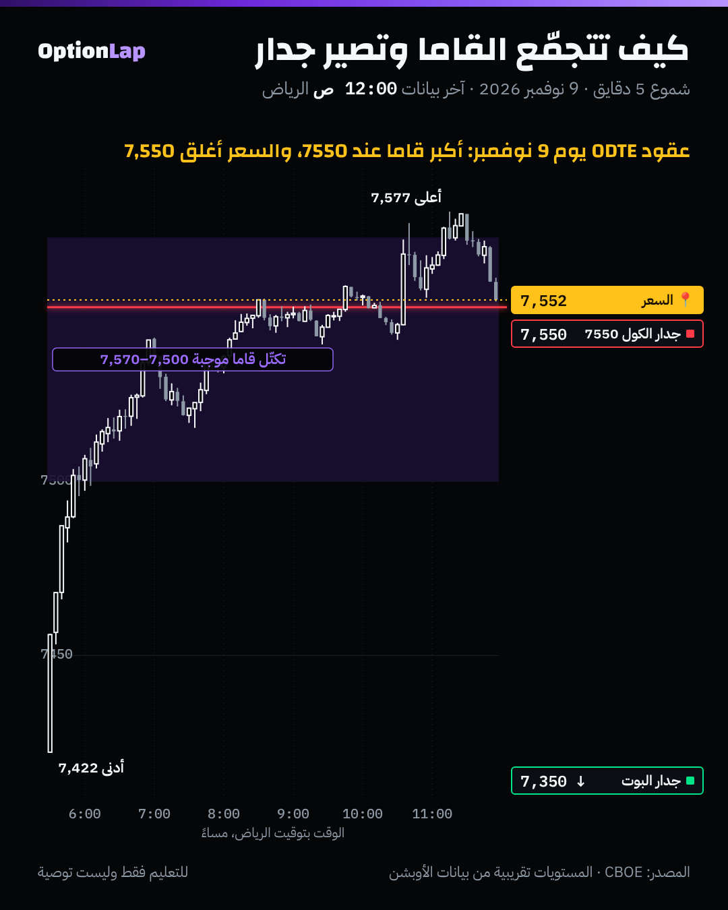

# 4.9 كيف تتجمّع يونانيات صناع السوق وتصير «جدران»

> للتعليم فقط وليست توصية.

## الشرح
- **العقد الواحد ما يسوي جدار.** الجدار يصير لما تتكدّس **عقود مفتوحة كثيرة** عند سترايك واحد، وصناع السوق ماسكينها، ولازم يتحوّطون عليها.
- **الخطوات:**
  1. **لكل عقد:** القاما (من بلاك-شولز) × العقود المفتوحة × 100 = كم تتغير دلتا صناع السوق لكل نقطة.
  2. **نضرب في السعر² × 1%:** فيطلع لنا كم دولار لازم يشترون أو يبيعون لو تحرك السعر 1% (الـGEX).
  3. **نجمع لكل سترايك:** الكول بإشارة +، والبوت بإشارة − (هذا **عرف**، مو حقيقة).
  4. **نجمع كل السترايكات:** يطلع صافي القاما، يعني النظام موجب أو سالب.
  5. **نحرّك السعر افتراضياً** ونعيد الحساب: وين يتقلب الصافي من سالب لموجب؟ هذي **الزيرو قاما**.
- **ليش يتصرف كجدار؟**
  - في **قاما موجبة**: لما يقرب السعر من سترايك عليه قاما كبيرة، صانع السوق يبيع الصعود ويشتري النزول، فالسعر «ينحبس» حوله.
  - في **قاما سالبة**: يصير العكس. صانع السوق يطارد السعر، والجدار ممكن ينكسر بقوة.
- **اليونانيات الثانية تحرّك الجدار:**
  - **الكلر والتشارم (الوقت):** جدار 0DTE عند السعر يقوى كل ساعة، والبعيد يذوب (`third-order-greeks.md` و`charm.md`).
  - **الزوما والفانا (التذبذب):** تذبذب عالي يفرطح القاما ويضعف الجدران (`vanna.md`).
  - **أي انتهاء تجمع؟** جدار عقود اليوم غير جدار الأسبوع كله. وهذا يغيّر الصورة كلها (شوف المثال تحت).
- **الحدود:** العقود المفتوحة ما تقول مين اشترى ومين باع، وتتحدّث مرة باليوم. وعقود 0DTE اللي تنفتح وتنقفل نفس اليوم ما تظهر. والمصادر نفسها تختلف في الإشارة. فلهذا رقم **MenthorQ عند المالك هو المرجع**، وأداتنا تقريب.

## مثال بالأرقام: 9 نوفمبر، عقود 0DTE (`chain_walls.py`، جديد)
- **المدخلات:**
  - العقود المفتوحة لعقود انتهاء 9 نوفمبر: تتحدّث الليل، فهي **معروفة عند الافتتاح** وما فيها نظر للمستقبل.
  - القاما محسوبة ببلاك-شولز عند سعر الافتتاح **7,422**، بتذبذب VIX أمس (**25.64%**)، وباقي 6.5 ساعات.

| السترايك | GEX (مليون دولار لكل 1%) | العقود المفتوحة (كول / بوت) |
|---|---|---|
| **7,550** | **+673** (أكبر رقم) | 7,185 / 826 |
| 7,350 | **−645** | 1,673 / 5,922 |
| 7,500 | +352 | 5,095 / 2,746 |
| 7,515 | +347 | 2,765 / 235 |
| 7,570 | +340 | 4,401 / 532 |

- **صافي القاما عند الافتتاح:** **+2.1 مليار** (موجب). والزيرو قاما تقريباً **7,350–7,365**.
- **جدار الكول:** 7,550. **وجدار البوت:** 7,350.
- **ولو جمعنا كل انتهاءات الأسبوع** (من لقطة الإغلاق): أكبر الأرقام صارت **سالبة** عند 7,510 و7,520، والصافي سالب. نفس السوق، بس **الصورة تنقلب** حسب وش تجمع. وهذا ليش لازم تعرف المنصة وش تحسب.

## تطبيق على الشارت: 9 نوفمبر

- **الافتتاح 7,422** فوق الزيرو قاما (حوالي 7,355)، يعني نظام **موجب** على عقود اليوم.
- السعر صعد لين منطقة القاما الموجبة الكبيرة (7,500–7,570) ووقف فيها حوالي ساعتين حول **7,550**.
- اخترق لين **7,577** (فوق 7,570) وما ثبت، ورجع **أغلق 7,550 بالضبط** عند جدار الكول.
- **قراءتي:** هذا يتوافق مع قاعدة المالك في القاما الموجبة: الجدار **يرد** السعر، والاختراق بدون ثبات = رفض. **بس:**
  - لقطة وحدة ويوم واحد.
  - والسترايكات محفوظة ضمن ±3% من سعر **الإغلاق**، فاختيار السترايكات فيه نظر للمستقبل خفيف. بس جدار 7550 داخل النطاق بأي حال.
  - **العيّنة صغيرة، النتيجة غير موثوقة.**

## باك تست
- **ما فيه باك تست كافي:** عندنا لقطة سلسلة وحدة بس (9 نوفمبر). وأداة `chain_walls.py` جاهزة تعيد الحساب لكل لقطة جديدة يحفظها `archive_day.py`.
- **الخطة (بعد 30 لقطة):**
  - لكل يوم: جدار الكول والبوت لعقود 0DTE عند الافتتاح.
  - نقيس: كم مرة لمس السعر الجدار؟ ولما لمسه، كم مرة رفض (إغلاق 5 دقايق راجع، حسب قاعدة المالك)؟ وكم بعد الإغلاق عن الجدار، مقارنة بأقرب سترايك 25 (الأساس)؟
  - ونقسمها حسب النظام: موجب أو سالب.

## الربط بالقاما
- هذا البند هو «القاما» نفسها على مستوى السوق: من قاما العقد الواحد (`gamma-greek.md`) إلى الـGEX لكل سترايك (`gex-deep.md`) إلى الجدران والزيرو قاما (`walls-hvl.md` و`zero-gamma.md`).
- **قاعدة المالك:** وضع القاما **الإجمالي** من MenthorQ يحدد نوع الصفقة: موجب = ارتداد من الجدار، وسالب = اختراق مع الكسر. والجدران من هالحساب تقول **وين**.

## أخطاء شائعة
1. تاخذ جدار من منصة بدون ما تعرف أي انتهاءات جمعت. عقود اليوم والأسبوع ممكن يعطون صورة معاكسة.
2. تعتبر الجدار «سقف» ثابت. في قاما سالبة ممكن ينكسر بقوة.
3. تنسى إن الإشارة (مين ماسك الكول ومين ماسك البوت) **افتراض**.
4. تستخدم لقطة أمس بعد ما تحرك السعر كثير. الجدار البعيد يذوب مع الوقت والسعر (السبيد والكلر).

## أسئلة وأجوبة
- **س: ليش 7550 كان جدار يوم 9 نوفمبر وليس 7500؟** ج: الاثنين فيهم عقود كثيرة، بس 7550 أقرب للسعر وقت ما وصله، وعليه 7,185 كول مقابل 826 بوت، فصار أكبر GEX موجب.
- **س: وش الفرق بين جدار عقود اليوم وجدار الأسبوع؟** ج: عقود اليوم قاماها أعلى بكثير قرب السعر (الكلر)، فأثرها داخل اليوم أقوى. وعقود الأسبوع تعطي صورة أوسع، وممكن تكون إشارتها معاكسة.
- **س: كيف أعرف إن الجدار «رد» السعر؟** ج: حسب قاعدة المالك: إغلاق 5 دقايق واضح تحت الجدار، مع ذيل خفيف فوقه، في نظام قاما موجب. ونراقب الدلتا والقاما.

## المصادر
- SpotGamma، جدار الكول وجدار البوت: https://spotgamma.com/call-wall-put-wall-explained/
- SpotGamma، تحوّط صناع السوق: https://spotgamma.com/options-dealer-hedging-explained/
- Moomoo Learn، الـGEX وتدفقات التحوّط: https://www.moomoo.com/us/learn/detail-gamma-exposure-gex-understanding-dealer-hedging-flows-and-key-levels-107906-260473079
- FlashAlpha، دليل الـGEX: https://flashalpha.com/articles/complete-guide-trading-gamma-exposure-gex
- البيانات: لقطة سلسلة سباكس من CBOE (`team/data/chain/2026-11-09_SPX.csv.gz`)
- الأداة: `team/tools/chain_walls.py`
