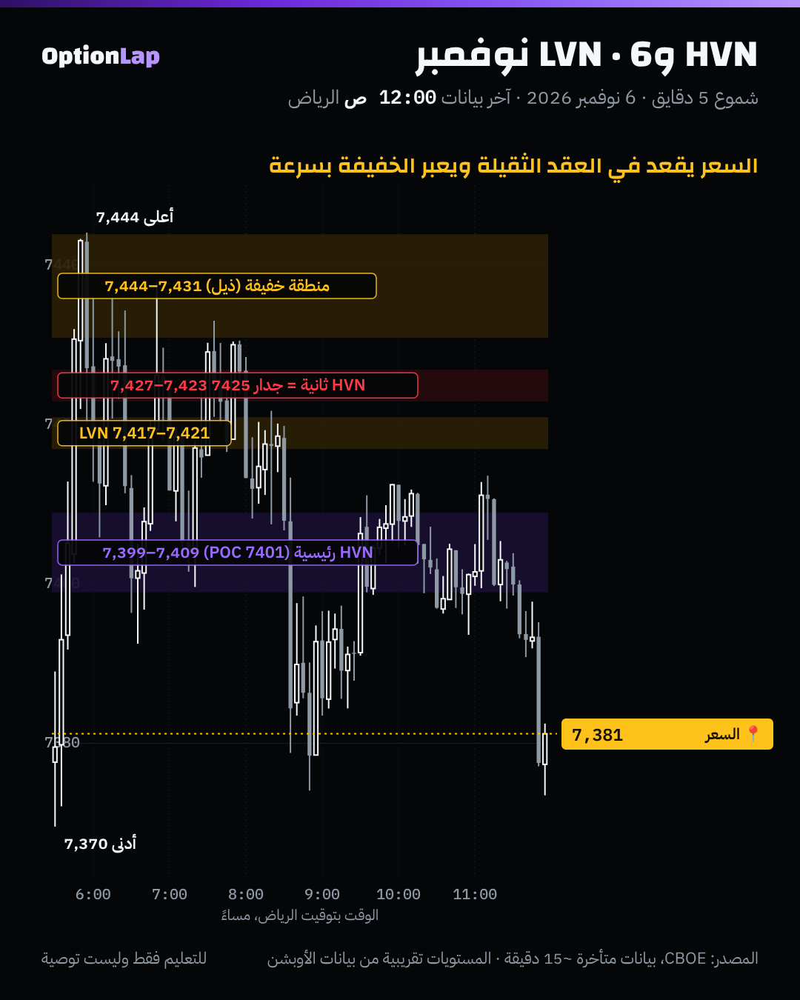

# 2.2 الفوليوم بروفايل بعمق: HVN وLVN، والجلسة ضد النطاق الثابت

> للتعليم فقط وليست توصية.

## الشرح
- **الفوليوم بروفايل:** كم انتداول عند كل سعر، مو كل وقت. ومعه:
  - **الـPOC:** السعر اللي عليه أكثر تداول.
  - **منطقة القيمة:** النطاق اللي فيه حوالي 70% من الحجم.
- **HVN (عقدة حجم عالي):** سعر انتداول عنده كثير. السوق «قبله» واتفق عليه، فالسعر يميل يقعد عنده ويرجع له (مغناطيس)، ويتباطأ فيه.
- **LVN (عقدة حجم منخفض):** وادي بين عقدتين ثقيلتين. السوق «رفضه» ومرّ منه بسرعة. لما يرجع له السعر، غالباً **يعبره بسرعة** أو **يرتد منه**، لأن ما فيه أحد يسنده هناك.
- **أنواع البروفايل:**
  - **الجلسة (Session):** بروفايل لكل يوم لحاله. نستخدمه لمستويات اليوم.
  - **النطاق الثابت (Fixed Range):** تختار البداية والنهاية بنفسك، مثل موجة صعود أو منطقة تجميع. وما يتغيّر لو حرّكت الشارت.
  - **المدى الظاهر (Visible Range):** يتغيّر مع الشاشة، فما نعتمد عليه.

## ملاحظة على بياناتنا
- مؤشر SPX **ما له فوليوم**. الفوليوم الحقيقي يكون على العقود المستقبلية (ES) أو SPY.
- عشان كذا نستخدم **الوقت عند السعر** بدال الحجم: كم دقيقة لمس السعر كل نقطة. هذا بروفايل الوقت (TPO)، وغالباً يعطي عقد قريبة من الفوليوم بروفايل، بس **مو مطابق**.

## مثال بالأرقام: 6 نوفمبر (بروفايل الوقت، نقطة نقطة)
| المنطقة | الدقايق عند السعر (متوسط 5 نقاط) | النوع |
|---|---|---|
| 7399–7409 | 54 إلى 62 | **HVN رئيسية**، والـPOC بالدقايق 7401 |
| 7417–7421 | حوالي 40 | **LVN خفيفة** بين العقدتين |
| 7423–7427 | 44 إلى 46 | **HVN ثانية** |
| 7431–7444 | 2 إلى 23 | منطقة خفيفة (ذيل القمة) |
| 7371–7375 | 2 إلى 9 | منطقة خفيفة (ذيل القاع) |

وحسب tpo.py (فترات 30 دقيقة) الـPOC 7405، ومنطقة القيمة 7392.5 إلى 7430.

## تطبيق على الشارت

**قراءتي:**
1. **الـHVN الثانية (7423–7427) طاحت على جدار القاما 7425.** السعر رجع لها أكثر من مرة وما قدر يقبل فوقها. هذا التقاء: حجم + جدار.
2. **المنطقة الخفيفة فوق 7431 (ذيل):** السعر زارها أول الجلسة بس، ورجع منها بسرعة. هذا رفض.
3. **الـHVN الرئيسية (7399–7409):** السعر رجع لها كثير خلال اليوم، يعني هي «القيمة».
4. **الإغلاق 7,381 تحت الـHVN الرئيسية وقريب من منطقة القاع الخفيفة:** الجلسة الجاية تبدأ تحت القيمة. فأول سؤال: هل يرجع للـHVN (7399–7409)، ولا يقبل تحتها؟

## الربط بالقاما
- **HVN + جدار قاما في نفس المكان = أقوى مستوى**، مثل 7425 يوم 6 نوفمبر.
- **LVN في قاما إجمالية سلبية:** نتوقع السعر يعبرها بسرعة، فتصير فرصة اختراق.
- **LVN في قاما إجمالية إيجابية:** أقرب للارتداد منها.
- **الـHVN مغناطيس، وأكبر دلتا موجبة مغناطيس.** لما يتفقون على مكان واحد يكون هدف قوي.

## باك تست وإحصائيات
- **ما فيه فوليوم حقيقي لـSPX:** الاختبار يكون على بروفايل الوقت، وعندنا 4 أيام دقيقة بس (2 و3 و4 و6 نوفمبر).
- **وصف ليوم واحد:** 6 نوفمبر، الـHVN الثانية التقت مع الجدار 7425، والسعر ما أغلق ولا شمعة 5 دقايق فوق 7431.
- **العيّنة صغيرة، النتيجة غير موثوقة.**
- **الاختبار الجاي لما يتجمّع أرشيف 30 يوم أو أكثر:** هل السعر يقطع الـLVN (من بروفايل أمس) أسرع من الـHVN، بالدقايق لكل نقطة؟ والأداة `archive_day.py` تجمع البيانات يومياً.

## الأخطاء الشائعة
1. تقرأ الفوليوم بروفايل على SPX مباشرة. ما له فوليوم، فاستخدم ES أو SPY، أو بروفايل الوقت.
2. تعتمد على «المدى الظاهر» وهو يتغيّر مع كل تحريك.
3. تسمّي كل سعر قليل الحجم LVN. الـLVN وادي **بين عقدتين ثقيلتين**، وأطراف اليوم اسمها ذيول.
4. تدخل عند الـHVN وتتوقع ارتداد قوي. الـHVN منطقة تباطؤ وتذبذب، مو دايماً جدار.

## أسئلة مع إجاباتها
1. **وش الفرق بين HVN وLVN في سلوك السعر؟** الـHVN السعر يقعد عندها ويرجع لها. والـLVN يعبرها بسرعة أو يرتد منها.
2. **ليش 7425 يوم 6 نوفمبر كان مستوى قوي؟** لأنه HVN وجدار قاما بنفس الوقت.
3. **متى تستخدم النطاق الثابت بدال الجلسة؟** لما تبي تحلّل موجة أو منطقة تجميع معيّنة تمتد أكثر من يوم.

## المصادر
- [TradingView Wiki: Volume Profile](https://www.tradingview.com/wiki/Volume_Profile)
- [TradingView: How to Read Volume Profile Structures](https://ar.tradingview.com/chart/GBPNZD/SQepNTr1-How-to-Read-Volume-Profile-Structures)
- [TradingView: How to trade with Volume Profile / Market Profile](https://pl.tradingview.com/chart/BTCUSDT/TOOCUO3l-How-to-trade-with-Volume-Profile-Market-Profile)
- [LuxAlgo: Fixed Range Volume Profile](https://www.luxalgo.com/library/indicator/4r2CZGol-fixed-range-volume-profile/)
- [Tapeboard: What is volume profile](https://tapeboard.com/blog/glossary-what-is-volume-profile)
