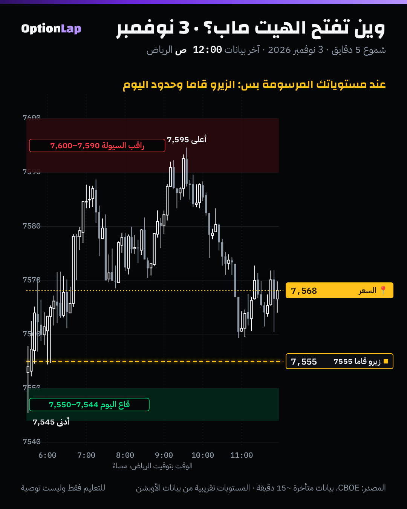

# 2.7 الآيسبيرغ، والسحب والتعبئة (Spoofing / Pulling)، وقراءة الهيت ماب

> للتعليم فقط وليست توصية.

## الشرح
- **الآيسبيرغ (Iceberg):** أمر كبير يظهر منه جزء صغير ثابت، وينفّذ دفعة دفعة لين يكمل أو ينلغى.
  - تستنتجه من **تنفيذ متكرر عند نفس السعر** والعرض يرجع يتجدّد.
  - **مو ممنوع.** الجهات الرقابية الأمريكية تعتبره أمر مشروع بحد ذاته.
- **السحب (Pulling):** أوامر كبيرة تنسحب من الدفتر لما يقرّب لها السعر. ممكن يكون عادي (تاجر غيّر رأيه)، أو جزء من تلاعب.
- **السبوفنق (Spoofing):** تحط أوامر **بنيّة إلغائها قبل التنفيذ**، عشان توهم السوق بطلب أو عرض. **ممنوع قانونياً** في أمريكا من قانون Dodd-Frank (2010) تحت قانون تداول السلع (CEA 4c(a)(5)(C)).
  - نمط شائع في قضايا الـCFTC: آيسبيرغ في جهة، وأوامر ظاهرة كبيرة في الجهة الثانية تنلغى بعد ما ينفّذ الآيسبيرغ.
- **الهيت ماب (Heatmap، مثل Bookmap):** يرسم الأوامر المعلّقة عند كل سعر **مع الوقت**. الألوان الفاتحة أو الحارة تعني سيولة كثيرة، والغامقة تعني سيولة خفيفة. (ألوان كل منصة تختلف، فراجع إعداداتك.)
  - **أهم استخدام:** تفرّق بين سيولة **تنفّذ** فعلاً (السعر يوصلها ويوقف)، وسيولة **تختفي** قبل ما يوصلها السعر (سحب، وممكن سبوفنق).
- **حدود الهيت ماب:** يبيّن نمط أوامر تظهر وتختفي، بس **ما يثبت النيّة**. إثبات السبوفنق يحتاج بيانات البورصة على مستوى الأمر والتاجر.

## مثال بالأرقام (توضيحي، مو بيانات حقيقية)
- السعر 7,588. وفي الهيت ماب خط سيولة قوي عند 7,595: 1,200 عقد عرض.
- **الحالة أ (حقيقي):** السعر يوصل 7,595، وينفّذ 1,500 عقد شراء والسعر واقف، والخط يتجدّد. هذا آيسبيرغ أو امتصاص، فالمستوى يدافع عنه أحد.
- **الحالة ب (سحب):** السعر يوصل 7,593، والخط عند 7,595 يختفي فجأة، والسعر يعبره بسرعة. هذا سحب، فالمستوى «وهمي»، ولا تعتمد عليه.

## تطبيق على الشارت: 3 نوفمبر

**قراءتي:**
- ما عندنا هيت ماب ولا دفتر أوامر. فالتطبيق هنا هو **وين تفتحه**: عند المستويات المرسومة من الصبح بس، مو طول الجلسة.
- **3 نوفمبر:**
  - القمة 7,595: السعر جرّبها مرتين ورجع. هنا تسأل: هل السيولة فوق تتجدّد (آيسبيرغ أو دفاع)، ولا تنسحب؟
  - الزيرو قاما 7555 من المنصة: السعر قعد فوقه طول اليوم.
  - القاع 7,545: لمسه أول الجلسة بس.
- **النتيجة:** يوم داخلي هادي فوق الزيرو قاما. وهذا يتماشى مع إن السيولة عند الحدود كانت تدافع (ارتداد مرتين من القمة).

## الربط بالقاما
- **جدار القاما = وين تتوقع سيولة كبيرة في الهيت ماب.** صناع السوق اللي يتحوّطون عندهم أوامر حقيقية عند الجدار.
- **قاما إجمالية إيجابية:** نتوقع السيولة عند الجدران **تتجدّد** (دفاع)، فالارتداد أرجح.
- **قاما إجمالية سلبية:** نتوقع السيولة **تنسحب** لما يقرّب السعر (صناع السوق يتحوّطون مع الحركة)، فالكسر أسهل.
- إذا الهيت ماب يبيّن سحب عند جدار في قاما إيجابية، هذا تحذير إن الجدار ممكن ما يمسك اليوم.

## باك تست وإحصائيات
- **غير قابل للاختبار ببياناتنا:** يحتاج دفتر أوامر تاريخي على مستوى الأمر (Market by Order) لـES، ومو متوفر مجاناً.
- ما فيه رقم جديد في STATS. والتطبيق كان وصفي على 3 نوفمبر.

## الأخطاء الشائعة
1. تعتمد على خط سيولة كبير كأنه جدار مضمون. ممكن ينسحب قبل ما يوصله السعر.
2. تتهم أي أمر ينسحب إنه سبوفنق. السحب العادي يصير كثير، والسبوفنق يحتاج إثبات نيّة.
3. تقرأ ألوان الهيت ماب بدون ما تعرف إعدادات منصتك.
4. تراقب الهيت ماب طول الجلسة وتغرق في التفاصيل. الصح عند مستوياتك بس.
5. **(قاعدة أخلاقية):** ولا مرة تعلّم الطلاب يحطون أوامر بنيّة إلغائها. هذا ممنوع قانونياً.

## أسئلة مع إجاباتها
1. **وش الفرق بين الآيسبيرغ والسبوفنق؟** الآيسبيرغ أمر حقيقي ينفّذ ومخفي حجمه، وهو مشروع. والسبوفنق أوامر بنيّة الإلغاء، وهو ممنوع.
2. **خط سيولة كبير اختفى لما قرّب السعر. وش تستنتج؟** إنه سحب. المستوى مو مدافع عنه، فلا تعتمد عليه كجدار.
3. **وين تتوقع أكبر سيولة حقيقية في الهيت ماب؟** عند جدران القاما، لأن تحوّط صناع السوق يتركّز هناك.

## المصادر
- [Bookmap: Heatmap in Trading, Complete Guide](https://bookmap.com/blog/heatmap-in-trading-the-complete-guide-to-market-depth-visualization)
- [Bookmap Learning Center: Heatmap overview](https://bookmap.com/learning-center//getting-started/liquidity-heatmap/heatmap-overview)
- [Bates White: An Update On Spoofing And Its Challenges](https://www.bateswhite.com/media/publication/156_An_Update_On_Spoofing_And_Its_Challenges.pdf)
- [CFTC: Order (2023, Adams/Cobb)](https://cftc.gov/media/9091/enfadamcobbwebborder080123/download)
- [King & Spalding: Spoofing, US Law and Enforcement](https://www.kslaw.com/attachments/000/007/109/original/Spoofing_US_Law_and_Enforcement.pdf)
- [JD Supra: High-Speed Trader Indicted for Spoofing](https://www.jdsupra.com/legalnews/high-speed-trader-indicted-for-spoofing-87145)
