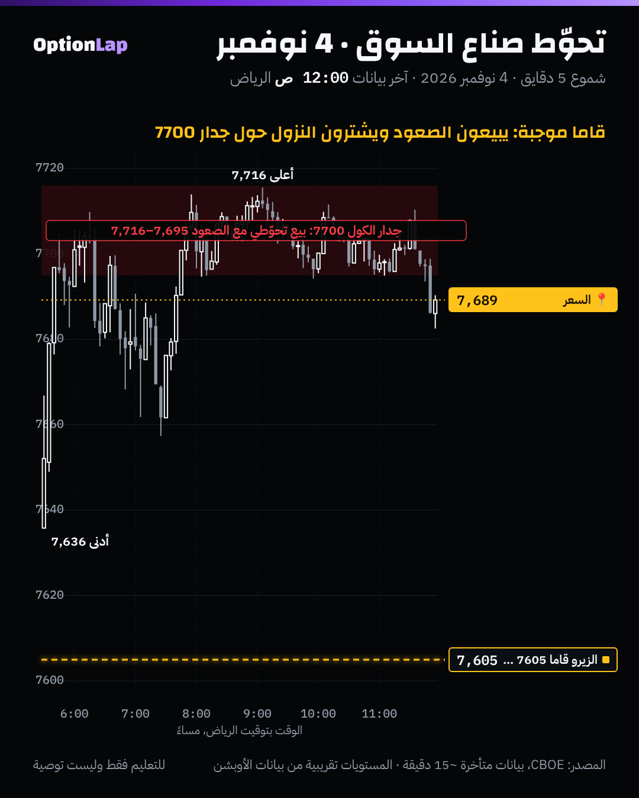

# 3.1 صناع السوق: ليش يتحوّطون، وكيف

> للتعليم فقط وليست توصية. فاتحة المسار 3 (القاما والأوبشن بعمق).

## الشرح
- **ليش يتحوّطون؟** صانع السوق يوفّر السيولة: يبيع لك العقد اللي تبي تشتريه، ويشتري اللي تبي تبيعه. هو **ما يبي يراهن على الاتجاه**. هدفه يربح من الفرق بين سعر الشراء والبيع (السبريد)، فلازم يلغي مخاطرة الاتجاه.
- **كيف؟ تحوّط الدلتا:** يشتري أو يبيع الأصل نفسه (SPX عن طريق ES أو SPY أو السلة) لين تصير محفظته **محايدة للدلتا**.
  - **مثال:** باع لك 10 كولات دلتا كل واحد 0.40، يعني صار قصير 4 «وحدات». فيشتري 4 وحدات من الأصل.
- **ليش يعدّل باستمرار؟ القاما:** الدلتا تتغيّر مع حركة السعر.
  - إذا هو **قصير قاما** (باع عقود): كل ما صعد السعر زادت دلتا الكولات اللي باعها، فيضطر **يشتري أكثر مع الصعود**، ويبيع مع النزول. وهذا يكبّر الحركة.
  - إذا هو **طويل قاما** (اشترى عقود): العكس. **يبيع مع الصعود ويشتري مع النزول**، وهذا يهدّي الحركة.
- **الأسهم ما تلغي القاما.** تحوّط القاما نفسها يحتاج عقود أوبشن ثانية، لأن الأسهم ما فيها «انحناء».
- **التأثير على السوق كله (محل نقاش):** وضع القاما الإجمالي عند صناع السوق يحدد هل التحوّط يهدّي السوق ولا يسرّعه. وهذا بالضبط أساس طريقتنا. بس انتبه: «موقع صناع السوق» **تقدير** من العقود المفتوحة، مو شي نشوفه مباشرة.

## مثال بالأرقام: 4 نوفمبر
- السعر فوق الزيرو قاما 7605 (من منصة المالك)، يعني نظام قاما **موجبة**.
- جدار الكول 7700: صناع السوق تحوّطهم عنده يعاكس الحركة.
- **اللي صار:** السعر وصل 7700 الساعة 6:30 م تقريباً، وقعد **حوالي 5 ساعات** يتذبذب بين 7,695 و7,716. كل صعود ينباع، وكل نزول ينشرى.
- وأغلق 7,689، يعني تحت الجدار بـ11 نقطة.

## تطبيق على الشارت

**قراءتي:** هذا شكل «السستة» اللي شرحناه في مقطع القاما. السعر انشد للجدار وما قدر يتعدّاه بعيد، لأن البيع التحوّطي مع الصعود يقابله، والشراء التحوّطي مع النزول يرجّعه.

## باك تست: هل فيه «تثبيت» (Pinning) يوم الانتهاء الشهري؟ (`bt_daily.py opex`، جديد)
- **الفكرة:** لو التحوّط يشد السعر لسترايكات كبيرة، نتوقع يوم انتهاء العقود الشهرية (الجمعة الثالثة) يكون **مداه أصغر**، وإغلاقه **أقرب** لسترايك (مضاعفات 25).
- لو الإغلاق عشوائي، متوسط المسافة لأقرب سترايك 25 يكون **6.25 نقطة**.

| الفترة | الأيام | n | متوسط المدى | المسافة لأقرب سترايك 25 (المتوسط / الوسيط) |
|---|---|---|---|---|
| 2014 لين 2026 | جمعة الانتهاء الشهري | 149 | 1.034% | 6.02 / 5.81 |
| 2014 لين 2026 | باقي الجُمع | 498 | 1.105% | 6.25 / 6.43 |
| 2023 لين 2026 | جمعة الانتهاء الشهري | 44 | 0.971% | 6.42 / 7.30 |
| 2023 لين 2026 | باقي الجُمع | 150 | 1.064% | 6.33 / 6.43 |

**القراءة:**
- جمعة الانتهاء **أهدى شوي** (المدى أقل بحوالي 0.07% لـ0.09%)، بس **غير مؤكد** (t=−0.97، ومن 2023 t=−1.06).
- **ما فيه تثبيت واضح** على السترايكات في الإغلاق اليومي (t=−0.67، ومن 2023 t=+0.14).
- **ليش؟** من 2022 صار فيه عقود تنتهي **كل يوم** (0DTE)، فيوم الانتهاء الشهري ما عاد مميز. والتحوّط صار يوزّع تأثيره على كل يوم، وهذا يفسّر ليش نرسم جدران **عقود اليوم**.
- يومي، بدون تكاليف.

## الربط بالقاما (طريقتنا)
- **كل قواعدنا مبنية على هالآلية:** جدار موجب = بيع تحوّطي مع الصعود. وقاما سالبة = تحوّط يلحق الحركة.
- **وضع القاما الإجمالي** هو الجواب على سؤال: «صناع السوق طويلين قاما ولا قصيرين؟»
- **عقود اليوم أهم من الشهرية** في سوق اليوم (نتيجة الاختبار فوق).

## الأخطاء الشائعة
1. تفكر إن صناع السوق «يلعبون ضدك». هم يتحوّطون، وتأثيرهم ميكانيكي مو نيّة.
2. تعتبر تقدير موقعهم (GEX) حقيقة مؤكدة. هو تقدير بافتراضات (البند 3.2).
3. تتوقع تثبيت على السترايك يوم الانتهاء الشهري. الأرقام ما تأكده.
4. تنسى إن التحوّط يصير على ES وSPY والسلة، مو على SPX نفسه.

## أسئلة مع إجاباتها
1. **صانع سوق باع كولات والسعر صعد. وش يسوي؟** يشتري أكثر من الأصل، لأن دلتا الكولات زادت. وهذا قصير قاما ويسرّع الصعود.
2. **ليش قعد السعر 5 ساعات حول 7700 يوم 4 نوفمبر؟** لأنه نظام قاما موجبة عند جدار كول، والتحوّط يبيع الصعود ويشتري النزول.
3. **فيه تثبيت يوم الانتهاء الشهري؟** حسب اختبارنا من 2014، لا (t=−0.67). ومن 2022 العقود اليومية خففت تميّز اليوم الشهري.

## المصادر
- [Global X: Exchange-Traded Options Market Making Explained, Part 2](https://www.globalxetfs.com/articles/etf-education/exchange-traded-options-market-making-explained-part-2)
- [SpotGamma: Options dealer hedging explained](https://spotgamma.com/options-dealer-hedging-explained/)
- [SpotGamma: What is Options Delta Pressure?](https://spotgamma.com/options-delta-pressure-explained/)
- [Option Alpha: Gamma exposure, interview with Tradier](https://optionalpha.com/podcast/gamma-exposure-for-options-traders-interview-w-lex-from-tradier)
- [Real Vision: How delta and gamma hedging moves markets](https://realvision.com/how-delta-and-gamma-hedging-moves-markets)
