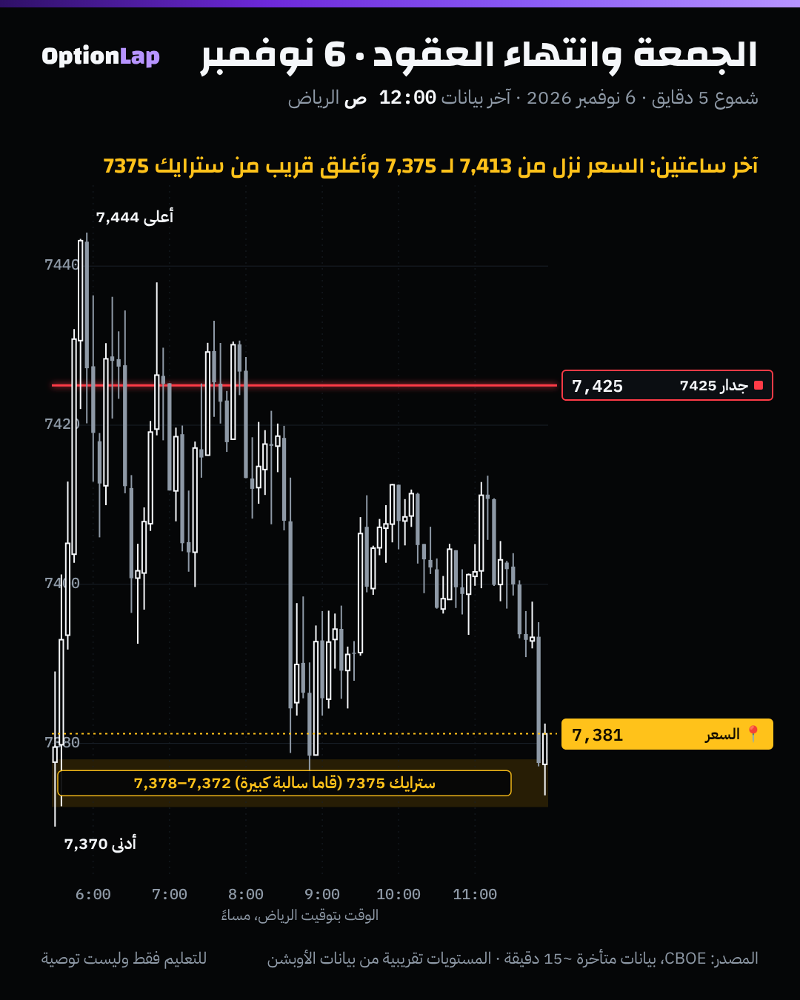

# 3.7 الانتهاء الشهري (OPEX) والـCharm Flows حوله

> للتعليم فقط وليست توصية.

## الشرح
- **OPEX:** انتهاء العقود الشهرية، وهو الجمعة الثالثة من كل شهر. انتهاء نوفمبر 2026 يوم **الجمعة 20 نوفمبر**.
- **الـCharm:** كم تتغيّر الدلتا **مع مرور الوقت** بدون ما يتحرك السعر.
  - كل يوم يقرّب الانتهاء، دلتا العقود البعيدة عن السعر تذوب باتجاه الصفر، والقريبة تتحرك باتجاه 0 أو 1.
  - فصناع السوق يعدّلون تحوّطهم **حسب الساعة**. لهذا يسمّونه «تدفق على الساعة».
- **الـVanna:** كم تتغيّر الدلتا **مع التذبذب الضمني**. حسب الرواية المتداولة، نزول التذبذب يقلّل دلتا العقود البعيدة، فيخلّي صناع السوق يرجّعون (يشترون) جزء من تحوّطهم القصير.
- **الرواية المتداولة:**
  - قبل OPEX، الـCharm والـVanna يخلّون صناع السوق **يشترون** (تدفق داعم).
  - بعد OPEX، العقود تنتهي والتدفق الداعم يختفي، فيصير **«نافذة ضعف» (Window of Weakness)**، والسوق أضعف قدام الأخبار.
- **التحفّظات من المصادر نفسها:**
  - التدفق الداعم **مو مضمون**. يحتاج كولات مشتراة فوق وبوتات مباعة تحت.
  - و«نافذة الضعف» **ما تعني انهيار**.
  - وأغلب الكلام من حسابات تداول ومنصات، مو دراسات محكّمة.

## باك تست: هل الأسبوع بعد OPEX أضعف؟ (`bt_daily.py opex_week`، جديد)
عائد الأسبوع من إغلاق لإغلاق، وأيام SPX من CBOE:

| الفترة | الأسبوع | n | المتوسط | الوسيط | الصعود | t |
|---|---|---|---|---|---|---|
| 2014 لين 2026 | كل الأسابيع | 670 | +0.234% | +0.345% | 57.8% | 2.69 |
| 2014 لين 2026 | **أسبوع OPEX** | 149 | +0.081% | +0.129% | 53.7% | 0.42 |
| 2014 لين 2026 | **الأسبوع بعد OPEX** | 149 | **+0.362%** | +0.548% | **61.1%** | 1.97 |
| 2014 لين 2026 | باقي الأسابيع | 372 | +0.243% | +0.362% | 58.1% | 2.13 |
| 2023 لين 2026 | أسبوع OPEX | 44 | +0.298% | +0.117% | 52.3% | 1.05 |
| 2023 لين 2026 | الأسبوع بعد OPEX | 44 | +0.387% | +0.649% | 63.6% | 1.64 |
| 2023 لين 2026 | باقي الأسابيع | 112 | +0.335% | +0.351% | 58.0% | 1.71 |

**القراءة:**
- **«نافذة الضعف» بعد OPEX ما ظهرت.** الأسبوع بعد OPEX كان **أقوى شوي** من غيره، مو أضعف.
- والفرق **غير مؤكد** إحصائياً: بعد OPEX مقابل الباقي t≈+0.55، وأسبوع OPEX مقابل الباقي t≈−0.73.
- يعني لا تبني صفقة على «الأسبوع بعد الانتهاء ضعيف» لحاله.
- أسبوعي، وبدون تكاليف.

## تطبيق على الشارت: الجمعة 6 نوفمبر (انتهاء أسبوعي، مو شهري)

**قراءتي:**
- آخر ساعتين (من 10:00 م بتوقيت الرياض)، السعر نزل من **7,411** لين **7,373**، وأغلق **7,381** قريب من سترايك **7375** (قاما سالبة كبيرة في لقطة الليل).
- **التحفّظ:** هذا انتهاء أسبوعي، واللقطة بعد الإغلاق. فما نقدر نقول إن الـCharm هو السبب. حالة وحدة.
- **انتهاء نوفمبر الشهري (20 نوفمبر)** بيكون أول اختبار حقيقي عندنا: نأخذ لقطة GEX الصبح، ونراقب آخر ساعتين.

## الربط بالقاما (طريقتنا)
- **أسبوع OPEX:** الجدران الشهرية (كل العقود) تكون أكبر. وبعد الجمعة الثالثة، جزء كبير منها **يختفي**، فاحسب الجدران من جديد يوم الاثنين.
- **آخر ساعتين في يوم انتهاء:** تدفق الـCharm يشتغل مع الساعة، فتوقّع ميل باتجاه السترايكات الكبيرة في قاما موجبة، وتسارع في قاما سالبة.
- **لا تعامل «نافذة الضعف» كإشارة بيع.** الأرقام ما تأكدها.

## الأخطاء الشائعة
1. تبيع لأن «الأسبوع بعد OPEX ضعيف». الأرقام من 2014 ما تأكد هذا.
2. تخلط الانتهاء الأسبوعي (كل جمعة) بالشهري (الجمعة الثالثة).
3. تنسى تحدّث الجدران بعد OPEX. اللي كان جدار ممكن يكون انتهى.
4. تفسّر كل حركة آخر اليوم بالـCharm بدون بيانات تحوّط في وقتها.

## أسئلة مع إجاباتها
1. **وش الـCharm بكلمة؟** تغيّر الدلتا مع الوقت، فيخلّي صناع السوق يعدّلون تحوّطهم مع الساعة.
2. **هل الأسبوع بعد OPEX أضعف تاريخياً؟** لا. من 2014 كان +0.362% (61% صعود) مقابل +0.243% للباقي، والفرق غير مؤكد.
3. **وش تسوي يوم الاثنين بعد OPEX؟** تعيد حساب الجدران، لأن جزء كبير من العقود الشهرية انتهى.

## المصادر
- [LuxAlgo: Vanna/Charm Flows](https://www.luxalgo.com/library/concept/vanna-charm-flows/)
- [Options Analysis Suite: What is Charm Flow?](https://www.optionsanalysissuite.com/documentation/charm-flow)
- [FlashAlpha: Charm Exposure (CHEX)](https://flashalpha.com/concepts/chex)
- [Investing.com (Acheron Insights): S&P 500, welcome to the window of weakness](https://www.investing.com/analysis/sp-500-welcome-to-the-window-of-weakness-200641914)
- [VolSignals: TGIF](https://volsignals.substack.com/p/tgif)
- [SpotGamma (2021)](https://spotgamma.com/spotgamma-1-18-21/)
