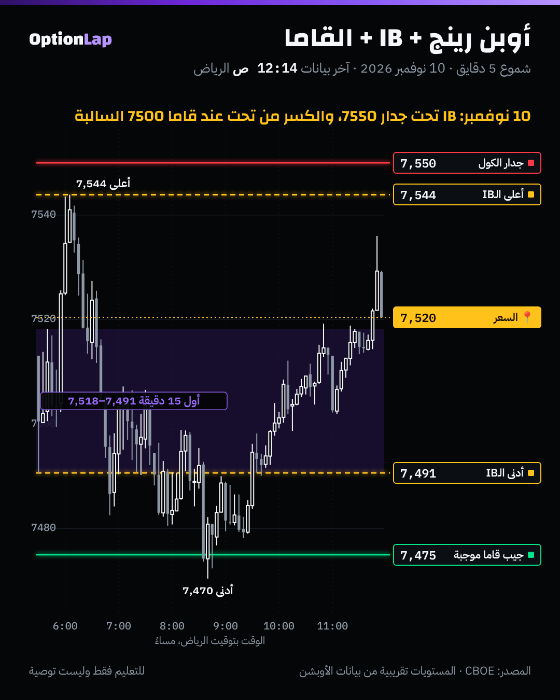

# 5.3 أوبن رينج + Initial Balance + القاما

> للتعليم فقط وليست توصية.

## الشرح
- **الأوبن رينج (OR):** أعلى وأدنى سعر في أول 5 أو 15 أو 30 دقيقة. يورّيك وين المبادرين دفعوا أول شي.
- **الـIB:** أعلى وأدنى سعر في أول ساعة (5:30 لين 6:30 م بتوقيت الرياض). أول «مزاد» لليوم (`ib.md`).
- **الكسر:** لو السعر طلع برّا الـIB وقعد، هذا امتداد، يعني يوم تنوّع طبيعي أو ترند. ولو رجع داخل، هذا رفض، يعني يوم طبيعي.
- **وين القاما؟**
  - **الجدار جنب حد الـIB:** في قاما **موجبة**، الحد + الجدار = رفض قوي. وفي قاما **سالبة**، الحد + القاما السالبة = نقطة كسر.
  - **النظام يقول وش تتوقع من الكسر:** سالب = الكسر يكمّل لين الجيب الجاي. موجب = الكسر ضعيف وممكن يرجع.
- **من الأبحاث المنشورة:**
  - دراسة Zarattini وAziz (2023) على QQQ: كسر أوبن رينج 5 دقايق طلع أحسن من الشراء والاحتفاظ **قبل التكاليف**، من 2016 لين 2023. وأحد الكتّاب مرتبط بشركة تداول.
  - **إعادة مستقلة** على 5 مؤشرات: النتيجة **قبل** التكاليف تتكرر، بس **بعد التكاليف تقريباً صفر**.
  - **الدرس:** الكسر لحاله ممكن يكون له ميزة صغيرة، والتكاليف تاكلها. فلازم فلتر، والقاما ممكن تكون هالفلتر.

## مثال بالأرقام: 6 أيام مؤرشفة (`bt_intraday.py ib` + النظام من ملخص الصبح)
| اليوم | النظام (حسابنا) | أول 15 دقيقة ÷ الـIB | أول كسر للـIB | الوقت (الرياض) | الإغلاق ضد نص الـIB | الامتداد ÷ الـIB |
|---|---|---|---|---|---|---|
| 2 نوفمبر | موجب | 26% | **تحت** | 8:31 م | تحت ✅ | 1.36 |
| 3 نوفمبر | سالب | 75% | **فوق** | 6:41 م | فوق ✅ | 0.88 |
| 4 نوفمبر | سالب | 82% | **فوق** | 7:55 م | فوق ✅ | 0.08 |
| 6 نوفمبر | (ما فيه) | 58% | ما كسر | | | 0 |
| 9 نوفمبر | سالب | 68% | **فوق** | 6:31 م | فوق ✅ | 0.61 |
| 10 نوفمبر | سالب | 52% | **تحت** | 6:51 م | فوق ❌ | 0.38 |

- **ولا يوم كسر الطرفين.** وفي **4 من 5** أيام كسر، الإغلاق كان بنفس جهة أول كسر.
- **أكبر امتداد** (1.36) كان بعد أضيق أول 15 دقيقة (26% من الـIB)، يوم 2 نوفمبر.
- **العيّنة صغيرة، النتيجة غير موثوقة** (n=6). وما نقدر نفصل أثر النظام لأن 4 من 5 أيام سالبة.

## تطبيق على الشارت: 10 نوفمبر

- **أول 15 دقيقة:** 7,491 لين 7,518. **والـIB:** 7,491 لين 7,544.
- **فوق:** أعلى الـIB (7,544) **تحت جدار الكول 7550 بست نقاط**. السعر ما قدر يوصل الجدار.
- **تحت:** أدنى الـIB (7,491) **تحت قاما 7500 السالبة**. ولما انكسر الساعة 6:51 م، مشى لين **7,470** (جيب 7475)، يعني 21 نقطة تحت الـIB.
- **آخر اليوم:** رجع داخل الـIB وأغلق 7,520 فوق النص. هذا اليوم الوحيد اللي الإغلاق فيه عكس الكسر.
- **قراءتي:** الجدران حددت حدود الـIB نفسه (سقف 7550، وقاما سالبة 7500). والكسر في نظام سالب مشى للجيب الجاي وبس.

## باك تست
- **ما فيه باك تست طويل:** الأوبن رينج والـIB يحتاجون شموع داخل اليوم، وعندنا 6 أيام بس من CBOE.
- **الخطة:**
  - **لما يوصل الأرشيف 30 يوم:** نختبر الكسر الأول للـIB حسب النظام (موجب ضد سالب) وحسب قرب الجدار من حد الـIB.
  - **المقياس:** الحركة بعد الكسر بـ30 دقيقة، والإغلاق، **بعد تكلفة تقديرية**.
  - **الأساس:** كل الكسرات بدون فلتر.

## الربط بالقاما وقاعدة المالك
- **قبل الافتتاح:** حدّد الجدار القريب والنظام.
- **بعد أول ساعة:** شوف وين الـIB بالنسبة للجدران:
  - **حد الـIB عند جدار + نظام موجب:** خطة ارتداد. وهنا قاعدة المالك: إغلاق 5 دقايق راجع مع ذيل.
  - **حد الـIB عند قاما سالبة + نظام سالب:** خطة كسر. إغلاق 5 دقايق برّا، والهدف الجيب الجاي، مو «لين ما يوقف».
- **أول 15 دقيقة ضيّقة (أقل من ثلث الـIB):** احتمال الامتداد أكبر، بحذر لأن n صغير.

## أخطاء شائعة
1. تدخل كسر الأوبن رينج بدون فلتر. الأبحاث تقول الميزة بعد التكاليف قريبة من صفر.
2. تدخل قبل ما تخلص أول ساعة في يوم أخبار. 10 نوفمبر أول ساعة طلعت 7,544 وبعدها انقلبت.
3. تتوقع الكسر يكمّل بلا حدود. في 10 نوفمبر وقف عند الجيب الجاي (7475) ورجع.
4. تتجاهل الجدار اللي جنب حد الـIB. هو اللي يقرر رفض ولا كسر.

## أسئلة وأجوبة
- **س: ليش أول ساعة مهمة؟** ج: لأنها أول مزاد لليوم. والكسر بعدها يقول لك هل فيه مبادرين يدفعون السعر لقيمة جديدة.
- **س: هل كسر الأوبن رينج مربح؟** ج: الدراسات تقول قبل التكاليف نعم، وبعدها تقريباً صفر. فنحتاج فلتر مثل النظام والجدار.
- **س: وش صار عند حد الـIB يوم 10 نوفمبر؟** ج: فوق كان جدار 7550 (ما وصله). وتحت كانت قاما 7500 السالبة، فلما انكسر مشى 21 نقطة لين جيب 7475، وبعدها رجع.

## المصادر
- Zarattini وAziz (2023)، «Can Day Trading Really Be Profitable?»: https://papers.ssrn.com/abstract=4416622
- ملخص البحث وتحفّظاته (CXO Advisory): https://www.cxoadvisory.com/technical-trading/day-trading-with-an-opening-range-breakout-strategy
- إعادة مستقلة على 5 مؤشرات (قبل التكاليف يتكرر، وبعدها صفر): https://www.mql5.com/en/blogs/post/776235
- Zarattini وBarbon وAziz، توسيع على أكثر من 7,000 سهم: https://concretumgroup.com/a-profitable-day-trading-strategy-for-the-u-s-equity-market/
- البيانات: CBOE (`team/data/intraday/`)، والأدوات `bt_intraday.py ib` و`chain_walls.py`
