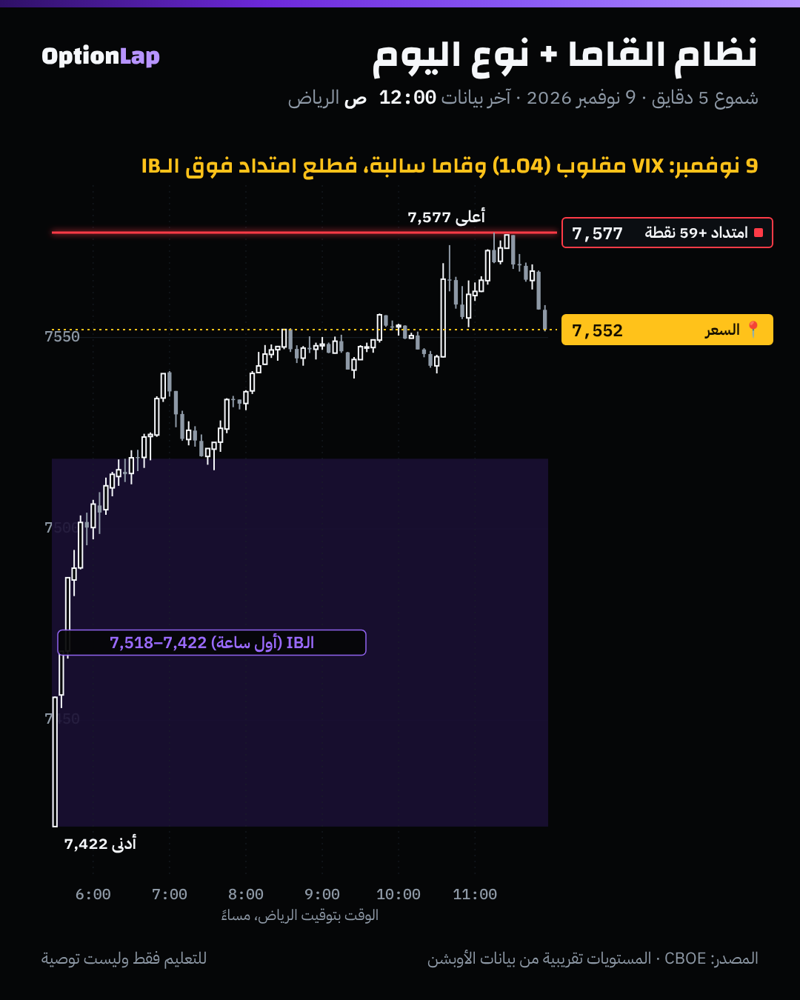

# 5.2 نظام القاما + نوع اليوم في نظرية المزاد

> للتعليم فقط وليست توصية.

## الشرح
- **أنواع الأيام (Dalton، بتعريف تقريبي):**
  - **طبيعي:** أول ساعة (الـIB) واسعة، واليوم كله تقريباً داخلها.
  - **تنوّع طبيعي:** طرف واحد يمتد برّا الـIB.
  - **ترند:** IB ضيّق، وامتداد بجهة وحدة، والإغلاق عند الطرف.
  - **محايد:** امتداد بالجهتين.
  - المصادر تختلف بالنسب والتعريفات الدقيقة. والمرجع الأصلي كتب Dalton (`day-types.md`).
- **وين القاما؟** النظام يقول لك **أي نوع يوم أرجح**:
  - **قاما موجبة:** صانع السوق يعاكس الحركة، فالأرجح يوم **طبيعي أو توازن**: الـIB يمسك، والأطراف ترد السعر.
  - **قاما سالبة:** صانع السوق يمشي مع الحركة، فالأرجح **امتداد**: تنوّع طبيعي أو ترند.
- **الاستخدام:** قبل الافتتاح تعرف النظام. بعد أول ساعة تعرف الـIB. **ونوع اليوم المتوقع يحدد الخطة:**
  - يوم طبيعي: تداول من أطراف الـIB للداخل (ارتداد).
  - يوم امتداد: انتظر كسر الـIB وامشِ معه (اختراق).
  - وهذا نفس منطق قاعدة المالك.

## مثال بالأرقام: الـ6 أيام المؤرشفة (`bt_intraday.py daytype` + النظام من ملخص الصبح)
| اليوم | نظام عقود اليوم (الصبح) | نوع اليوم | الامتداد ÷ الـIB |
|---|---|---|---|
| 2 نوفمبر | موجب (+448M) | تنوّع طبيعي هابط | **1.36** |
| 3 نوفمبر | سالب | تنوّع طبيعي صاعد | 0.88 |
| 4 نوفمبر | سالب | طبيعي | 0.08 |
| 6 نوفمبر | (ما فيه ملخص، انقطاع) | طبيعي | 0 |
| 9 نوفمبر | سالب | تنوّع طبيعي صاعد | 0.61 |
| 10 نوفمبر | سالب | طبيعي | 0.38 |

- **العيّنة صغيرة، النتيجة غير موثوقة.** وأكبر امتداد كان يوم **موجب** (2 نوفمبر)، يعني ما فيه نمط واضح من 5 أيام.
- ونظامنا تقريبي (حسابنا، مو MenthorQ). فنحتاج اختبار أطول ببديل تاريخي، وهو تحت.

## تطبيق على الشارت: 9 نوفمبر

- **قبل الافتتاح:** VIX ÷ VIX3M = **1.04** (مقلوب)، وقاما عقود اليوم سالبة.
- **الـIB:** 7,422 لين 7,518 (96 نقطة، واسع). بعدها **امتداد +59 نقطة** فوقه لين 7,577، والإغلاق 7,550 (+2.35%).
- **قراءتي:** هذا يوم «توسّع» زي ما يتوقع النظام السالب والهيكل المقلوب. بس رجع شوي من القمة وأغلق عند جدار 7550، يعني تنوّع طبيعي مو ترند كامل.

## باك تست: هل «الضغط» قبل الافتتاح يتوقع نوع اليوم؟ (`bt_daily.py regime_daytype`، جديد)
- **البديل:** ما عندنا قاما تاريخية. فاستخدمنا **VIX ÷ VIX3M عند إغلاق أمس**: لو فوق 1 (مقلوب)، السوق مضغوط، وعادةً صناع السوق قاما سالبة. (البند 3.10)
- **النتائج:**
  - **مدى اليوم** ÷ وسيط مدى آخر 20 يوم.
  - **يوم ترند:** المدى 1.5 ضعف الوسيط أو أكثر، والإغلاق في آخر 15% من الطرف.
  - **يوم داخلي:** داخل نطاق أمس.
- **الفترة:** 2014 لين 10 نوفمبر 2026. والمصدر CBOE، وبدون تكاليف.

| هيكل VIX أمس | n | المدى ÷ الوسيط (متوسط / وسيط) | أيام ترند | أيام داخلية |
|---|---|---|---|---|
| **مقلوب >1** | 238 | **1.62 / 1.33** | **22.7%** (±5.3) | 14.7% |
| طبيعي 0.9–1 | 1,023 | 1.18 / 1.03 | 10.9% (±1.9) | 10.7% |
| هادي <0.9 | 1,952 | 1.02 / 0.89 | **7.1%** (±1.1) | 10.6% |
| كل الأيام | 3,213 | 1.12 / 0.96 | 9.5% (±1.0) | 10.9% |

- **الخلاصة:**
  - **بعد هيكل مقلوب، أيام الترند تصير 3 أضعاف** (22.7% ضد 7.1% في الهدوء)، والمدى أوسع بحوالي 60% من العادي. والفرق أكبر بكثير من هامش الخطأ.
  - ومعها، أيام داخلية أكثر شوي (14.7%). يعني الأيام المضغوطة **متطرفة**: يا امتداد كبير، يا انكماش.
  - **في الهدوء:** الأرجح يوم طبيعي، والمدى أقل من المعتاد.
- **الحدود:**
  - VIX مقلوب **بديل** للقاما السالبة، مو قاما فعلية.
  - وأيام الهيكل المقلوب متجمّعة في فترات أزمات، فمو مستقلة عن بعض.
  - وتعريف يوم الترند تقريبي على بيانات يومية.

## الربط بالقاما وقاعدة المالك
- **قبل الافتتاح:** شيّك النظام الإجمالي من MenthorQ وهيكل VIX.
  - سالب ومقلوب: توقّع امتداد، وجهّز خطة «اختراق».
  - موجب وهادي: توقّع يوم طبيعي، وجهّز خطة «ارتداد» من الأطراف والجدران.
- **بعد الـIB:** IB ضيّق في نظام سالب = خطر ترند. IB واسع في نظام موجب = غالباً يوم طبيعي.
- **الحجم:** في الأيام المضغوطة المدى أوسع بحوالي 60%، فالوقف لازم يكون أوسع والحجم أصغر.

## أخطاء شائعة
1. تتداول «ارتداد» من أطراف الـIB في يوم مضغوط. هنا الامتداد 3 أضعاف أرجح.
2. تتوقع ترند كل يوم سالب. حتى بعد الهيكل المقلوب، 77% من الأيام **مو** ترند.
3. تحكم على نوع اليوم قبل ما تخلص أول ساعة.
4. تنسى إن الأيام المضغوطة ممكن تكون داخلية (انكماش) بعد.

## أسئلة وأجوبة
- **س: وش أكثر رقم يفرق قبل الافتتاح؟** ج: هيكل VIX (ونظام القاما). بعد هيكل مقلوب، أيام الترند 22.7% ضد 7.1% في الهدوء.
- **س: 9 نوفمبر كان ترند؟** ج: لا، تنوّع طبيعي صاعد: امتداد 0.61 من الـIB، ورجع شوي من القمة وأغلق عند جدار 7550.
- **س: هل القاما الموجبة تضمن يوم طبيعي؟** ج: لا. 2 نوفمبر كان موجب بحسابنا وطلع أكبر امتداد بالأيام الست. الاحتمال يتغير، مو يتحدد.

## المصادر
- LuxAlgo، تصنيف أنواع الأيام: https://www.luxalgo.com/library/concept/day-type-taxonomy/
- NexusFi، الماركت بروفايل وأنواع الأيام: https://nexusfi.com/a/strategies/market-profile-tpo-charts
- MarketCalls، أنواع أيام الماركت بروفايل: https://www.marketcalls.in/market-profile/market-profile-different-types-of-profile-days.html
- بيانات VIX وVIX3M من Cboe: https://cdn.cboe.com/api/global/us_indices/daily_prices/VIX_History.csv
- الإحصاء: `team/tools/bt_daily.py regime_daytype` و`bt_intraday.py daytype`
