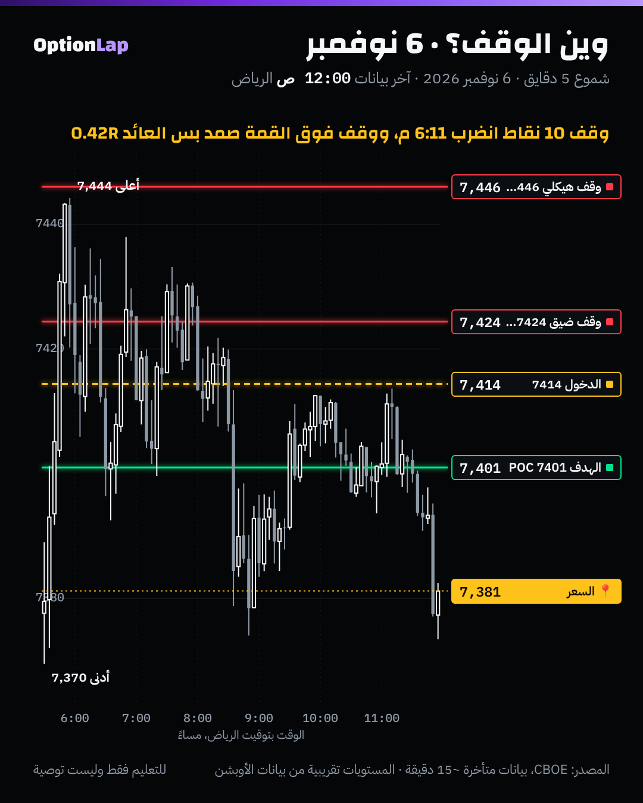

# 2.9 إدارة المخاطرة عند السكالبرز: 0.25%، ووين الوقف، ونسب العائد

> للتعليم فقط وليست توصية. ولا رقم هنا وعد بربح. المحاكاة تفترض «أفضلية معروفة»، والمتداول الحقيقي ما يعرف أفضليته بالضبط.

## الشرح
- **المخاطرة لكل صفقة نسبة ثابتة من الحساب.** حسب ملخصات مقابلات فابيو (مصادر ثانوية)، يبدأ بحوالي **0.25%**، ويزيد الحجم بس من الأرباح المتراكمة. وبعض الملخصات تذكر حد **3 وقوفات باليوم** كحد أقصى.
- **حجم الصفقة يجي من الوقف، مو العكس:**

  عدد العقود = المبلغ المخاطَر ÷ (مسافة الوقف × قيمة النقطة)

  يعني الوقف الأوسع = عقود أقل، والمخاطرة بالريال نفسها.
- **وين الوقف؟** **ورا الهيكل اللي يلغي فكرتك**، مو رقم ثابت.
  - فابيو (ملخص ثانوي): 1 إلى 2 تك ورا عقدة الامتصاص أو المزاد الفاشل، وما يتعدّى نقطة الإلغاء.
  - وعندنا قاعدة المحاضرة: **5 نقاط ورا منطقة الدخول**، وهذي تمشي لما تكون منطقة الدخول هي الهيكل نفسه.
- **نسبة العائد للمخاطرة (R) ونسبة الربح لازم تُقرأ مع بعض.** نسبة الربح اللي تتعادل فيها:

| R | نسبة الربح للتعادل |
|---|---|
| 1 | 50% |
| 1.5 | 40% |
| 2 | 33.3% |
| 3 | 25% |
| 5 | 16.7% |

## المحاكاة: ليش 0.25%؟ (`python3 team/tools/risk_sim.py`)
250 صفقة، و20,000 محاكاة. تفترض نسبة ربح ثابتة ومعروفة، وبدون تكاليف. **الرقم المهم هو التراجع (Drawdown)، مو النمو.**

| نسبة الربح / R | المخاطرة لكل صفقة | أقصى تراجع (الوسيط) | أقصى تراجع (أسوأ 5%) | أطول سلسلة خسارة (أسوأ 5%) |
|---|---|---|---|---|
| 40% / 2R | **0.25%** | 3.2% | 5.9% | 14 صفقة |
| 40% / 2R | 1% | 12.6% | 22.2% | 14 |
| 40% / 2R | 2% | 24.4% | **40.3%** | 14 |
| 30% / 3R | **0.25%** | 4.4% | 8.2% | 20 |
| 30% / 3R | 2% | 31.5% | **51.3%** | 20 |
| 55% / 1R | **0.25%** | 2.7% | 4.9% | 9 |
| 55% / 1R | 2% | 20.2% | 34.6% | 9 |

**القراءة:**
- حتى لو عندك أفضلية حقيقية، **14 خسارة متتالية** شي متوقع مع ربح 40%.
- مع 2% لكل صفقة، 1 من كل 20 متداول بنفس الأفضلية بالضبط يشوف حسابه ينزل 40%.
- مع 0.25%، نفس السيناريو تقريباً 6%. يعني 0.25% تخليك **تعيش** لين تتأكد إن أفضليتك حقيقية.

## تطبيق على الشارت: 6 نوفمبر (بيع من جدار 7425)

- **الدخول:** أول إغلاق 5 دقايق تحت 7425 بعد القمة: شمعة 10:01 نيويورك (6:01 م الرياض)، إغلاق **7,414.4**. والهدف الـPOC **7,401**.
- **وقف ضيق (10 نقاط) عند 7,424.4:** **انضرب** 6:11 م، قبل ما يوصل الهدف. والسعر رجع لـ7,433. يعني الصفقة خسرت 1R، والفكرة كانت صح.
- **وقف هيكلي فوق القمة (7,446):** **صمد**، والهدف انلمس 6:31 م. بس المخاطرة 31.6 نقطة مقابل ربح 13.4، يعني **0.42R** بس.

**الدرس:**
- الوقف الضيق داخل «ضجيج» الجدار ينضرب.
- والوقف الهيكلي يصمد، بس يخرّب نسبة العائد إذا الدخول بعيد عن الهيكل.

**الحل:**
1. **دخول أقرب للهيكل:** تنتظر رجعة للجدار (7425–7430) وتبيع هناك، والوقف فوق 7,446. وقتها الـR للـPOC حوالي 1، وللهدف الثاني 7,381 حوالي 2.
2. **أو** تقبل R أقل مع **حجم أصغر**، عشان المخاطرة تظل 0.25%.

## الربط بالقاما
- **قاما إجمالية إيجابية (ارتداد):** الحركة تهدأ، فالأهداف أقرب والـR أقل. عوّضها بدخول أقرب للجدار ووقف هيكلي.
- **قاما إجمالية سلبية (اختراق):** الحركة أوسع والوقف لازم يكون أوسع، فحجم أصغر بنفس النسبة. والأهداف أبعد، والـR أعلى.
- **عقود 0DTE:** القيمة الزمنية تذوب، فالوقف الزمني مهم برضو. لو ما تحرّك السعر خلال وقت محدد، تطلع.

## باك تست وإحصائيات
- **محاكاة مونت كارلو** (`risk_sim.py`، جديدة): الأرقام في الجدول فوق. **افتراضية**، مو أداء حقيقي.
- **مثال 6 نوفمبر:** وقف ضيق انضرب، ووقف هيكلي صمد بـ0.42R. **العيّنة صغيرة، النتيجة غير موثوقة** (حالة وحدة).

## الأخطاء الشائعة
1. تحط الوقف حسب المبلغ اللي «تتحمّله»، مو حسب الهيكل. والصح: الوقف من الهيكل، والحجم من المبلغ.
2. تكبّر المخاطرة بعد خسارة عشان «تعوّض».
3. تطارد R عالي بوقف ضيق داخل الضجيج، فتنضرب وفكرتك صح.
4. ما تحط حد يومي للخسارة.
5. تحسب الـR بدون نسبة الربح، أو العكس.

## أسئلة مع إجاباتها
1. **الوقف 20 نقطة، والمخاطرة 500 ريال، وقيمة النقطة 5 ريال للعقد. كم عقد؟** 500 ÷ (20 × 5) = **5 عقود**.
2. **ليش 0.25% وأنت متأكد من أفضليتك؟** لأن 14 خسارة متتالية ممكنة حتى مع أفضلية حقيقية، وبـ2% يصير التراجع حوالي 25 لـ40%.
3. **يوم 6 نوفمبر، ليش الوقف الضيق انضرب والفكرة صح؟** لأنه كان داخل منطقة الجدار (ضجيج)، مو ورا الهيكل (القمة 7,444).

## المصادر
- [Recapio: These Small Mistakes Are Keeping You Unprofitable (Titans of Tomorrow)](https://recapio.com/digest/world-s-1-scalper-these-small-mistakes-are-keeping-you-unprofitable-fabio-valentini-by-titans-of-tom)
- [forex.in.rs: Fabio Valentini's Order-Flow Edge (ثانوي)](https://www.forex.in.rs/footprint-vwap-compounding)
- [FuturesHive: Fabio Valentini, DeepCharts co-founder (تقديرات)](https://www.futureshive.com/blog/fabio-valentini-worlds-best-scalper-deepcharts)
- [Sahi: Scalping risk and money management](https://www.sahi.com/courses/scalping-in-trading/scalping-risk-and-money-management)
- [Recapio: Trading LIVE with the #1 Scalper](https://recapio.com/digest/trading-live-with-the-1-scalper-in-the-world-extreme-accuracy-by-chart-fanatics)
