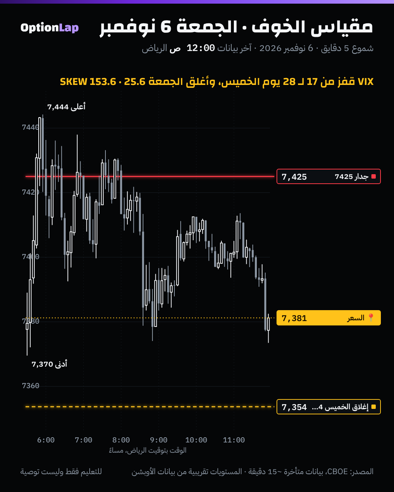

# 3.9 الـSkew وسطح التذبذب: وش يقول عن الخوف

> للتعليم فقط وليست توصية.

## الشرح
- **التذبذب الضمني (IV):** الحركة اللي تتوقعها أسعار العقود. ويسمّيه المدرّب «التضخم».
  - **VIX** = التذبذب الضمني لـSPX لمدة 30 يوم، من عقود قريبة من السعر.
- **الـSkew (الميلان):** التذبذب الضمني **ما يكون متساوي** بين السترايكات.
  - في SPX، البوت البعيد تحت السعر غالباً **أغلى** من الكول البعيد فوقه بنفس المسافة، لأن الناس تشتري حماية من النزول.
  - هذا اللي في شاشة MenthorQ: **Put Bias** ضغط على البوت، و**Call Bias** ضغط على الكول، و**Neutral** طبيعي.
- **سطح التذبذب (Vol Surface):** التذبذب الضمني لكل سترايك **ولكل تاريخ انتهاء** مع بعض. يعني الـSkew (عبر السترايكات) + هيكل المدة (عبر التواريخ).
- **مؤشر Cboe SKEW:**
  - يقيس **سعر حماية الذيل** (البوتات البعيدة جداً) لـ30 يوم.
  - المعادلة: SKEW = 100 − 10 × الانحراف الإحصائي (Skewness) تحت مقياس المخاطرة المحايد.
  - 100 يعني ما فيه علاوة ذيل تقريباً، وفوق 130 تقريباً يعتبرونه «مرتفع» (عرف، مو حد رسمي).
- **أهم تحذير من المصادر:** الـSKEW يقيس **سعر التأمين، مو موعد الحريق**. والأبحاث تلقى له قيمة توقيت ضعيفة.

## مثال بالأرقام: الأسبوع اللي فات (CBOE)
| اليوم | VIX (إغلاق) | SKEW |
|---|---|---|
| الأربعاء 4 نوفمبر | 16.61 | 150.90 |
| **الخميس 5 نوفمبر** (SPX −4.4%) | **28.18** (أعلى 28.36) | 149.37 |
| الجمعة 6 نوفمبر | **25.64** | **153.55** |

- **VIX الجمعة في الشريحة 95%** من آخر سنة، و**SKEW في الشريحة 90%**.
- يعني الخوف مرتفع، وحماية الذيل غالية.

## تطبيق على الشارت: 6 نوفمبر

**قراءتي:** بعد قفزة VIX يوم الخميس، الجمعة حاولت ترتد لجدار 7425 ورجعت. والتذبذب الضمني العالي يعني:
- **مدى أوسع** متوقع (الحركة المتوقعة أكبر).
- و**الجدران أضعف** قدام الأخبار.
- والسعر قريب من إغلاق الخميس، بس الخوف ما هدأ (VIX 25.6).

## باك تست: هل الـSKEW أو VIX العالي يتوقع نزول؟ (`bt_daily.py skew`، جديد)
- **الطريقة:**
  - نرتّب قيمة اليوم مقابل آخر 252 يوم **قبله** (بدون نظر للمستقبل).
  - الأعلى 20% مقابل الأدنى 20%، ونقيس عائد SPX في الـ20 يوم الجاية وأقصى نزول خلالها.
  - الفترة من 2015 لين 2026 تقريباً.

| المقياس | الشريحة | n | عائد 20 يوم (المتوسط / الوسيط) | الصعود | أقصى نزول خلال 20 يوم (المتوسط) |
|---|---|---|---|---|---|
| كل الأيام | – | 2,956 | +1.00% / +1.51% | 67.3% | −2.40% |
| **SKEW** | **أعلى 20%** | 818 | +0.73% / +1.63% | 70.0% | **−2.34%** |
| SKEW | أدنى 20% | 652 | +1.24% / +1.53% | 63.5% | −3.00% |
| **VIX** | **أعلى 20%** | 574 | **+1.94%** / +2.42% | 68.6% | **−3.43%** |
| VIX | أدنى 20% | 811 | +0.89% / +1.22% | 67.3% | −1.62% |

**القراءة:**
1. **الـSKEW العالي ما سبق نزول أكبر:** أقصى النزول بعده (−2.34%) **أقل** من العادي، وأقل من الـSKEW المنخفض (−3.00%). يعني «تأمين غالي» ≠ «حريق جاي». وهذا يتفق مع المصادر.
2. **VIX العالي = حركة أوسع في الاتجاهين:** العائد بعده أعلى (+1.94%، يعني الخوف يرتد)، والنزول خلاله أعمق (−3.43%). يعني الفرص أكبر والمخاطرة أكبر.
- **تحفّظ إحصائي مهم:** نوافذ الـ20 يوم **متداخلة** (كل يوم يشارك 20 يوم مع جيرانه)، فقيم t المطبوعة **مضخّمة**. ونعامل الفروق كوصف، مو كدليل قوي.
- يومي، وبدون تكاليف.

## الربط بالقاما (طريقتنا)
- **VIX عالي + قاما سالبة:** أوسع مدى، والكسر أسرع. صغّر الحجم، ووسّع الوقف الهيكلي (البند 2.9).
- **Put Bias (الـSkew) في MenthorQ:** انطباع إن الطلب على الحماية عالي. نأكده بباقي الشاشات، ومو قرار لحاله (مراجعة المحاضرة الأولى).
- **الـSKEW العالي لحاله ما يبرر البيع.** الأرقام تقول العكس تقريباً.
- **قبل الأخبار** (تضخم، أو فيدرالي): التذبذب الضمني يرتفع، والجدران ممكن تنكسر. والأفضل تنتظر بعد الخبر.

## الأخطاء الشائعة
1. تقرأ SKEW العالي كإشارة انهيار.
2. تخلط VIX (التذبذب العام) بالـSkew (الفرق بين البوت والكول).
3. تشتري عقود وقت VIX عالي بدون ما تحسب إنها غالية (التذبذب الضمني داخل سعرها).
4. تستخدم نفس حجم الصفقة في VIX 15 وVIX 28.
5. تعتمد على قيم t من نوافذ متداخلة.

## أسئلة مع إجاباتها
1. **وش يقيس مؤشر SKEW؟** سعر الحماية من الهبوط الحاد (البوتات البعيدة جداً)، مو احتمال الهبوط.
2. **بعد VIX عالي، وش صار تاريخياً؟** العائد بعد 20 يوم كان أعلى (+1.94%)، بس النزول خلالها أعمق (−3.43%). يعني حركة أوسع في الاتجاهين.
3. **VIX 25.6 والقاما سالبة يوم الاثنين. وش تغيّر في خطتك؟** حجم أصغر، ووقف هيكلي أوسع، وتوقّع مدى أوسع والكسر أسرع.

## المصادر
- [Zhen (AUT): CBOE SKEW, methodology and evidence (PDF)](https://acfr.aut.ac.nz/__data/assets/pdf_file/0004/29803/F-Zhen-CBOE_SKEW.pdf)
- [LuxAlgo: SKEW Index](https://www.luxalgo.com/library/concept/skew-index/)
- [Tapeboard: What is the Cboe SKEW Index](https://tapeboard.com/glossary/what-is-the-cboe-skew-index)
- [TradingView: Understanding the CBOE SKEW Index](https://in.tradingview.com/chart/SKEW/vtRCtiJ0-THE-SKEWED-GAMES-UNDERSTANDING-CBOE-SKEW-INDEX-SKEW)
- بيانات Cboe اليومية: VIX_History.csv وSKEW_History.csv (cdn.cboe.com).
