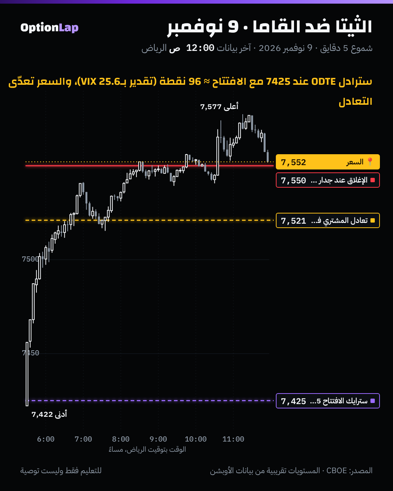

# 4.3 الثيتا: تآكل الوقت وعلاقته بالقاما

> للتعليم فقط وليست توصية. ولا شي هنا دعوة لبيع العقود: البيع فيه مخاطرة كبيرة على الأيام الحادة.

## الشرح
- **الثيتا = كم يخسر العقد من قيمته كل يوم** لو ما تحرك السعر ولا تغيّر التذبذب.
- **التآكل يتسارع قرب الانتهاء:** بطيء مع شهور متبقية، وسريع جداً بالأيام الأخيرة. وعقود 0DTE تذوب كلها خلال ساعات.
- **الثيتا = سعر القاما:**
  - **المشتري** (قاما طويلة) يدفع الثيتا كل يوم، مقابل إنه يستفيد لو تحرك السعر بقوة.
  - **البايع** (قاما قصيرة) يقبض الثيتا، بس يتحمّل الخسارة لو تحرك السعر بقوة.
  - **نفس العقود** (عند السعر وقرب الانتهاء) فيها أعلى ثيتا وأعلى قاما بنفس الوقت.
- **علاوة التذبذب (Variance Risk Premium):** العقود تاريخياً تتسعّر بتذبذب ضمني **أعلى** من الحركة اللي تصير فعلاً. وهذا مفهوم **غير** الثيتا، بس يخلّي البايع يكسب أغلب الأيام، ويخسر بقوة في الأيام القليلة الحادة.

## مثال بالأرقام: تآكل كول عند السعر (بلاك-شولز، السعر 7,550، التذبذب 20%)
| الوقت المتبقي | قيمة الكول (نقاط) | الخسارة في اليوم الأخير من الفترة |
|---|---|---|
| 30 يوم | 172.7 | 2.9 |
| 14 يوم | 118.0 | 4.3 |
| 7 أيام | 83.4 | 6.2 |
| 3 أيام | 54.6 | 10.0 |
| يوم واحد | 31.5 | 31.5 (كلها تذوب) |
| 6 ساعات | 15.8 | |

يعني الكول يخسر حوالي 3 نقاط باليوم وهو بعيد شهر، وكل الـ31.5 نقطة في يومه الأخير.

## تطبيق على الشارت: 9 نوفمبر

- **تقدير سترادل 0DTE عند الافتتاح** (كول + بوت عند 7425):
  - ≈ 0.8 × VIX (25.6%) × √(1/252) × 7,422 ≈ **96 نقطة**.
  - يعني المشتري يحتاج السعر يطلع فوق **7,521** أو ينزل تحت **7,329** عشان يربح عند الإغلاق.
- **اللي صار:** السعر طلع لين 7,577 وأغلق حوالي 7,550، فوق التعادل بحوالي 29 نقطة.
  - هذا يوم **القاما غلبت الثيتا**، والمشتري كسب.
  - بس هذا يوم استثنائي (+2.3%). شوف الإحصاء تحت.
- **تقدير تقريبي:** VIX تذبذب 30 يوم، وتذبذب عقود اليوم يختلف.

## باك تست: مين يكسب أغلب الأيام، الثيتا ولا القاما؟ (`bt_daily.py theta_gamma`، جديد)
- **الطريقة:** سترادل ليوم واحد عند السعر، سعره تقريباً 0.8 × VIX × √(1/252) × الإغلاق. ونقارنه بالحركة الفعلية من إغلاق لإغلاق. الفترة 2014 لين 2026، n=3,231.

| الحالة | أيام | ربح المشتري (% من المؤشر) المتوسط / الوسيط | المشتري كسب |
|---|---|---|---|
| كل الأيام | 3,231 | −0.196% / −0.341% | **27.5%** |
| VIX تحت 15 | 1,238 | −0.240% / −0.341% | 21.1% |
| VIX بين 15 و25 | 1,601 | −0.207% / −0.343% | 29.6% |
| **VIX فوق 25** | 392 | **−0.012%** / −0.344% | **39.0%** |

- **وسيط (الحركة الفعلية ÷ السعر) = 0.58.** يعني عادةً الحركة تطلع حوالي 58% بس من اللي مسعّر.

**القراءة:**
1. **الثيتا (البايع) كسب حوالي 72% من الأيام.** وهذي علاوة التذبذب.
2. **بس لما يكون VIX فوق 25**، المتوسط قريب من صفر، والمشتري كسب 39% من الأيام. يعني الأيام الحادة تعوّض.
3. **الخطر على البايع:** خسائر الأيام الحادة كبيرة جداً (الانحراف عالي). يوم مثل 5 نوفمبر (−4.4%) ممكن يمسح أرباح أسابيع.
- **تحفّظات:** VIX تقريب لسعر عقد يوم واحد، وبدون Skew، وبدون تكاليف ولا انزلاق، والسعر محسوب من الإغلاق.

## الربط بالقاما (طريقتنا)
- **مشتري 0DTE** (مثل طلابنا): الثيتا ضدك كل ساعة. فالدخول يكون **عند المستوى وبزناد واضح**، والوقف الزمني مهم: لو ما تحرك السعر خلال وقت محدد، تطلع.
- **صفقة MSFT:** دخل بعقد داخل الفلوس (قيمة زمنية قليلة)، فالثيتا ما أكلته كثير. هذا اختيار ذكي.
- **قاما إيجابية** (السوق يتذبذب حول جدار): أيام الثيتا، والحركة صغيرة. **وقاما سلبية + VIX عالي**: أيام القاما، والحركة كبيرة.

## الأخطاء الشائعة
1. تشتري عقد 0DTE بعيد بعد الظهر وتنتظر. الثيتا تأكله بالكامل.
2. تبيع عقود قريبة الانتهاء لأنها «تكسب أغلب الأيام». خسارة يوم حاد واحد ممكن تكون كارثية.
3. تخلط الثيتا بعلاوة التذبذب.
4. تنسى إن ارتفاع التذبذب الضمني ممكن يعوّض الثيتا مؤقتاً.

## أسئلة مع إجاباتها
1. **وش الثيتا بجملة؟** كم يخسر العقد من قيمته مع مرور الوقت، إذا ثبت كل شي ثاني.
2. **مين كسب أغلب الأيام تاريخياً، مشتري السترادل ليوم واحد ولا البايع؟** البايع، حوالي 72% من الأيام. بس لما VIX فوق 25، المتوسط قريب من الصفر.
3. **ليش يوم 9 نوفمبر كان يوم المشتري؟** لأن الحركة (+128 نقطة من الافتتاح) كانت أكبر من سعر السترادل المقدّر (حوالي 96).

## المصادر
- [Macroption: Option Theta](https://www.macroption.com/option-theta/)
- [Option Alpha: Options theta](https://optionalpha.com/learn/options-theta)
- [OptionsTradingIQ: Options time decay](https://optionstradingiq.com/options-time-decay/)
- [Ryan O'Connell: Option Theta, time decay explained](https://ryanoconnellfinance.com/option-theta/)
- بيانات Cboe اليومية: SPX وVIX_History.csv.
