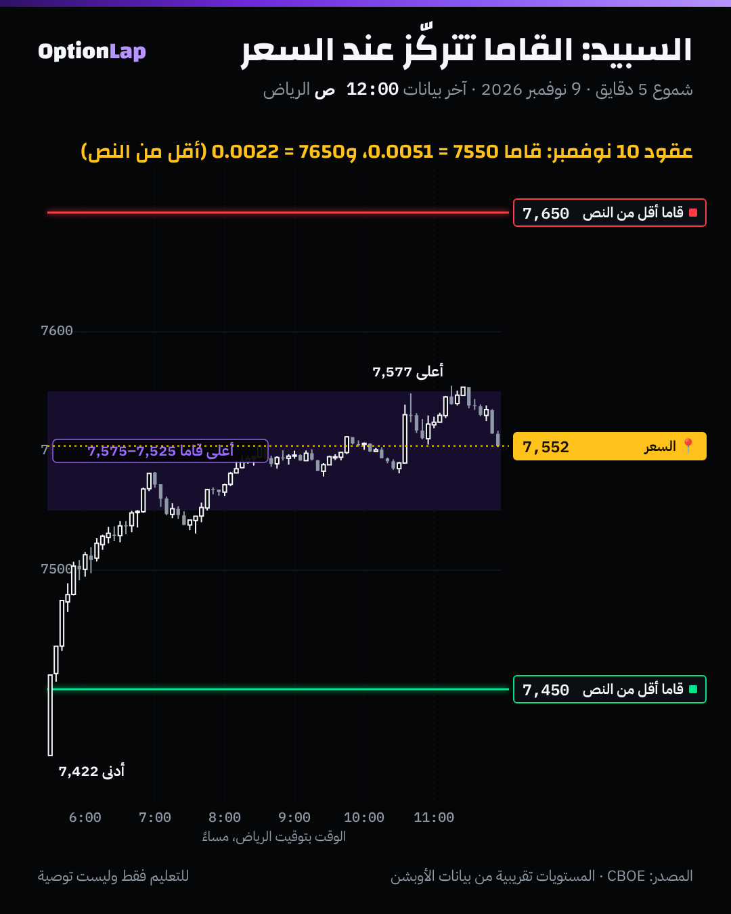

# 4.7 اليونانيات من الدرجة الثالثة: Speed وZomma وColor (باختصار)

> للتعليم فقط وليست توصية.

## الشرح
هذي اليونانيات تقيس **كيف تتغيّر القاما نفسها**. والقاما هي سرعة تغيّر الدلتا (`gamma-greek.md`).

| الاسم | تقيس تغيّر القاما مع | بكلام بسيط |
|---|---|---|
| **Speed (السبيد)** | **السعر** | القاما عالية عند السترايك وتطيح بسرعة لما يبعد السعر. وقرب الانتهاء «القمة» تصير حادة جداً |
| **Zomma (الزوما)** | **التذبذب** | تذبذب أعلى = قاما أقل عند السعر، وأكثر شوي في البعيد (القمة تتفرطح). وتذبذب أقل = قمة حادة |
| **Color (الكلر)** | **الوقت** | مع مرور الوقت قاما العقد اللي عند السعر **تكبر بقوة**. واللي بعيد تكبر شوي، وبعدين **تنهار** بالساعات الأخيرة. ويسمونها «تآكل القاما» |

- **ليش تهمنا؟** ما نتداول عليها مباشرة. بس تشرح **ليش الجدران والمستويات تتغير قوتها** مع حركة السعر والتذبذب والوقت، خصوصاً في 0DTE.
- المصادر متفقة على التعريفات. والكلام عن «استخدامها بالتداول» أغلبه من منصات تبيع أدوات.

## مثال بالأرقام (بلاك-شولز، سترايك 7550)

**Speed، باقي ساعة على الانتهاء (التذبذب 20%):**
| السعر | 7,500 | 7,525 | 7,550 | 7,575 | 7,600 |
|---|---|---|---|---|---|
| القاما | 0.0044 | 0.0086 | **0.0107** | 0.0085 | 0.0043 |
- 50 نقطة بس تخلي القاما تنزل لأقل من النص.

**Zomma، باقي يوم واحد (السعر 7,550):**
| السترايك | تذبذب 15% | 20% | 25% | 30% |
|---|---|---|---|---|
| 7,550 (عند السعر) | **0.0056** | 0.0042 | 0.0034 | 0.0028 |
| 7,650 (بعيد) | 0.0021 | 0.0025 | 0.0024 | 0.0022 |
- التذبذب العالي ينزّل قاما اللي عند السعر للنص تقريباً، والبعيد بالكاد يتغير.

**Color، التذبذب 20%:**
| الأيام المتبقية | 5 | 3 | 2 | 1 |
|---|---|---|---|---|
| قاما 7,550 (عند السعر) | 0.0019 | 0.0024 | 0.0030 | **0.0042** |
| قاما 7,650 (بعيد) | 0.0017 | 0.0020 | 0.0023 | 0.0025 |
- كل يوم يقرّب الانتهاء، اللي عند السعر يكبر أسرع بكثير من البعيد.
- وبالساعات الأخيرة البعيد ينهار: قاما 7,650 مع باقي 3 ساعات **0.0019**، ومع باقي ساعة **0.0003** بس.

## تطبيق على الشارت: 9 نوفمبر، وسلسلة الإغلاق

- من لقطة سلسلة إغلاق 9 نوفمبر (`team/data/chain/`، CBOE)، كولات انتهاء **10 نوفمبر**:
  - 7,550: قاما **0.0051**، و7,575: **0.0052**.
  - 7,650: **0.0022**، و7,450: **0.0023**.
  - يعني 100 نقطة بعيد عن السعر = أقل من **نص** القاما. وهذا الـ**Speed** بالأرقام الحقيقية.
- **وانتهاء 11 نوفمبر** (يوم زيادة):
  - 7,550: **0.0039** (أقل من 0.0051).
  - 7,650: **0.0025** (أكثر من 0.0022).
  - وهذا الـ**Color**: يوم زيادة يفرطح القمة.
- **وفيه Zomma بعد:** التذبذب الضمني يختلف بين السترايكات (7,450 = 23.4% و7,650 = 17.0%، بسبب الـSkew).
- **قراءتي:** السعر أغلق 7,552، يعني **في قلب** منطقة القاما الأعلى. وهذا يفسّر ليش جدار 7550 مسك آخر اليوم.
- **العيّنة صغيرة، النتيجة غير موثوقة:** لقطة وحدة. والأرقام وصفية مو باك تست.

## باك تست
- **ما سوّيت باك تست جديد.** هذي اليونانيات تشرح شكل القاما، مو إشارة تداول، وتحتاج سلسلة عقود تاريخية ما عندنا منها إلا لقطة وحدة.
- اللي اختبرناه قبل وله علاقة:
  - **4.2:** قاما 0DTE حوالي 7.6 أضعاف عقد بكرة. وهذا الـColor.
  - **4.6:** آخر ساعة ما ثبّتت السعر في 3 من 5 أيام.
- **الخطة:** لما تتراكم لقطات السلسلة (30 يوم أو أكثر)، نختبر: هل الإغلاق يكون أقرب للسترايك اللي فيه أعلى قاما × عقود مفتوحة، أكثر من أقرب سترايك 25؟

## الربط بالقاما
- **Speed:** قوة الجدار **محلية**. لو السعر ابتعد 50 إلى 100 نقطة عن جدار 0DTE، تأثيره يضعف بسرعة.
- **Zomma:** في أيام الذعر (VIX عالي) القاما مفرطحة، فالجدران أضعف والسعر يتحرك أكثر. وفي الأيام الهادية القمة حادة، والتثبيت ممكن أكثر.
- **Color:** الجدار اللي عند السعر **يقوى كل ساعة** يقرّب فيها الانتهاء. والجدار البعيد **يذوب** بآخر ساعات اليوم.
- وهذا يكمّل قاعدة المالك: وضع القاما الإجمالي من MenthorQ يحدد ارتداد أو اختراق، والـSpeed والـColor يقولون **أي جدار** له وزن اليوم.

## أخطاء شائعة
1. تعامل جدار 0DTE بعيد 100 نقطة مثل جدار عند السعر. قاماه أقل من النص.
2. تتوقع نفس قوة الجدار في يوم VIX فيه 30 ويوم VIX فيه 15. الزوما تغيّر شكل القاما كله.
3. تقارن قاما عقود الأسبوع الجاي بعقود اليوم. الكلر يخلّي اللي عند السعر اليوم أقوى بكثير.
4. تحاول تتداول على هالأرقام مباشرة. هي أداة **فهم**، مو إشارة.

## أسئلة وأجوبة
- **س: ليش قاما 0DTE «حادة» عند السترايك؟** ج: بسبب الـSpeed مع وقت قليل: الدلتا تقفز من قريب 0 لقريب 1 خلال نقاط قليلة، فالقاما كلها متركّزة عند السترايك.
- **س: وش يصير لقاما العقد اللي عند السعر لو طلع التذبذب؟** ج: تنزل (Zomma سالبة عند السعر)، والقمة تتفرطح. فالجدار يضعف.
- **س: ليش جدار بعيد ممكن يختفي قرب الانتهاء؟** ج: الـColor: بالساعات الأخيرة قاما العقود البعيدة تنهار (7,650 من 0.0019 إلى 0.0003 بين آخر 3 ساعات وآخر ساعة)، فتحوّط صناع السوق عندها يقل.

## المصادر
- Macroption، اليونانيات من الدرجة الثالثة: https://macroption.com/third-order-greeks
- Macroption، اليونانيات العليا: https://macroption.com/higher-order-greeks
- Options Analysis Suite، Speed: https://www.optionsanalysissuite.com/documentation/speed
- Options Analysis Suite، Zomma: https://www.optionsanalysissuite.com/documentation/zomma
- SpotGamma، Color: https://support.spotgamma.com/hc/en-us/articles/15246635205651-Color
- البيانات: لقطة سلسلة سباكس من CBOE (`team/data/chain/2026-11-09_SPX.csv.gz`)
