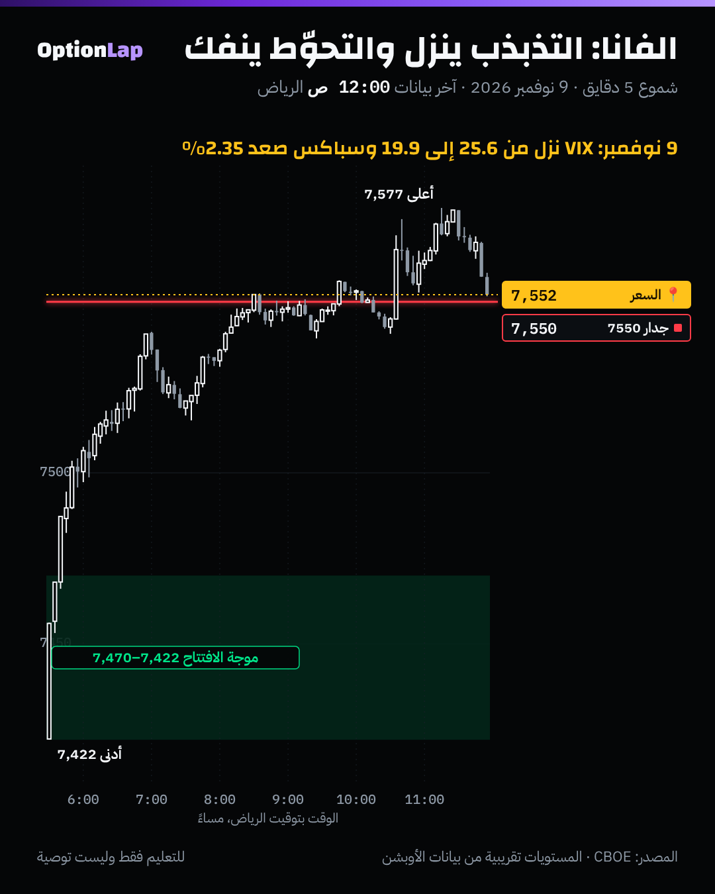

# 4.5 الفانا (Vanna): تغيّر الدلتا مع التذبذب، وتدفقات الفانا

> للتعليم فقط وليست توصية.

## الشرح
- **الفانا = كم تتغيّر الدلتا لو تغيّر التذبذب الضمني (IV).** وهي بنفس الوقت كم تتغيّر الفيقا لو تحرك السعر.
- **العقود البعيدة عن السعر (OTM) هي اللي تتأثر:**
  - لما ينزل التذبذب، البوت البعيد يصير «أبعد» احتمالياً، فدلتاه تصغر.
  - ولما يطلع التذبذب، دلتاه تكبر.
  - وعند السعر (ATM) الدلتا بالكاد تتغير.
- **تدفقات الفانا (الرواية المتداولة):**
  1. المستثمرين يشترون بوتات حماية، وصناع السوق يبيعونها لهم.
  2. صانع السوق يتحوّط ببيع فيوتشر.
  3. لما ينزل التذبذب، دلتا البوتات تصغر، فيحتاج تحوّط أقل، **فيشتري** جزء من الفيوتشر. وهذا يدعم السعر، والتذبذب ينزل أكثر.
  4. والعكس وقت الذعر: التذبذب يطلع، فدلتا البوتات تكبر، فيبيع أكثر.
- **تحفّظ مهم:** إشارة الفانا تعتمد على مين ماسك وش. والمصادر نفسها تختلف في الإشارة (طويل أو قصير فانا). ومعظم أرقام «التدفقات بالمليارات» من شركات تبيع أدوات، وبدون مصدر.
- الفانا مذكورة باختصار في `opex-charm.md`. هنا التفصيل والاختبار.

## مثال بالأرقام (بلاك-شولز، السعر 7,550، 30 يوم)
| السترايك | دلتا البوت عند تذبذب 25.6% | عند 19.9% | التغيّر |
|---|---|---|---|
| 7,200 (بوت بعيد) | −0.247 | −0.195 | **+0.052** |
| 7,550 (عند السعر) | −0.485 | −0.489 | تقريباً صفر |

- **مثال توضيحي:** صانع سوق باع 10,000 بوت 7,200 (المضاعف 100).
  - تحوّطه الأول: بيع ما يعادل 0.247 × 10,000 × 100 ≈ **247,000** وحدة سباكس.
  - بعد ما نزل التذبذب من 25.6% إلى 19.9% (والسعر ثابت): يحتاج 195,000 بس.
  - فيشتري حوالي **52,000** وحدة، يعني تقريباً **393 مليون دولار** (× 7,550)، **بدون ما يتحرك السعر**.
- الأرقام **توضيحية**. ما نعرف مراكز صناع السوق الحقيقية.

## تطبيق على الشارت: 9 نوفمبر

- VIX كان مرتفع بعد 5 و6 نوفمبر (25.64)، ونزل يوم 9 نوفمبر إلى **19.92** (−22%، المصدر CBOE).
- هذا بالضبط شرط «إشارة الفانا» في الاختبار تحت: تذبذب عالي، وبعدين ينزل 5% أو أكثر.
- السعر طلع من **7,422** لين **7,577**، ومسك جدار **7550** آخر اليوم.
- **قراءتي:** نزول التذبذب يتوافق مع رواية الفانا (فكّ تحوّط البوتات). بس كان فيه بنفس اليوم سبب ثاني (ارتداد بعد هبوط 5 نوفمبر، وأخبار الشركات). ما نقدر نفصل أثر الفانا لحاله من يوم واحد.

## باك تست: هل «إشارة الفانا» تعطي ميزة؟ (`bt_daily.py vanna`، جديد)
- **الطريقة:**
  - «VIX عالي» يعني إغلاق أمس فوق الشريحة 80% من آخر سنة (بدون نظر للمستقبل).
  - الإشارة: VIX عالي، واليوم نزل 5% أو أكثر.
  - نقيس عائد سباكس بكرة، وبعد 5 أيام، من الإغلاق.
  - الفترة 2014 لين 9 نوفمبر 2026. بدون تكاليف.

| الحالة | n | بكرة: متوسط / وسيط / صعود | 5 أيام: متوسط / وسيط / صعود | t (5 أيام) |
|---|---|---|---|---|
| كل الأيام (الأساس) | 2,974 | +0.05% / +0.07% / 53.9% | +0.25% / +0.40% / 60.3% | +5.94 |
| VIX عالي (أي يوم) | 575 | +0.10% / +0.12% / 54.4% | **+0.50%** / +0.76% / 59.7% | +3.43 |
| **VIX عالي ونزل ≥5% (الفانا)** | 225 | **−0.08%** / +0.06% / 52.0% | **+0.51%** / +0.76% / 60.4% | +2.20 |
| VIX عالي وطلع ≥5% | 126 | +0.17% / +0.20% / 57.9% | +0.26% / +0.45% / 56.3% | +0.74 |
| VIX منخفض ونزل ≥5% | 65 | +0.13% / +0.12% / 55.4% | +0.01% / −0.03% / 49.2% | +0.05 |

- **الخلاصة:**
  - بعد إشارة الفانا، الـ5 أيام فيها **+0.51%**، يعني ضعف الأيام العادية (+0.25%).
  - **بس** نفس النتيجة تقريباً لأي يوم VIX فيه عالي (+0.50%). يعني الميزة جاية من **«التذبذب عالي»** نفسه (ارتداد بعد خوف)، **مو** من نزول VIX بذاك اليوم.
  - وبكرة بعد الإشارة مافيه ميزة (−0.08%).
  - ونزول VIX وهو منخفض أصلاً ما يعطي شي.
- **الحدود:** نوافذ الـ5 أيام متداخلة (t مضخّم)، ووصف تاريخي بس، وبدون تكاليف. ومافيه بيانات مراكز صناع السوق، فهذا اختبار **للرواية** مو للفانا نفسها.

## الربط بالقاما
- **القاما:** الدلتا تتغير مع **السعر**. **الفانا:** الدلتا تتغير مع **التذبذب**. والاثنين يجبرون صانع السوق يعدّل تحوّطه.
- **في قاما موجبة:** السعر هادي والتذبذب ينزل، فالفانا تضيف شراء. ونفس الشي يصير قرب OPEX مع الـCharm.
- **في قاما سالبة:** التذبذب يطلع مع الهبوط، فالفانا تضيف بيع فوق بيع القاما. وهذا ليش الهبوط في القاما السالبة يتسارع.

## أخطاء شائعة
1. تعتبر الفانا إشارة دخول. الاختبار يقول نزول VIX لحاله ما أضاف ميزة بكرة.
2. تصدّق أرقام «تدفقات الفانا» بدون مصدر. أغلبها تقديرات من شركات تبيع أدوات.
3. تنسى إن الإشارة تعتمد على مراكز صناع السوق، وهذي ما نشوفها مباشرة.
4. تخلط الفانا بالفيقا. الفيقا تغيّر **سعر** العقد مع التذبذب، والفانا تغيّر **دلتاه**.

## أسئلة وأجوبة
- **س: ليش الفانا تأثر على البوتات البعيدة أكثر من اللي عند السعر؟** ج: لأن احتمال وصول البعيد يعتمد بقوة على التذبذب. واللي عند السعر احتماله حوالي 50% أياً كان التذبذب.
- **س: وش يصير بعد خبر كبير مثل CPI لو ما كان مخيف؟** ج: التذبذب ينزل (سحق)، فدلتا البوتات تصغر، وصناع السوق (حسب الرواية) يشترون جزء من تحوّطهم، فممكن يصير دعم.
- **س: هل نتداول على إشارة الفانا؟** ج: لا لحالها. اختبارنا يقول الميزة جاية من مستوى VIX العالي نفسه، مو من النزول. استخدمها كسياق مع وضع القاما والمستويات.

## المصادر
- SpotGamma، شرح الفانا والتشارم: https://spotgamma.com/vanna-and-charm-explained/
- FlashAlpha، الفانا والتشارم: https://flashalpha.com/articles/vanna-charm-second-order-greeks-guide
- Options Analysis Suite، تعريف الفانا: https://www.optionsanalysissuite.com/documentation/vanna
- Options Analysis Suite، تحوّط صناع السوق: https://www.optionsanalysissuite.com/documentation/dealer-hedging
- بيانات VIX اليومية من Cboe: https://cdn.cboe.com/api/global/us_indices/daily_prices/VIX_History.csv
- الإحصاء: `team/tools/bt_daily.py vanna`
