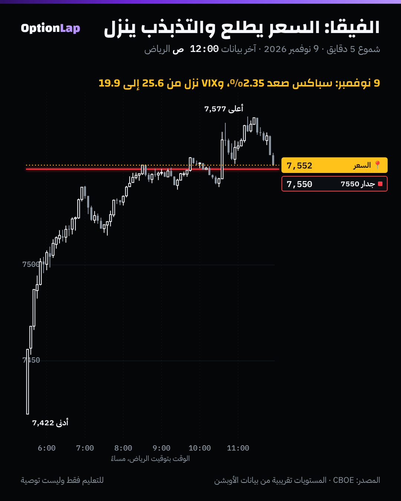

# 4.4 الفيقا: حساسية التذبذب

> للتعليم فقط وليست توصية.

## الشرح
- **الفيقا = كم يتغير سعر العقد لو تغيّر التذبذب الضمني (IV) نقطة وحدة.**
  - المشتري (كول أو بوت) فيقا موجبة: يكسب لما يطلع التذبذب، ويخسر لما ينزل.
  - البايع فيقا سالبة: العكس.
- **وين تكون أكبر؟**
  - عند السعر (ATM)، لأن فيها أكبر قيمة زمنية.
  - وكل ما زاد الوقت للانتهاء. وعقود 0DTE فيقاها صغيرة، وحركتها قاما أكثر من فيقا.
- **في سباكس السعر والتذبذب يمشون عكس بعض:** نزول قوي يرفع VIX، وصعود هادي ينزّله. فالبوت يكسب مرتين وقت الهبوط (دلتا + فيقا)، والكول يخسر شي من الفيقا وقت الصعود.
- **سحق التذبذب (IV crush):** بعد الحدث (أرباح، CPI، فيدرالي) التذبذب ينزل بسرعة. فممكن تتوقع الاتجاه صح وتخسر، لأن خسارة الفيقا أكبر من ربح الدلتا.
- **انتبه للوحدة:** بلاك-شولز يعطي الفيقا لكل 100% تذبذب. والمنصات تقسمها على 100 (لكل نقطة). تأكد قبل تقارن.

## مثال بالأرقام (بلاك-شولز، السعر 7,550، التذبذب 20%، عقد عند السعر)
| الوقت المتبقي | الفيقا لكل نقطة تذبذب (نقاط مؤشر) |
|---|---|
| 30 يوم | 8.63 |
| 7 أيام | 4.17 |
| يوم واحد | 1.58 |

- **كول 30 يوم، والسعر يطلع 1%** (حوالي 75 نقطة):
  - الدلتا حوالي 0.5، يعني **+38** تقريباً.
  - والتذبذب ينزل بالمتوسط 1.4 نقطة (الإحصاء تحت)، يعني **−12** من الفيقا.
  - الصافي حوالي **+26**، مو +38. والحساب تقريبي (خطي).
- **بوت 30 يوم في يوم مثل 5 نوفمبر** (VIX طلع 11.6 نقطة):
  - الفيقا لحالها حوالي 11.6 × 8.6 ≈ **100 نقطة** فوق ربح الدلتا. والحساب الخطي يبالغ شوي مع قفزة بهالحجم.

## تطبيق على الشارت: 9 نوفمبر

- سباكس طلع **2.35%** (7,422 لين 7,577، وأغلق حوالي 7,550 عند الجدار).
- وVIX نزل من **25.64 إلى 19.92** (−5.7 نقطة، المصدر CBOE). والميل التاريخي يتوقع حوالي −3.3، فالنزول كان أكبر من العادي، لأن VIX كان مرتفع بعد 5 نوفمبر.
- **الدرس:** اللي اشترى كول 30 يوم كسب من الدلتا، بس خسر حوالي 49 نقطة من الفيقا (5.7 × 8.6). واللي اشترى بوت خسر مرتين.

## باك تست: كيف يتحرك VIX مع سباكس؟ (`bt_daily.py vega`، جديد)
- **الطريقة:** تغيّر سباكس اليومي % ضد تغيّر VIX بالنقاط، من 2014 لين 9 نوفمبر 2026، n=3,231 يوم. المصدر CBOE.

| الحالة | أيام | سلوك VIX |
|---|---|---|
| كل الأيام | 3,231 | الارتباط **−0.80**، والميل **−1.39** نقطة لكل 1% |
| سباكس نازل | 1,479 | VIX طلع **76.4%** من الأيام، متوسط +1.02 |
| سباكس طالع | 1,750 | VIX نزل **81.1%** من الأيام، متوسط −0.85 |
| سباكس −2% أو أقل | 103 | متوسط **+5.20**، والوسيط +4.23 |

- **الخلاصة:** العلاقة قوية بس **مو متماثلة**. النزول يرفع التذبذب أكثر من ما الصعود ينزّله.
- **الحدود:** VIX تذبذب 30 يوم لسلّة عقود، مو تذبذب عقدك بالذات. والـSkew يخلّي البوتات البعيدة تتحرك غير. وبيانات يومية بس، وبدون تكاليف.

## الربط بالقاما
- **القاما** تشتغل لما يتحرك **السعر**، و**الفيقا** لما يتحرك **التذبذب**.
- قرب الانتهاء القاما تكبر والفيقا تصغر. وبعيد الانتهاء العكس.
- في قاما سالبة (صانع السوق يطارد السعر) الحركات تتوسع وVIX يطلع عادةً، فالفيقا تساعد البوت. وفي قاما موجبة الحركة تهدى والتذبذب ينزل، فالفيقا تضغط على المشتري.

## أخطاء شائعة
1. تشتري كول قبل خبر وتتوقع الاتجاه صح، وتخسر من سحق التذبذب.
2. تشتري بوت بعد ما طلع VIX كثير. تدفع تذبذب غالي، وأي هدوء ياكل ربحك.
3. تقارن فيقا منصتين بوحدات مختلفة (لكل 1 أو لكل 100).
4. تحسب الفيقا ثابتة. هي تتغير مع السعر والوقت والتذبذب.

## أسئلة وأجوبة
- **س: ليش الكول ما ارتفع قد ما توقعت لما طلع السعر؟** ج: غالباً التذبذب نزل مع الصعود، والفيقا أكلت جزء من ربح الدلتا.
- **س: عقود 0DTE تتأثر بالفيقا؟** ج: قليل. فيقاها صغيرة (حوالي 1.6 نقطة لكل نقطة تذبذب)، وأغلب حركتها من الدلتا والقاما.
- **س: متى الفيقا تكون أخطر؟** ج: قبل الأحداث (CPI، الفيدرالي، الأرباح)، وفي العقود البعيدة عند السعر.

## المصادر
- SoFi، شرح الفيقا: https://www.sofi.com/learn/content/vega-options/
- Ryan O'Connell، الفيقا وحساسية التذبذب: https://ryanoconnellfinance.com/option-vega/
- IncomeShares، شرح الفيقا: https://incomeshares.com/en-eu/insights/options-vega-explained
- بيانات VIX اليومية من Cboe: https://cdn.cboe.com/api/global/us_indices/daily_prices/VIX_History.csv
- الإحصاء: `team/tools/bt_daily.py vega`
