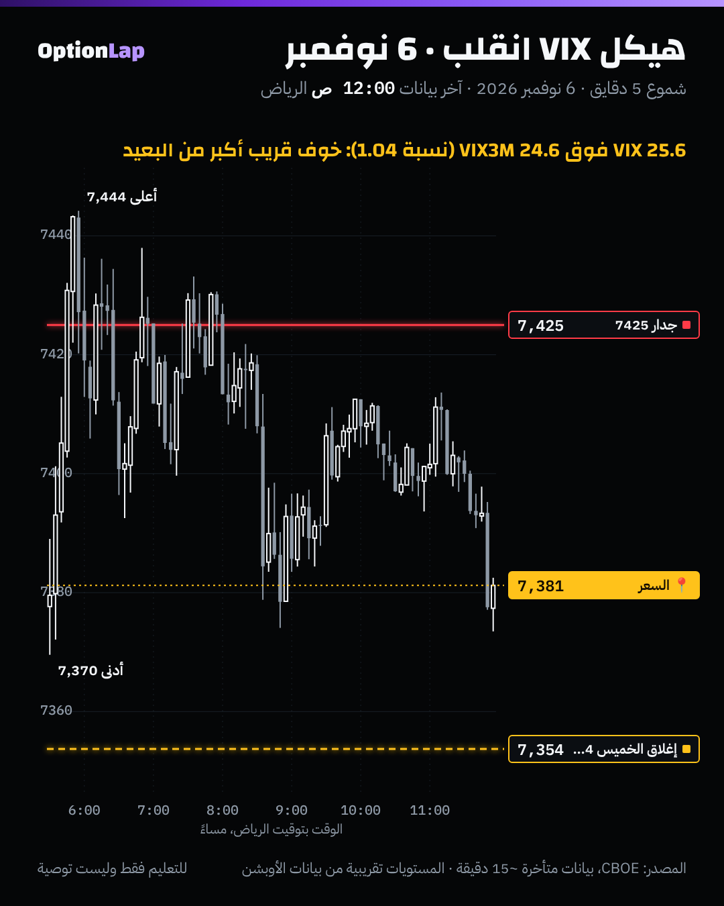

# 3.10 VIX وهيكل المدة (Term Structure) وعلاقتها بالقاما

> للتعليم فقط وليست توصية. فيه أرقام عن عوائد بعد فترات الخوف. هذي **وصف تاريخي**، مو وعد ولا توصية بالشراء.

## الشرح
- **هيكل المدة:** التذبذب الضمني لمدد مختلفة:
  - **VIX9D:** 9 أيام.
  - **VIX:** 30 يوم.
  - **VIX3M:** 3 شهور.
- **الوضع الطبيعي (Contango):** المدى القريب **أقل** من البعيد (VIX < VIX3M). السوق هادي، والخوف «بعيد».
- **الانقلاب (Backwardation):** المدى القريب **أعلى** من البعيد (VIX > VIX3M). خوف **حالي** من حدث قريب، وغالباً بعد نزول قوي.
- **النسبة اللي نستخدمها:** VIX ÷ VIX3M.
  - فوق 1 = انقلاب.
  - بين 0.85 و1 = طبيعي.
  - تحت 0.85 = هدوء قوي (Contango حاد).
- **العلاقة بالقاما:**
  - الانقلاب يجي غالباً مع **قاما سالبة** (السعر تحت الزيرو قاما)، وتحوّط صناع السوق يسرّع الحركة.
  - ولما يرجع الهيكل طبيعي، التذبذب الضمني ينزل، والـVanna تخلّي صناع السوق **يشترون** (البند 3.7). وهذا جزء من سبب «الارتداد بعد الخوف».

## مثال بالأرقام: الأسبوع اللي فات (Cboe)
| اليوم | VIX9D | VIX | VIX3M | VIX ÷ VIX3M |
|---|---|---|---|---|
| الأربعاء 4 نوفمبر | 15.19 | 16.61 | 18.80 | **0.88** (طبيعي) |
| الخميس 5 نوفمبر (SPX −4.4%) | **32.66** | 28.18 | 25.55 | **1.10** (انقلاب قوي) |
| الجمعة 6 نوفمبر | 27.18 | 25.64 | 24.60 | **1.04** (لسا مقلوب) |

يعني الهيكل انقلب في يوم واحد، وللحين ما رجع طبيعي.

## تطبيق على الشارت: 6 نوفمبر

**قراءتي:** الجمعة كانت يوم «ما بعد الصدمة». السعر حاول يرتد لجدار 7425 ورجع، وأغلق فوق إغلاق الخميس بشوي. والهيكل لسا مقلوب، يعني السوق لسا خايف من الأيام القريبة. فالاثنين يبدأ بنظام تذبذب عالي، والحركة ممكن تكون كبيرة في الاتجاهين.

## باك تست: وش يصير بعد الانقلاب؟ (`bt_daily.py term`، جديد)
| الفترة | الحالة | أيام | عائد 5 أيام (المتوسط) | عائد 20 يوم (المتوسط / الوسيط) | صعود 20 يوم | أقصى نزول خلال 20 يوم |
|---|---|---|---|---|---|---|
| 2014 لين 2026 | **انقلاب (>1)** | 239 (80 موجة) | +0.97% | **+3.19% / +3.79%** | 74.1% | **−3.59%** |
| 2014 لين 2026 | طبيعي (0.85–1) | 1,901 | +0.28% | +1.03% / +1.72% | 68.8% | −2.43% |
| 2014 لين 2026 | هدوء قوي (<0.85) | 1,072 | +0.04% | +0.43% / +0.78% | 62.4% | −1.97% |
| 2014 لين 2026 | كل الأيام | 3,212 | +0.25% | +0.99% / +1.42% | 67.1% | −2.36% |
| 2023 لين 2026 | انقلاب (>1) | 48 | +1.16% | +4.09% / +5.51% | 70.8% | −3.14% |

**القراءة:**
1. **بعد الانقلاب، العائد التاريخي أعلى بكثير** (+3.2% خلال 20 يوم مقابل +1.0%)، **بس النزول خلال الطريق أعمق** (−3.6%). يعني اللي يدخل بعد الصدمة لازم يتحمّل تذبذب كبير.
2. **الهدوء القوي = عوائد أقل** (+0.43%).
3. **تحفّظات مهمة:**
   - الـ239 يوم انقلاب مجمّعة في **حوالي 80 موجة** بس، فالعيّنة المستقلة أصغر بكثير من 239.
   - النوافذ متداخلة، فقيم t مضخّمة.
   - في فترات مثل 2008 (قبل بيانات العينة) أو 2020، الانقلاب استمر وجا بعده نزول أكبر.
   - **ما فيه ضمان إن هالمرة نفس اللي قبلها.**
- يومي، بدون تكاليف، وبدون نظر للمستقبل (النسبة معروفة وقت الإغلاق).

## الربط بالقاما (طريقتنا)
- **انقلاب + قاما سالبة** (مثل الحين): أوسع مدى، والجدران أضعف، والكسر أسرع. يعني حجم أصغر ووقف هيكلي.
- **رجوع الهيكل للطبيعي:** غالباً يتزامن مع رجوع السعر فوق الزيرو قاما، ويصير نظام «ارتداد من الجدار».
- **راقب VIX9D:** لو نزل تحت VIX بعد ما كان فوقه، الخوف القريب يهدأ. وهذي من أولى علامات الهدوء.

## الأخطاء الشائعة
1. تشتري «لأن الانقلاب تاريخياً يرتد». النزول خلال الطريق −3.6% بالمتوسط، والموجات قليلة.
2. تتجاهل الانقلاب وتتداول بنفس الحجم.
3. تقرأ VIX لحاله بدون مقارنته بالمدد الثانية.
4. تحسب الـ239 يوم كأنها 239 حالة مستقلة.

## أسئلة مع إجاباتها
1. **وش يعني إن VIX فوق VIX3M؟** الخوف من الأيام القريبة أكبر من البعيدة، يعني انقلاب، وغالباً بعد صدمة.
2. **وش صار تاريخياً بعد الانقلاب؟** عائد 20 يوم أعلى (+3.2%)، بس نزول خلال الطريق أعمق (−3.6%). وحوالي 80 موجة بس من 2014.
3. **الاثنين 9 نوفمبر، الهيكل مقلوب والقاما سالبة. وش تغيّر؟** حجم أصغر، ووقف هيكلي أوسع، وتوقّع مدى كبير، وتداول مع الكسر بدل الارتداد.

## المصادر
- بيانات Cboe اليومية: VIX_History.csv، وVIX3M_History.csv، وVIX9D_History.csv (cdn.cboe.com).
- [LuxAlgo: SKEW Index (سياق التذبذب)](https://www.luxalgo.com/library/concept/skew-index/)
- [Investing.com (Acheron Insights): Window of weakness](https://www.investing.com/analysis/sp-500-welcome-to-the-window-of-weakness-200641914)
- [LuxAlgo: Vanna/Charm Flows](https://www.luxalgo.com/library/concept/vanna-charm-flows/)
- ملفاتنا: `skew-vol-surface.md`، و`opex-charm.md`، و`zero-gamma.md`.
