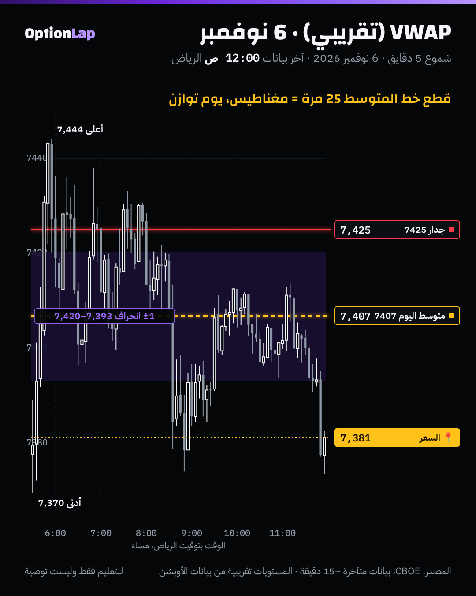

# 2.3 VWAP وانحرافاته: متى يكون مغناطيس، ومتى يكون جدار

> للتعليم فقط وليست توصية.

## الشرح
- **VWAP** هو متوسط السعر موزون بالحجم من بداية الجلسة. يعني «متوسط سعر الدخول» لكل اللي تداولوا اليوم. والمؤسسات تقيس تنفيذها عليه.
- **الانحرافات (±1، ±2):** نطاقات حول الخط تقيس قد إيش السعر بعيد عن «العادل».
- **متى يكون مغناطيس؟** في يوم **توازن (تدوير)**:
  - الخط مسطّح، والنطاقات ضيقة أو ثابتة.
  - السعر يقطع الخط كثير ويرجع له.
  - الأطراف (±1 أو ±2) أماكن ارتداد للوسط.
- **متى يكون جدار؟** في يوم **اتجاه**:
  - الخط مايل، والنطاقات تتوسّع.
  - السعر في جهة وحدة، وكل رجعة للخط تنرفض.
  - ±2 تصير **سكة** يمشي عليها السعر، مو مكان عكس.
- **القاعدة:** لا تعاكس الحركة والنطاقات تتوسّع.

## ملاحظة على بياناتنا
SPX ما له فوليوم. عشان كذا نحسب **متوسط زمني (TWAP)** لسعر الشمعة النموذجي (الأعلى + الأدنى + الإغلاق) ÷ 3 من الافتتاح، وهو تقريب للـVWAP. والـVWAP الحقيقي يكون على ES أو SPY.

## مثال بالأرقام (أرشيفنا، 4 أيام)
| اليوم | قطع الخط (بعد أول 30 دقيقة) | وقت السعر فوق الخط | الانحراف | النوع |
|---|---|---|---|---|
| 2 نوفمبر | **3 مرات** | 16% | 29.1 | **جدار**: يوم اتجاه نازل، وكل رجعة للخط انرفضت |
| 3 نوفمبر | 16 | 72% | 9.1 | مغناطيس: يوم داخلي هادي |
| 4 نوفمبر | 15 | 76% | 12.2 | مغناطيس، بس أغلب الوقت فوقه (صعود) |
| 6 نوفمبر | **25 مرة** | 31% | 13.6 | **مغناطيس**: يوم توازن |

## تطبيق على الشارت: 6 نوفمبر

**قراءتي:**
1. متوسط اليوم آخر الجلسة 7,407، ونطاق ±1 انحراف بين 7,393 و7,420.
2. السعر قطع الخط 25 مرة، وهذا يوم توازن. والخط كان مغناطيس، والرجوع له تكرّر.
3. الحد الأعلى للنطاق (7,420) قريب من جدار القاما 7425. هذا التقاء: طرف VWAP + جدار.
4. الإغلاق 7,381 تحت النطاق كامل، يعني آخر اليوم طلع من التوازن لتحت.
- الرسم يبيّن **قيمة آخر اليوم** كخط أفقي. الخط الحقيقي يتحرك خلال اليوم، والأداة ترسم مستويات ثابتة بس.

## الربط بالقاما
- **قاما إجمالية إيجابية:** نتوقع VWAP **مغناطيس**، وأطراف النطاق مع الجدران أماكن ارتداد. (3 نوفمبر فوق الزيرو قاما: 16 قطع.)
- **قاما إجمالية سلبية:** نتوقع VWAP **جدار**، والنطاقات تتوسّع، والأحسن تمشي مع الاتجاه. (2 نوفمبر تحت حد القاما: 3 قطع بس، ونزل 120 نقطة.)
- يعني وضع القاما يقول لك وش تتوقع من الـVWAP قبل ما يفتح السوق.

## باك تست وإحصائيات
- **الأداة:** `python3 team/tools/bt_intraday.py vwap` (جديدة).
  - تحسب لكل يوم: عدد القطع، ونسبة الوقت فوق الخط، وهل الجهة الساعة 10:00 بتوقيت نيويورك (6:00 م الرياض) صمدت لين الإغلاق.
  - الجهة تنقاس وقتها، فما فيه نظر للمستقبل.
- **النتيجة:** n=4 أيام. السعر كان فوق الخط الساعة 10:00 في الأيام الأربعة، وأغلق تحته في **الأربعة كلها (0 من 4)**. وأيام التوازن قطع فيها 15 لـ25 مرة، ويوم الاتجاه 3 مرات.
- **العيّنة صغيرة، النتيجة غير موثوقة.** والمقياس TWAP مو VWAP، وبدون تكاليف. نعيد الاختبار لما يصير عندنا 30 يوم أو أكثر.

## الأخطاء الشائعة
1. تعاكس السعر عند ±2 والنطاقات تتوسّع (يوم اتجاه).
2. تعتبر الـVWAP دعم أو مقاومة في كل الأيام. يكون مغناطيس في التوازن، وجدار في الاتجاه.
3. تحسبه على SPX كأنه فوليوم حقيقي.
4. تستخدمه أول 15 دقيقة. الخط وقتها مبني على شموع قليلة ويتحرك كثير.

## أسئلة مع إجاباتها
1. **السعر قطع الـVWAP 3 مرات بس طول اليوم وهو تحته. وش نوع اليوم؟** يوم اتجاه نازل، والـVWAP جدار.
2. **النطاقات تتوسّع والسعر عند +2. تبيع؟** لا. هذي سكة اتجاه، مو مكان عكس.
3. **وش يقول لك وضع القاما عن الـVWAP؟** إيجابي غالباً مغناطيس، وسلبي غالباً جدار واتجاه.

## المصادر
- [StockAlarm: VWAP indicator guide](https://pro.stockalarm.io/blog/vwap-indicator-guide)
- [TradingView: Institutional VWAP Bands](https://www.tradingview.com/script/HBa1RdfD-Institutional-VWAP-Bands-JOAT/)
- [TradingView: VWAP scripts](https://tr.tradingview.com/scripts/vwaps/)
- [NexusFi: VWAP trading strategies](https://nexusfi.com/a/strategies/vwap-trading-strategies)
