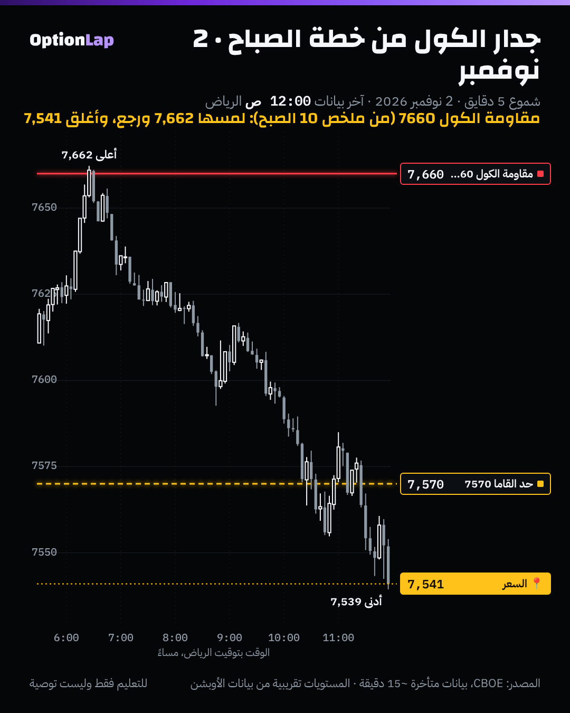

# 3.4 جدار الكول وجدار البوت والـHVL: وكيف تنحسب عند المنصات المختلفة

> للتعليم فقط وليست توصية.

## الشرح: نفس الفكرة بأسماء مختلفة
| المفهوم | SpotGamma | MenthorQ (منصة المالك) | عندنا (`gex.py`) |
|---|---|---|---|
| أكبر قاما كول فوق السعر = مقاومة | **Call Wall** | **Call Resistance** (ونسخة 0DTE) | «مقاومة الكول»: أكبر GEX موجب فوق السعر ضمن ±3% |
| أكبر قاما بوت = دعم | **Put Wall** | **Put Support** (ونسخة 0DTE) | «دعم البوت»: أكبر قاما تحت مقاومة الكول |
| وين يتقلب صافي القاما | **Gamma Flip** | **HVL** (High Vol Level) | «الزيرو قاما» (`zero_gamma.py`)، **تقريبي** |

- **جدار الكول:** صناع السوق عنده يبيعون مع الصعود، فيصير مقاومة. وSpotGamma تقول إنه **أقوى** من جدار البوت كمقاومة.
- **جدار البوت:** دعم رئيسي، بس **أضعف شوي** من جدار الكول. ولما ينكسر، القاما غالباً تصير سالبة والحركة تتسارع.
- **الـHVL عند MenthorQ:** منطقة انتقال. **تحتها القاما سالبة**، فالزخم والترند يسيطرون. و**فوقها** الرجوع للوسط يسيطر. وهذا بالضبط «وضع القاما» في قاعدة المالك.
- **الجدران تتحرك:** العقود المفتوحة تنتقل، والجدار ممكن «يطلع» لسترايك أعلى خلال أيام. فارسمها **كل صبح** من جديد.
- **المنصات تختلف في الحساب:** نطاق التواريخ (0DTE أو كل العقود)، والإشارة، ومصدر العقود المفتوحة. فنفس اليوم ممكن يطلع له جدار مختلف شوي من منصة لمنصة.

## مثال بالأرقام: جدار الكول من ملخص الصبح (أرشيفنا)
| اليوم | مقاومة الكول الصبح (0DTE) | قوتها | أعلى سعر في اليوم | الإغلاق | النتيجة |
|---|---|---|---|---|---|
| 2 نوفمبر | **7660** | +976 مليون | **7,662** | 7,541 | **لمسه ورجع**، وأغلق تحته بـ119 نقطة |
| 3 نوفمبر | **7620** | +211 مليون | 7,595 | 7,568 | ما وصله، وتحته طول اليوم |
| 4 نوفمبر | **7700** | +20 مليون (**ضعيف**) | **7,716** | 7,689 | **اخترقه بـ16 نقطة**، بس أغلق تحته |

## تطبيق على الشارت: 2 نوفمبر

**قراءتي:**
- جدار قوي (+976 مليون)، والسعر وصل له **بالضبط تقريباً** (7,662 مقابل 7660) ورجع.
- وكان السعر تحت حد القاما 7570 آخر اليوم (نظام سالب)، فالنزول بعد الرفض **تسارع** لين 7,541.
- **مقارنة 4 نوفمبر:** الجدار هناك ضعيف (+20 مليون) فانكسر شوي (16 نقطة). يعني **حجم الجدار مهم**، مو بس مكانه.

## الربط بطريقتنا
- **مقاومة الكول ودعم البوت** نأخذها من Net GEX لعقود اليوم، من حسابنا أو من MenthorQ.
- **الـHVL من MenthorQ = النظام:** فوقه ارتداد من الجدار، وتحته اختراق مع الكسر.
- **قيّم قوة الجدار:** جدار بمئات الملايين يختلف عن جدار بعشرات. والجدار الضعيف ممكن ينكسر شوي حتى في نظام موجب.
- **لما ينكسر جدار الكول** والقاما اللي بعده موجبة، يكمل لها (المحاضرة الأولى). ولما ينكسر جدار البوت، توقّع تسارع.

## باك تست وإحصائيات
- **جدار الكول من ملخص الصبح** (بدون نظر للمستقبل، لأن الجدار انرسم قبل الافتتاح):
  - **n=3**: انلمس أو انخترق مرتين من 3. و**أغلق السعر تحته 3 من 3**.
  - الجدار القوي (+976 مليون) رجّع السعر بالضبط. والضعيف (+20 مليون) انخترق 16 نقطة.
  - **العيّنة صغيرة، النتيجة غير موثوقة.**
- **ما فيه اختبار تاريخي أطول:** ما عندنا أرشيف جدران قبل 2 نوفمبر. الأرشفة اليومية (`archive_day.py` و`team/data/gex/`) مستمرة، ونعيد الاختبار بعد 30 يوم:
  - كم مرة يلمس السعر جدار الكول؟
  - كم مرة يقفل تحته؟
  - وهل حجم الجدار يفرق؟

## الأخطاء الشائعة
1. تخلط أسماء المنصات وتحسبها مستويات مختلفة. Call Wall وCall Resistance نفس الفكرة.
2. تستخدم جدار «كل العقود» لتداول عقود اليوم.
3. تعامل كل الجدران بنفس القوة. شوف الحجم.
4. تحسب جدار البوت بنفس قوة جدار الكول. المصادر تقول البوت أضعف كدعم.
5. ترسم الجدار مرة وتنساه، وهو يتحرك مع العقود المفتوحة.

## أسئلة مع إجاباتها
1. **وش يقابل الـHVL عند SpotGamma؟** الـGamma Flip، يعني وين يتقلب صافي القاما. (هذي مقارنة استنتاجية من التعريفات.)
2. **ليش انكسر جدار 7700 يوم 4 نوفمبر و7660 صمد يوم 2 نوفمبر؟** لأن 7700 كان ضعيف (+20 مليون)، و7660 كان قوي (+976 مليون).
3. **السعر تحت الـHVL وقريب من جدار البوت. ترتد ولا تنتظر كسر؟** تحت الـHVL القاما سالبة والزخم يسيطر، فالكسر أرجح من الارتداد. وتنتظر زناد في اتجاه الكسر.

## المصادر
- [SpotGamma: Call Wall and Put Wall explained](https://spotgamma.com/call-wall-put-wall-explained/)
- [SpotGamma Support: Put Wall](https://support.spotgamma.com/hc/en-us/articles/15297856056979-Put-Wall)
- [SpotGamma: The theory behind put walls](https://spotgamma.com/the-theory-behind-put-walls/)
- [MenthorQ: Product Training, Gamma Levels (PDF)](https://menthorq.com/wp-content/uploads/2023/11/Product-Training-Gamma-Levels.pdf)
- [LuxAlgo: Strike Walls](https://www.luxalgo.com/library/concept/strike-walls.md)
- ملخصات الصبح عندنا: `team/out/market/2026-11-02.md` و`03` و`04`.
